# Plaguemon II: The AfterWorld

Sprite sheets for v0.1.0, laid out like the Pokémon Crystal page on [The Spriters Resource](https://www.spriters-resource.com/game_boy_gbc/pokemoncrystal/).

## Characters

<table><tr><td align="center" valign="top"> <a href="view/characters/characters-battle.md">Characters (Battle)</a> <a href="characters/characters-battle.png">1×</a></td><td align="center" valign="top"> <a href="view/characters/characters-overworld.md">Characters (Overworld)</a> <a href="characters/characters-overworld.png">1×</a></td></tr></table>

## Pokémon

<table><tr><td align="center" valign="top"><a href="view/pokemon/generation-1-pokemon.md">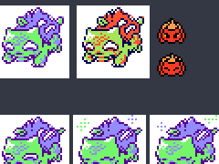</a> <a href="view/pokemon/generation-1-pokemon.md">Generation 1 Pokémon</a> <a href="pokemon/generation-1-pokemon.png">1×</a></td><td align="center" valign="top"> <a href="view/pokemon/generation-2-pokemon.md">Generation 2 Pokémon</a> <a href="pokemon/generation-2-pokemon.png">1×</a></td><td align="center" valign="top"> <a href="view/pokemon/unown-formes.md">Unown Formes</a> Paratypes <a href="pokemon/unown-formes.png">1×</a></td></tr></table>

**[Pokédex](view/pokedex.md)**: every monster with all sprites, animation and stats · [Animated battle sprites](view/animated.md) ([shiny](view/animated-shiny.md))

## Backgrounds (Routes)

<table><tr><td align="center" valign="top"> <a href="view/backgrounds/routes/route-17.md">Route 17</a> AREA 17 <a href="backgrounds/routes/route-17.png">1×</a></td><td align="center" valign="top"><a href="view/backgrounds/routes/route-26.md">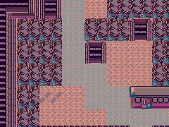</a> <a href="view/backgrounds/routes/route-26.md">Route 26</a> AREA 26 <a href="backgrounds/routes/route-26.png">1×</a></td><td align="center" valign="top"> <a href="view/backgrounds/routes/route-27.md">Route 27</a> AREA 27 <a href="backgrounds/routes/route-27.png">1×</a></td></tr><tr><td align="center" valign="top"> <a href="view/backgrounds/routes/route-36.md">Route 36</a> AREA 36 <a href="backgrounds/routes/route-36.png">1×</a></td><td align="center" valign="top"><a href="view/backgrounds/routes/route-40.md">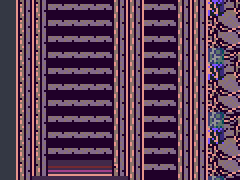</a> <a href="view/backgrounds/routes/route-40.md">Route 40</a> AREA 40 <a href="backgrounds/routes/route-40.png">1×</a></td><td align="center" valign="top"> <a href="view/backgrounds/routes/route-43.md">Route 43</a> AREA 43 <a href="backgrounds/routes/route-43.png">1×</a></td></tr></table>

## Backgrounds (Locations)

<table><tr><td align="center" valign="top"><a href="view/backgrounds/locations/azalea-town.md">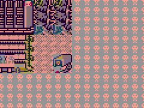</a> <a href="view/backgrounds/locations/azalea-town.md">Azalea Town</a> LOS AURA <a href="backgrounds/locations/azalea-town.png">1×</a></td><td align="center" valign="top"> <a href="view/backgrounds/locations/battle-tower.md">Battle Tower</a> BATTLE TOWER <a href="backgrounds/locations/battle-tower.png">1×</a></td><td align="center" valign="top"> <a href="view/backgrounds/locations/blackthorn-city.md">Blackthorn City</a> PEAK OF DREAD <a href="backgrounds/locations/blackthorn-city.png">1×</a></td></tr><tr><td align="center" valign="top"><a href="view/backgrounds/locations/burned-tower.md">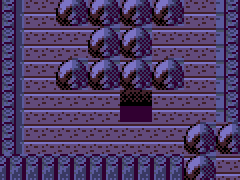</a> <a href="view/backgrounds/locations/burned-tower.md">Burned Tower</a> BURNED TOWER <a href="backgrounds/locations/burned-tower.png">1×</a></td><td align="center" valign="top"> <a href="view/backgrounds/locations/celadon-city.md">Celadon City</a> CELADON CITY <a href="backgrounds/locations/celadon-city.png">1×</a></td><td align="center" valign="top"> <a href="view/backgrounds/locations/cerulean-city.md">Cerulean City</a> CERULEAN CITY <a href="backgrounds/locations/cerulean-city.png">1×</a></td></tr><tr><td align="center" valign="top"> <a href="view/backgrounds/locations/cherrygrove-city.md">Cherrygrove City</a> NEARBYTOWN <a href="backgrounds/locations/cherrygrove-city.png">1×</a></td><td align="center" valign="top"> <a href="view/backgrounds/locations/cianwood-city.md">Cianwood City</a> OVERSEA ASYLUM <a href="backgrounds/locations/cianwood-city.png">1×</a></td><td align="center" valign="top"> <a href="view/backgrounds/locations/cinnabar-island.md">Cinnabar Island</a> CINNABAR ISLAND <a href="backgrounds/locations/cinnabar-island.png">1×</a></td></tr><tr><td align="center" valign="top"> <a href="view/backgrounds/locations/daycare.md">Daycare</a> AREA 34 <a href="backgrounds/locations/daycare.png">1×</a></td><td align="center" valign="top"> <a href="view/backgrounds/locations/dragons-den.md">Dragon's Den</a> DRAGON'S DEN <a href="backgrounds/locations/dragons-den.png">1×</a></td><td align="center" valign="top"><a href="view/backgrounds/locations/ecruteak-city.md">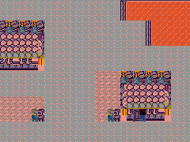</a> <a href="view/backgrounds/locations/ecruteak-city.md">Ecruteak City</a> SUBURBIA <a href="backgrounds/locations/ecruteak-city.png">1×</a></td></tr><tr><td align="center" valign="top"> <a href="view/backgrounds/locations/fuchsia-city.md">Fuchsia City</a> FUCHSIA CITY <a href="backgrounds/locations/fuchsia-city.png">1×</a></td><td align="center" valign="top"><a href="view/backgrounds/locations/glitter-lighthouse.md">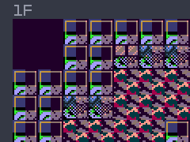</a> <a href="view/backgrounds/locations/glitter-lighthouse.md">Glitter Lighthouse</a> PENTAFLOOR <a href="backgrounds/locations/glitter-lighthouse.png">1×</a></td><td align="center" valign="top"><a href="view/backgrounds/locations/goldenrod-city.md">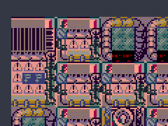</a> <a href="view/backgrounds/locations/goldenrod-city.md">Goldenrod City</a> METRO COMPLEX <a href="backgrounds/locations/goldenrod-city.png">1×</a></td></tr><tr><td align="center" valign="top"> <a href="view/backgrounds/locations/goldenrod-radio-tower.md">Goldenrod Radio Tower</a> RADIO TOWER <a href="backgrounds/locations/goldenrod-radio-tower.png">1×</a></td><td align="center" valign="top"> <a href="view/backgrounds/locations/ice-path.md">Ice Path</a> PARKING LOT <a href="backgrounds/locations/ice-path.png">1×</a></td><td align="center" valign="top"> <a href="view/backgrounds/locations/ilex-forest.md">Ilex Forest</a> SUICIDE FOREST <a href="backgrounds/locations/ilex-forest.png">1×</a></td></tr><tr><td align="center" valign="top"><a href="view/backgrounds/locations/indigo-plateau.md">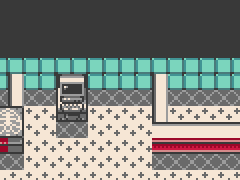</a> <a href="view/backgrounds/locations/indigo-plateau.md">Indigo Plateau</a> INDIGO PLATEAU <a href="backgrounds/locations/indigo-plateau.png">1×</a></td><td align="center" valign="top"> <a href="view/backgrounds/locations/lavender-town.md">Lavender Town</a> LAVENDER TOWN <a href="backgrounds/locations/lavender-town.png">1×</a></td><td align="center" valign="top"> <a href="view/backgrounds/locations/mahogany-town.md">Mahogany Town</a> LONELY WOODS <a href="backgrounds/locations/mahogany-town.png">1×</a></td></tr><tr><td align="center" valign="top"> <a href="view/backgrounds/locations/mt-mortar.md">Mt. Mortar</a> MT.MORTAR <a href="backgrounds/locations/mt-mortar.png">1×</a></td><td align="center" valign="top"> <a href="view/backgrounds/locations/mt-silver.md">Mt. Silver</a> SILVER CAVE <a href="backgrounds/locations/mt-silver.png">1×</a></td><td align="center" valign="top"><a href="view/backgrounds/locations/national-park.md">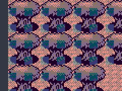</a> <a href="view/backgrounds/locations/national-park.md">National Park</a> NATIONAL PARK <a href="backgrounds/locations/national-park.png">1×</a></td></tr><tr><td align="center" valign="top"><a href="view/backgrounds/locations/new-bark-town.md">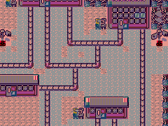</a> <a href="view/backgrounds/locations/new-bark-town.md">New Bark Town</a> HOMETOWN <a href="backgrounds/locations/new-bark-town.png">1×</a></td><td align="center" valign="top"> <a href="view/backgrounds/locations/olivine-city.md">Olivine City</a> GOVERNMENT <a href="backgrounds/locations/olivine-city.png">1×</a></td><td align="center" valign="top"><a href="view/backgrounds/locations/pallet-town.md">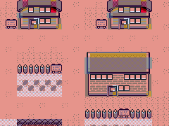</a> <a href="view/backgrounds/locations/pallet-town.md">Pallet Town</a> PALLET TOWN <a href="backgrounds/locations/pallet-town.png">1×</a></td></tr><tr><td align="center" valign="top"><a href="view/backgrounds/locations/pewter-city.md">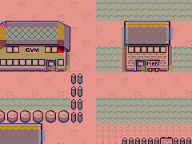</a> <a href="view/backgrounds/locations/pewter-city.md">Pewter City</a> PEWTER CITY <a href="backgrounds/locations/pewter-city.png">1×</a></td><td align="center" valign="top"> <a href="view/backgrounds/locations/pokemon-center-mart.md">Pokémon Center / Mart</a> NEARBYTOWN <a href="backgrounds/locations/pokemon-center-mart.png">1×</a></td><td align="center" valign="top"><a href="view/backgrounds/locations/rocket-hideout.md">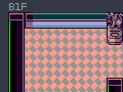</a> <a href="view/backgrounds/locations/rocket-hideout.md">Rocket Hideout</a> LONELY WOODS <a href="backgrounds/locations/rocket-hideout.png">1×</a></td></tr><tr><td align="center" valign="top"> <a href="view/backgrounds/locations/ruins-of-alph.md">Ruins of Alph</a> BIO IMPACT <a href="backgrounds/locations/ruins-of-alph.png">1×</a></td><td align="center" valign="top"> <a href="view/backgrounds/locations/s-s-aqua.md">S.S. Aqua</a> FAST SHIP <a href="backgrounds/locations/s-s-aqua.png">1×</a></td><td align="center" valign="top"> <a href="view/backgrounds/locations/saffron-city.md">Saffron City</a> SAFFRON CITY <a href="backgrounds/locations/saffron-city.png">1×</a></td></tr><tr><td align="center" valign="top"> <a href="view/backgrounds/locations/slowpoke-well.md">Slowpoke Well</a> SLOWPOKE WELL <a href="backgrounds/locations/slowpoke-well.png">1×</a></td><td align="center" valign="top"><a href="view/backgrounds/locations/sprout-tower.md">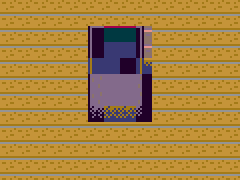</a> <a href="view/backgrounds/locations/sprout-tower.md">Sprout Tower</a> SPROUT TOWER <a href="backgrounds/locations/sprout-tower.png">1×</a></td><td align="center" valign="top"> <a href="view/backgrounds/locations/unused-maps.md">Unused Maps</a> GOVERNMENT <a href="backgrounds/locations/unused-maps.png">1×</a></td></tr><tr><td align="center" valign="top"> <a href="view/backgrounds/locations/vermilion-city.md">Vermilion City</a> VERMILION CITY <a href="backgrounds/locations/vermilion-city.png">1×</a></td><td align="center" valign="top"> <a href="view/backgrounds/locations/violet-city.md">Violet City</a> NOSTALGOTHIA <a href="backgrounds/locations/violet-city.png">1×</a></td><td align="center" valign="top"><a href="view/backgrounds/locations/viridian-city.md">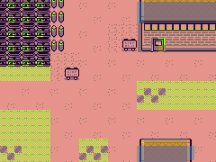</a> <a href="view/backgrounds/locations/viridian-city.md">Viridian City</a> VIRIDIAN CITY <a href="backgrounds/locations/viridian-city.png">1×</a></td></tr></table>

Not yet (1)

Magnet Train Tracks

## Miscellaneous

<table><tr><td align="center" valign="top"> <a href="view/miscellaneous/bag-interface.md">Bag Interface</a> <a href="miscellaneous/bag-interface.png">1×</a></td><td align="center" valign="top"><a href="view/miscellaneous/font.md">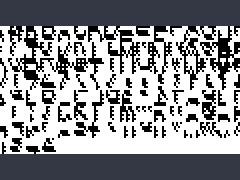</a> <a href="view/miscellaneous/font.md">Font</a> <a href="miscellaneous/font.png">1×</a></td><td align="center" valign="top"> <a href="view/miscellaneous/game-freak-intro.md">Game Freak Intro</a> <a href="miscellaneous/game-freak-intro.png">1×</a></td></tr><tr><td align="center" valign="top"> <a href="view/miscellaneous/intro-backgrounds.md">Intro Backgrounds</a> <a href="miscellaneous/intro-backgrounds.png">1×</a></td><td align="center" valign="top"> <a href="view/miscellaneous/pokemon-egg.md">Pokémon Egg</a> <a href="miscellaneous/pokemon-egg.png">1×</a></td><td align="center" valign="top"> <a href="view/miscellaneous/professor-oaks-opening-lecture.md">Professor Oak's Opening Lecture</a> <a href="miscellaneous/professor-oaks-opening-lecture.png">1×</a></td></tr><tr><td align="center" valign="top"><a href="view/miscellaneous/tileset-day.md">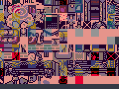</a> <a href="view/miscellaneous/tileset-day.md">Tileset (Day)</a> <a href="miscellaneous/tileset-day.png">1×</a></td><td align="center" valign="top"> <a href="view/miscellaneous/tileset-morning.md">Tileset (Morning)</a> <a href="miscellaneous/tileset-morning.png">1×</a></td><td align="center" valign="top"> <a href="view/miscellaneous/tileset-night.md">Tileset (Night)</a> <a href="miscellaneous/tileset-night.png">1×</a></td></tr><tr><td align="center" valign="top"> <a href="view/miscellaneous/trainer-card.md">Trainer Card</a> <a href="miscellaneous/trainer-card.png">1×</a></td></tr></table>

Not yet (10)

Bill's PC Interface, Credits, Intro Sprites, Mail, Minigames, Mobile Content, Mystery Gift Screen, Pokégear, Super Game Boy Error Message, Trading Sequence

## More

Not on the Crystal page.

<table><tr><td align="center" valign="top"> <a href="view/more/title-screen.md">Title Screen</a> <a href="more/title-screen.png">1×</a></td></tr></table>

Every other map, by in-game place (57)

<table><tr><td align="center" valign="top"> <a href="view/more/maps/area-1.md">Area 1</a> <a href="more/maps/area-1.png">1×</a></td><td align="center" valign="top"> <a href="view/more/maps/area-10.md">Area 10</a> <a href="more/maps/area-10.png">1×</a></td><td align="center" valign="top"> <a href="view/more/maps/area-11.md">Area 11</a> <a href="more/maps/area-11.png">1×</a></td></tr><tr><td align="center" valign="top"> <a href="view/more/maps/area-12.md">Area 12</a> <a href="more/maps/area-12.png">1×</a></td><td align="center" valign="top"><a href="view/more/maps/area-13.md">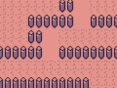</a> <a href="view/more/maps/area-13.md">Area 13</a> <a href="more/maps/area-13.png">1×</a></td><td align="center" valign="top"> <a href="view/more/maps/area-14.md">Area 14</a> <a href="more/maps/area-14.png">1×</a></td></tr><tr><td align="center" valign="top"> <a href="view/more/maps/area-15.md">Area 15</a> <a href="more/maps/area-15.png">1×</a></td><td align="center" valign="top"><a href="view/more/maps/area-16.md">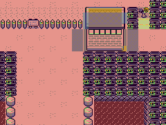</a> <a href="view/more/maps/area-16.md">Area 16</a> <a href="more/maps/area-16.png">1×</a></td><td align="center" valign="top"> <a href="view/more/maps/area-17.md">Area 17</a> <a href="more/maps/area-17.png">1×</a></td></tr><tr><td align="center" valign="top"> <a href="view/more/maps/area-18.md">Area 18</a> <a href="more/maps/area-18.png">1×</a></td><td align="center" valign="top"> <a href="view/more/maps/area-19.md">Area 19</a> <a href="more/maps/area-19.png">1×</a></td><td align="center" valign="top"> <a href="view/more/maps/area-2.md">Area 2</a> <a href="more/maps/area-2.png">1×</a></td></tr><tr><td align="center" valign="top"> <a href="view/more/maps/area-20.md">Area 20</a> <a href="more/maps/area-20.png">1×</a></td><td align="center" valign="top"><a href="view/more/maps/area-21.md">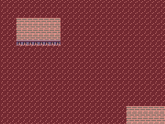</a> <a href="view/more/maps/area-21.md">Area 21</a> <a href="more/maps/area-21.png">1×</a></td><td align="center" valign="top"> <a href="view/more/maps/area-22.md">Area 22</a> <a href="more/maps/area-22.png">1×</a></td></tr><tr><td align="center" valign="top"> <a href="view/more/maps/area-23.md">Area 23</a> <a href="more/maps/area-23.png">1×</a></td><td align="center" valign="top"> <a href="view/more/maps/area-24.md">Area 24</a> <a href="more/maps/area-24.png">1×</a></td><td align="center" valign="top"> <a href="view/more/maps/area-25.md">Area 25</a> <a href="more/maps/area-25.png">1×</a></td></tr><tr><td align="center" valign="top"> <a href="view/more/maps/area-26.md">Area 26</a> <a href="more/maps/area-26.png">1×</a></td><td align="center" valign="top"> <a href="view/more/maps/area-27.md">Area 27</a> <a href="more/maps/area-27.png">1×</a></td><td align="center" valign="top"><a href="view/more/maps/area-28.md">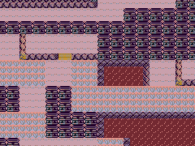</a> <a href="view/more/maps/area-28.md">Area 28</a> <a href="more/maps/area-28.png">1×</a></td></tr><tr><td align="center" valign="top"> <a href="view/more/maps/area-29.md">Area 29</a> <a href="more/maps/area-29.png">1×</a></td><td align="center" valign="top"> <a href="view/more/maps/area-3.md">Area 3</a> <a href="more/maps/area-3.png">1×</a></td><td align="center" valign="top"> <a href="view/more/maps/area-30.md">Area 30</a> <a href="more/maps/area-30.png">1×</a></td></tr><tr><td align="center" valign="top"><a href="view/more/maps/area-31.md">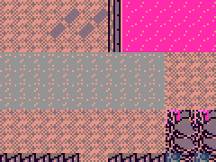</a> <a href="view/more/maps/area-31.md">Area 31</a> <a href="more/maps/area-31.png">1×</a></td><td align="center" valign="top"> <a href="view/more/maps/area-32.md">Area 32</a> <a href="more/maps/area-32.png">1×</a></td><td align="center" valign="top"> <a href="view/more/maps/area-33.md">Area 33</a> <a href="more/maps/area-33.png">1×</a></td></tr><tr><td align="center" valign="top"> <a href="view/more/maps/area-34.md">Area 34</a> <a href="more/maps/area-34.png">1×</a></td><td align="center" valign="top"> <a href="view/more/maps/area-35.md">Area 35</a> <a href="more/maps/area-35.png">1×</a></td><td align="center" valign="top"> <a href="view/more/maps/area-36.md">Area 36</a> <a href="more/maps/area-36.png">1×</a></td></tr><tr><td align="center" valign="top"> <a href="view/more/maps/area-37.md">Area 37</a> <a href="more/maps/area-37.png">1×</a></td><td align="center" valign="top"> <a href="view/more/maps/area-38.md">Area 38</a> <a href="more/maps/area-38.png">1×</a></td><td align="center" valign="top"><a href="view/more/maps/area-39.md">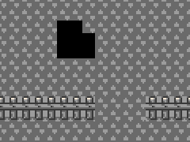</a> <a href="view/more/maps/area-39.md">Area 39</a> <a href="more/maps/area-39.png">1×</a></td></tr><tr><td align="center" valign="top"><a href="view/more/maps/area-4.md">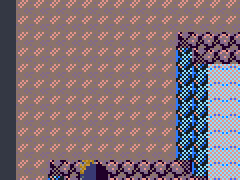</a> <a href="view/more/maps/area-4.md">Area 4</a> <a href="more/maps/area-4.png">1×</a></td><td align="center" valign="top"><a href="view/more/maps/area-41.md">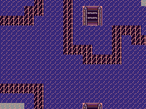</a> <a href="view/more/maps/area-41.md">Area 41</a> <a href="more/maps/area-41.png">1×</a></td><td align="center" valign="top"> <a href="view/more/maps/area-42.md">Area 42</a> <a href="more/maps/area-42.png">1×</a></td></tr><tr><td align="center" valign="top"> <a href="view/more/maps/area-43.md">Area 43</a> <a href="more/maps/area-43.png">1×</a></td><td align="center" valign="top"><a href="view/more/maps/area-44.md">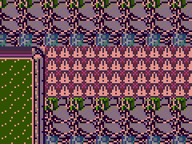</a> <a href="view/more/maps/area-44.md">Area 44</a> <a href="more/maps/area-44.png">1×</a></td><td align="center" valign="top"> <a href="view/more/maps/area-45.md">Area 45</a> <a href="more/maps/area-45.png">1×</a></td></tr><tr><td align="center" valign="top"> <a href="view/more/maps/area-46.md">Area 46</a> <a href="more/maps/area-46.png">1×</a></td><td align="center" valign="top"> <a href="view/more/maps/area-5.md">Area 5</a> <a href="more/maps/area-5.png">1×</a></td><td align="center" valign="top"> <a href="view/more/maps/area-6.md">Area 6</a> <a href="more/maps/area-6.png">1×</a></td></tr><tr><td align="center" valign="top"> <a href="view/more/maps/area-7.md">Area 7</a> <a href="more/maps/area-7.png">1×</a></td><td align="center" valign="top"> <a href="view/more/maps/area-8.md">Area 8</a> <a href="more/maps/area-8.png">1×</a></td><td align="center" valign="top"><a href="view/more/maps/area-9.md">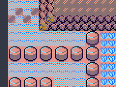</a> <a href="view/more/maps/area-9.md">Area 9</a> <a href="more/maps/area-9.png">1×</a></td></tr><tr><td align="center" valign="top"> <a href="view/more/maps/digletts-cave.md">Diglett'S Cave</a> <a href="more/maps/digletts-cave.png">1×</a></td><td align="center" valign="top"><a href="view/more/maps/mt-moon.md">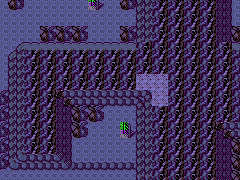</a> <a href="view/more/maps/mt-moon.md">Mt.Moon</a> <a href="more/maps/mt-moon.png">1×</a></td><td align="center" valign="top"> <a href="view/more/maps/power-plant.md">Power Plant</a> <a href="more/maps/power-plant.png">1×</a></td></tr><tr><td align="center" valign="top"> <a href="view/more/maps/rock-tunnel.md">Rock Tunnel</a> <a href="more/maps/rock-tunnel.png">1×</a></td><td align="center" valign="top"> <a href="view/more/maps/sewers.md">Sewers</a> <a href="more/maps/sewers.png">1×</a></td><td align="center" valign="top"> <a href="view/more/maps/source-of-plasma.md">Source Of Plasma</a> <a href="more/maps/source-of-plasma.png">1×</a></td></tr><tr><td align="center" valign="top"> <a href="view/more/maps/tin-tower.md">Tin Tower</a> <a href="more/maps/tin-tower.png">1×</a></td><td align="center" valign="top"><a href="view/more/maps/tohjo-falls.md">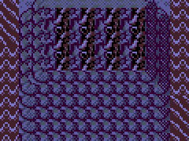</a> <a href="view/more/maps/tohjo-falls.md">Tohjo Falls</a> <a href="more/maps/tohjo-falls.png">1×</a></td><td align="center" valign="top"><a href="view/more/maps/underground.md">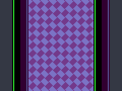</a> <a href="view/more/maps/underground.md">Underground</a> <a href="more/maps/underground.png">1×</a></td></tr><tr><td align="center" valign="top"> <a href="view/more/maps/union-cave.md">Union Cave</a> <a href="more/maps/union-cave.png">1×</a></td><td align="center" valign="top"> <a href="view/more/maps/victory-road.md">Victory Road</a> <a href="more/maps/victory-road.png">1×</a></td><td align="center" valign="top"><a href="view/more/maps/whirl-islands.md">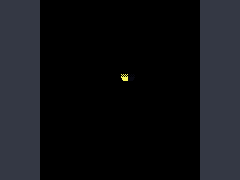</a> <a href="view/more/maps/whirl-islands.md">Whirl Islands</a> <a href="more/maps/whirl-islands.png">1×</a></td></tr></table>

Not yet (2)

Battle Screen, Battle Backgrounds

Click a sheet to view it enlarged; **1×** is the original. Offline viewer with zoom and search: `index.html`.

---

Plaguemon II © Hikikomori / Plague Labs. Pokémon © Nintendo / Creatures / GAME FREAK. Unofficial; no ROM data included.
