# Plaguemon II: The AfterWorld sprite rip

*Plaguemon II: The AfterWorld* (プラゲモンII後の世界) is a horror Pokémon Crystal ROM hack set in a cyberpunk dystopia, the follow-up to *Plaguemon: Lost Diaries* (2018). It replaces nearly everything: 240+ redrawn, animated monsters, new types, and every map and tileset. v0.1.0 is its first public release.

This repo has its sprites, animations, maps and screens.

<table><tr><td><b>Game</b></td><td>Plaguemon II: The AfterWorld v0.1.0</td></tr><tr><td><b>By</b></td><td>Hikikomori @ <a href="https://plaguelabs.com">Plague Labs</a></td></tr><tr><td><b>Download</b></td><td><a href="https://plaguemon.com">plaguemon.com</a></td></tr><tr><td><b>Requires</b></td><td>Pokémon Crystal (USA/Europe) base ROM; the download is a patch</td></tr></table>

 

## Structure

| Directory | Format | Contents |
|---|---|---|
| `sprites/front/` | PNG 40–56 px | battle sprites by number (`6.png`, `201-a.png`); `transparent/` too |
| `sprites/shiny/` | PNG | shiny palette; `transparent/` too |
| `sprites/animated/` | GIF | battle animations; `shiny/` too |
| `sprites/frames/` | PNG strip | every animation frame, base first |
| `sprites/icons/` | PNG 36×16 | party icons, both frames |
| `data/pokedex.json` | JSON | names, types, stats, palettes, animation mode, file paths |
| `pokemon/`, `characters/`, `backgrounds/`, `miscellaneous/`, `more/` | PNG 1× | sprite sheets |
| `view/` | Markdown | pages for browsing on GitHub (generated) |

## Pokémon

<table><tr><td align="center" valign="bottom"> <a href="view/pokedex/001_WEEDAZOR.md">001 WEEDAZOR</a> DRUGS · MEDICAL</td><td align="center" valign="bottom"> <a href="view/pokedex/002_COCAZOR.md">002 COCAZOR</a> DRUGS · MEDICAL</td><td align="center" valign="bottom"> <a href="view/pokedex/003_OPIUMZOR.md">003 OPIUMZOR</a> DRUGS · MEDICAL</td><td align="center" valign="bottom"><a href="view/pokedex/004_CHARMHELL.md">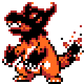</a> <a href="view/pokedex/004_CHARMHELL.md">004 CHARMHELL</a> SATANIC</td></tr><tr><td align="center" valign="bottom"><a href="view/pokedex/005_BELIALEON.md">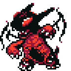</a> <a href="view/pokedex/005_BELIALEON.md">005 BELIALEON</a> SATANIC</td><td align="center" valign="bottom"> <a href="view/pokedex/006_LUCIFERION.md">006 LUCIFERION</a> SATANIC · DIVINITY</td><td align="center" valign="bottom"> <a href="view/pokedex/007_SCOLINA.md">007 SCOLINA</a> SEX</td><td align="center" valign="bottom"> <a href="view/pokedex/008_SCOLANO.md">008 SCOLANO</a> SEX</td></tr><tr><td align="center" valign="bottom"><a href="view/pokedex/009_SCOLENE.md">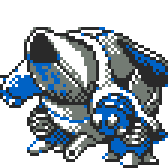</a> <a href="view/pokedex/009_SCOLENE.md">009 SCOLENE</a> SEX · MILITARY</td><td align="center" valign="bottom"> <a href="view/pokedex/010_GUNBAG.md">010 GUNBAG</a> MILITARY</td><td align="center" valign="bottom"> <a href="view/pokedex/011_MUTAPUD.md">011 MUTAPUD</a> MILITARY</td><td align="center" valign="bottom"> <a href="view/pokedex/012_MONASIGHT.md">012 MONASIGHT</a> MILITARY · MECHANIC</td></tr><tr><td align="center" valign="bottom"> <a href="view/pokedex/013_WERMIX.md">013 WERMIX</a> MILITARY · MEDICAL</td><td align="center" valign="bottom"> <a href="view/pokedex/014_KAKUZI.md">014 KAKUZI</a> MILITARY · MEDICAL</td><td align="center" valign="bottom"> <a href="view/pokedex/015_CAMOGATL.md">015 CAMOGATL</a> MILITARY · MEDICAL</td><td align="center" valign="bottom"> <a href="view/pokedex/016_CIKKAN.md">016 CIKKAN</a> MUTANT · MECHANIC</td></tr><tr><td align="center" valign="bottom"> <a href="view/pokedex/017_UBERBIRO.md">017 UBERBIRO</a> MUTANT · MECHANIC</td><td align="center" valign="bottom"> <a href="view/pokedex/018_HEPOCORPS.md">018 HEPOCORPS</a> MUTANT · MECHANIC</td><td align="center" valign="bottom"> <a href="view/pokedex/019_FOGNUS.md">019 FOGNUS</a> MUTANT</td><td align="center" valign="bottom"> <a href="view/pokedex/020_RATOZZO.md">020 RATOZZO</a> MUTANT</td></tr><tr><td align="center" valign="bottom"> <a href="view/pokedex/021_SBLARFO.md">021 SBLARFO</a> MUTANT · MECHANIC</td><td align="center" valign="bottom"> <a href="view/pokedex/022_SGLARFO.md">022 SGLARFO</a> MUTANT · MECHANIC</td><td align="center" valign="bottom"> <a href="view/pokedex/023_ANFESIBO.md">023 ANFESIBO</a> MEDICAL</td><td align="center" valign="bottom"> <a href="view/pokedex/024_URBOROK.md">024 URBOROK</a> MEDICAL</td></tr><tr><td align="center" valign="bottom"> <a href="view/pokedex/025_PIKACHEWED.md">025 PIKACHEWED</a> CYBER · NUCLEAR</td><td align="center" valign="bottom"> <a href="view/pokedex/026_RAICHEWEDZ.md">026 RAICHEWEDZ</a> NUCLEAR</td><td align="center" valign="bottom"> <a href="view/pokedex/027_PAPYRYU.md">027 PAPYRYU</a> ORGANIC</td><td align="center" valign="bottom"> <a href="view/pokedex/028_SPHINXO.md">028 SPHINXO</a> ORGANIC</td></tr><tr><td align="center" valign="bottom"> <a href="view/pokedex/029_FINGAH.md">029 FINGAH</a> MEDICAL</td><td align="center" valign="bottom"><a href="view/pokedex/030_HANDA.md">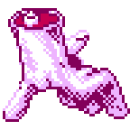</a> <a href="view/pokedex/030_HANDA.md">030 HANDA</a> MEDICAL</td><td align="center" valign="bottom"> <a href="view/pokedex/031_KALEDENDS.md">031 KALEDENDS</a> MEDICAL · ORGANIC</td><td align="center" valign="bottom"> <a href="view/pokedex/032_SCRAMBLO.md">032 SCRAMBLO</a> MEDICAL</td></tr><tr><td align="center" valign="bottom"> <a href="view/pokedex/033_GRABOIDO.md">033 GRABOIDO</a> MEDICAL</td><td align="center" valign="bottom"> <a href="view/pokedex/034_KESARUS.md">034 KESARUS</a> MEDICAL · ORGANIC</td><td align="center" valign="bottom"> <a href="view/pokedex/035_CRISTALIA.md">035 CRISTALIA</a> MUTANT</td><td align="center" valign="bottom"> <a href="view/pokedex/036_AMELITA.md">036 AMELITA</a> MUTANT</td></tr><tr><td align="center" valign="bottom"> <a href="view/pokedex/037_NYMPHAX.md">037 NYMPHAX</a> SATANIC</td><td align="center" valign="bottom"> <a href="view/pokedex/038_KITSUNAIL.md">038 KITSUNAIL</a> SATANIC · SEX</td><td align="center" valign="bottom"> <a href="view/pokedex/039_EYEBALLY.md">039 EYEBALLY</a> MUTANT</td><td align="center" valign="bottom"> <a href="view/pokedex/040_KAWAIKAGO.md">040 KAWAIKAGO</a> MUTANT</td></tr><tr><td align="center" valign="bottom"> <a href="view/pokedex/041_GOTCHICK.md">041 GOTCHICK</a> MEDICAL · MECHANIC</td><td align="center" valign="bottom"> <a href="view/pokedex/042_VAMPESSA.md">042 VAMPESSA</a> MEDICAL · MECHANIC</td><td align="center" valign="bottom"> <a href="view/pokedex/043_ODDGLITCH.md">043 ODDGLITCH</a> DRUGS · MEDICAL</td><td align="center" valign="bottom"> <a href="view/pokedex/044_INFECTO.md">044 INFECTO</a> DRUGS · MEDICAL</td></tr><tr><td align="center" valign="bottom"> <a href="view/pokedex/045_LARSENEF.md">045 LARSENEF</a> DRUGS · MEDICAL</td><td align="center" valign="bottom"> <a href="view/pokedex/046_PARASITO.md">046 PARASITO</a> MILITARY · DRUGS</td><td align="center" valign="bottom"> <a href="view/pokedex/047_PSILOCYBO.md">047 PSILOCYBO</a> MILITARY · DRUGS</td><td align="center" valign="bottom"> <a href="view/pokedex/048_GNAKGNAK.md">048 GNAKGNAK</a> MILITARY · MEDICAL</td></tr><tr><td align="center" valign="bottom"> <a href="view/pokedex/049_CHORDYCEPS.md">049 CHORDYCEPS</a> MILITARY · MEDICAL</td><td align="center" valign="bottom"> <a href="view/pokedex/050_KAZETTO.md">050 KAZETTO</a> ORGANIC</td><td align="center" valign="bottom"> <a href="view/pokedex/051_GANGBANGO.md">051 GANGBANGO</a> ORGANIC</td><td align="center" valign="bottom"> <a href="view/pokedex/052_NIGGA.md">052 NIGGA</a> MUTANT</td></tr><tr><td align="center" valign="bottom"><a href="view/pokedex/053_TENKA.md">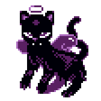</a> <a href="view/pokedex/053_TENKA.md">053 TENKA</a> MUTANT</td><td align="center" valign="bottom"> <a href="view/pokedex/054_WORMACK.md">054 WORMACK</a> SEX</td><td align="center" valign="bottom"> <a href="view/pokedex/055_DUKAKIS.md">055 DUKAKIS</a> SEX</td><td align="center" valign="bottom"> <a href="view/pokedex/056_HIROOSH.md">056 HIROOSH</a> VIOLENCE</td></tr><tr><td align="center" valign="bottom"> <a href="view/pokedex/057_NAGASAK.md">057 NAGASAK</a> VIOLENCE</td><td align="center" valign="bottom"> <a href="view/pokedex/058_SCRATCHY.md">058 SCRATCHY</a> SATANIC</td><td align="center" valign="bottom"> <a href="view/pokedex/059_BJORN.md">059 BJORN</a> SATANIC</td><td align="center" valign="bottom"> <a href="view/pokedex/060_SPERMOTZ.md">060 SPERMOTZ</a> SEX</td></tr><tr><td align="center" valign="bottom"> <a href="view/pokedex/061_PROLIFIK.md">061 PROLIFIK</a> SEX</td><td align="center" valign="bottom"> <a href="view/pokedex/062_SMEGMATIC.md">062 SMEGMATIC</a> SEX · VIOLENCE</td><td align="center" valign="bottom"> <a href="view/pokedex/063_GENESUS.md">063 GENESUS</a> NEURAL</td><td align="center" valign="bottom"> <a href="view/pokedex/064_PROFETUS.md">064 PROFETUS</a> NEURAL</td></tr><tr><td align="center" valign="bottom"> <a href="view/pokedex/065_MARTIRUS.md">065 MARTIRUS</a> NEURAL</td><td align="center" valign="bottom"> <a href="view/pokedex/066_ANOREX.md">066 ANOREX</a> VIOLENCE</td><td align="center" valign="bottom"> <a href="view/pokedex/067_STERODO.md">067 STERODO</a> VIOLENCE</td><td align="center" valign="bottom"> <a href="view/pokedex/068_KONGORISH.md">068 KONGORISH</a> VIOLENCE</td></tr><tr><td align="center" valign="bottom"> <a href="view/pokedex/069_PILLORYD.md">069 PILLORYD</a> DRUGS · MEDICAL</td><td align="center" valign="bottom"><a href="view/pokedex/070_GUILTYOTIN.md">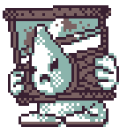</a> <a href="view/pokedex/070_GUILTYOTIN.md">070 GUILTYOTIN</a> DRUGS · MEDICAL</td><td align="center" valign="bottom"> <a href="view/pokedex/071_NORIMBERGU.md">071 NORIMBERGU</a> DRUGS · MEDICAL</td><td align="center" valign="bottom"> <a href="view/pokedex/072_HENTAICOOL.md">072 HENTAICOOL</a> SEX · MEDICAL</td></tr><tr><td align="center" valign="bottom"><a href="view/pokedex/073_HENTAIGORE.md">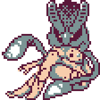</a> <a href="view/pokedex/073_HENTAIGORE.md">073 HENTAIGORE</a> SEX · MEDICAL</td><td align="center" valign="bottom"> <a href="view/pokedex/074_URANIUM.md">074 URANIUM</a> MINERAL · ORGANIC</td><td align="center" valign="bottom"> <a href="view/pokedex/075_PLUTONIUM.md">075 PLUTONIUM</a> MINERAL · ORGANIC</td><td align="center" valign="bottom"> <a href="view/pokedex/076_ATOMIUM.md">076 ATOMIUM</a> MINERAL · ORGANIC</td></tr><tr><td align="center" valign="bottom"><a href="view/pokedex/077_HELLESTO.md">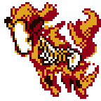</a> <a href="view/pokedex/077_HELLESTO.md">077 HELLESTO</a> SATANIC</td><td align="center" valign="bottom"> <a href="view/pokedex/078_FAXHIRO.md">078 FAXHIRO</a> SATANIC</td><td align="center" valign="bottom"> <a href="view/pokedex/079_SLOWGHOST.md">079 SLOWGHOST</a> SEX · NEURAL</td><td align="center" valign="bottom"> <a href="view/pokedex/080_KORNUPIAK.md">080 KORNUPIAK</a> SEX · NEURAL</td></tr><tr><td align="center" valign="bottom"> <a href="view/pokedex/081_GHOSHELLO.md">081 GHOSHELLO</a> NUCLEAR · CYBER</td><td align="center" valign="bottom"> <a href="view/pokedex/082_SORAYAMBOT.md">082 SORAYAMBOT</a> NUCLEAR · CYBER</td><td align="center" valign="bottom"> <a href="view/pokedex/083_BONDAGEDOG.md">083 BONDAGEDOG</a> MUTANT · MECHANIC</td><td align="center" valign="bottom"> <a href="view/pokedex/084_BIPOLARIO.md">084 BIPOLARIO</a> MUTANT · MECHANIC</td></tr><tr><td align="center" valign="bottom"> <a href="view/pokedex/085_PSICOTO.md">085 PSICOTO</a> MUTANT · MECHANIC</td><td align="center" valign="bottom"> <a href="view/pokedex/086_MEGADIL.md">086 MEGADIL</a> SEX</td><td align="center" valign="bottom"> <a href="view/pokedex/087_MEGADIL500.md">087 MEGADIL500</a> SEX · CHEMICAL</td><td align="center" valign="bottom"> <a href="view/pokedex/088_GRINDED.md">088 GRINDED</a> MEDICAL</td></tr><tr><td align="center" valign="bottom"> <a href="view/pokedex/089_KUMORAH.md">089 KUMORAH</a> MEDICAL</td><td align="center" valign="bottom"> <a href="view/pokedex/090_SHELLDER.md">090 SHELLDER</a> SEX</td><td align="center" valign="bottom"><a href="view/pokedex/091_VAGINDAM.md">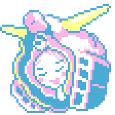</a> <a href="view/pokedex/091_VAGINDAM.md">091 VAGINDAM</a> SEX · CHEMICAL</td><td align="center" valign="bottom"> <a href="view/pokedex/092_GOSBAMP.md">092 GOSBAMP</a> DEATH · MEDICAL</td></tr><tr><td align="center" valign="bottom"> <a href="view/pokedex/093_WRAITARL.md">093 WRAITARL</a> DEATH · MEDICAL</td><td align="center" valign="bottom"> <a href="view/pokedex/094_TREROR.md">094 TREROR</a> DEATH · MEDICAL</td><td align="center" valign="bottom"> <a href="view/pokedex/095_OBSIDIAN.md">095 OBSIDIAN</a> MINERAL · ORGANIC</td><td align="center" valign="bottom"> <a href="view/pokedex/096_DUPUPETT.md">096 DUPUPETT</a> NEURAL · PUPPET</td></tr><tr><td align="center" valign="bottom"> <a href="view/pokedex/097_BURHAT.md">097 BURHAT</a> NEURAL · PUPPET</td><td align="center" valign="bottom"> <a href="view/pokedex/098_TOXIWASTE.md">098 TOXIWASTE</a> SEX</td><td align="center" valign="bottom"> <a href="view/pokedex/099_NUKEBARL.md">099 NUKEBARL</a> SEX</td><td align="center" valign="bottom"> <a href="view/pokedex/100_KOWARENING.md">100 KOWARENING</a> NUCLEAR</td></tr><tr><td align="center" valign="bottom"> <a href="view/pokedex/101_NINGOGORE.md">101 NINGOGORE</a> NUCLEAR</td><td align="center" valign="bottom"> <a href="view/pokedex/102_DARUMORT.md">102 DARUMORT</a> DRUGS · NEURAL</td><td align="center" valign="bottom"> <a href="view/pokedex/103_MASKABUKI.md">103 MASKABUKI</a> DRUGS · NEURAL</td><td align="center" valign="bottom"> <a href="view/pokedex/104_RIOTTO.md">104 RIOTTO</a> ORGANIC</td></tr><tr><td align="center" valign="bottom"> <a href="view/pokedex/105_TERORISTO.md">105 TERORISTO</a> ORGANIC</td><td align="center" valign="bottom"> <a href="view/pokedex/106_THAIFAITA.md">106 THAIFAITA</a> VIOLENCE</td><td align="center" valign="bottom"> <a href="view/pokedex/107_MIKEFAITA.md">107 MIKEFAITA</a> VIOLENCE</td><td align="center" valign="bottom"> <a href="view/pokedex/108_PUKALOT.md">108 PUKALOT</a> MUTANT</td></tr><tr><td align="center" valign="bottom"> <a href="view/pokedex/109_SARSARAS.md">109 SARSARAS</a> MEDICAL</td><td align="center" valign="bottom"><a href="view/pokedex/110_LUNGANSER.md">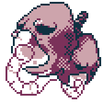</a> <a href="view/pokedex/110_LUNGANSER.md">110 LUNGANSER</a> MEDICAL</td><td align="center" valign="bottom"> <a href="view/pokedex/111_ELICORPS.md">111 ELICORPS</a> ORGANIC · MINERAL</td><td align="center" valign="bottom"> <a href="view/pokedex/112_MEDUCUNT.md">112 MEDUCUNT</a> ORGANIC · MINERAL</td></tr><tr><td align="center" valign="bottom"> <a href="view/pokedex/113_PREGNANTA.md">113 PREGNANTA</a> MUTANT</td><td align="center" valign="bottom"> <a href="view/pokedex/114_WORMICELLI.md">114 WORMICELLI</a> DRUGS</td><td align="center" valign="bottom"> <a href="view/pokedex/115_HELLTECH.md">115 HELLTECH</a> MUTANT</td><td align="center" valign="bottom"> <a href="view/pokedex/116_COCKY.md">116 COCKY</a> SEX</td></tr><tr><td align="center" valign="bottom"> <a href="view/pokedex/117_SCROTRA.md">117 SCROTRA</a> SEX</td><td align="center" valign="bottom"> <a href="view/pokedex/118_BLINKY.md">118 BLINKY</a> SEX</td><td align="center" valign="bottom"> <a href="view/pokedex/119_HOGEROT.md">119 HOGEROT</a> SEX</td><td align="center" valign="bottom"> <a href="view/pokedex/120_MALOKINGI.md">120 MALOKINGI</a> SEX</td></tr><tr><td align="center" valign="bottom"><a href="view/pokedex/121_IRUKUNJI.md">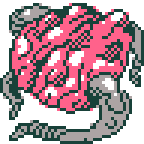</a> <a href="view/pokedex/121_IRUKUNJI.md">121 IRUKUNJI</a> SEX · NEURAL</td><td align="center" valign="bottom"> <a href="view/pokedex/122_MR_SHADOW.md">122 MR.SHADOW</a> NEURAL</td><td align="center" valign="bottom"> <a href="view/pokedex/123_HANZORU.md">123 HANZORU</a> MILITARY · MECHANIC</td><td align="center" valign="bottom"> <a href="view/pokedex/124_JYZZO.md">124 JYZZO</a> CHEMICAL · NEURAL</td></tr><tr><td align="center" valign="bottom"><a href="view/pokedex/125_VOLCUTION.md">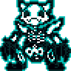</a> <a href="view/pokedex/125_VOLCUTION.md">125 VOLCUTION</a> NUCLEAR</td><td align="center" valign="bottom"> <a href="view/pokedex/126_BURNAR.md">126 BURNAR</a> SATANIC</td><td align="center" valign="bottom"> <a href="view/pokedex/127_SHAMABOO.md">127 SHAMABOO</a> MILITARY</td><td align="center" valign="bottom"> <a href="view/pokedex/128_DIGESTOR.md">128 DIGESTOR</a> MUTANT</td></tr><tr><td align="center" valign="bottom"> <a href="view/pokedex/129_ROKUJOSHI.md">129 ROKUJOSHI</a> SEX</td><td align="center" valign="bottom"> <a href="view/pokedex/130_HANNYADOS.md">130 HANNYADOS</a> SEX · MECHANIC</td><td align="center" valign="bottom"> <a href="view/pokedex/131_KARONTIS.md">131 KARONTIS</a> SEX · CHEMICAL</td><td align="center" valign="bottom"> <a href="view/pokedex/132_SHITTO.md">132 SHITTO</a> MUTANT</td></tr><tr><td align="center" valign="bottom"> <a href="view/pokedex/133_DEADDOG.md">133 DEADDOG</a> MUTANT</td><td align="center" valign="bottom"> <a href="view/pokedex/134_VENEREON.md">134 VENEREON</a> SEX</td><td align="center" valign="bottom"> <a href="view/pokedex/135_NUKENION.md">135 NUKENION</a> NUCLEAR</td><td align="center" valign="bottom"> <a href="view/pokedex/136_CERBERION.md">136 CERBERION</a> SATANIC</td></tr><tr><td align="center" valign="bottom"> <a href="view/pokedex/137_TERMINALIX.md">137 TERMINALIX</a> CYBER</td><td align="center" valign="bottom"> <a href="view/pokedex/138_SHARPIDER.md">138 SHARPIDER</a> MINERAL · SEX</td><td align="center" valign="bottom"> <a href="view/pokedex/139_MECHANIGAL.md">139 MECHANIGAL</a> MINERAL · SEX</td><td align="center" valign="bottom"> <a href="view/pokedex/140_ZIRLORG.md">140 ZIRLORG</a> MINERAL · SEX</td></tr><tr><td align="center" valign="bottom"> <a href="view/pokedex/141_ZILOSNAK.md">141 ZILOSNAK</a> MINERAL · SEX</td><td align="center" valign="bottom"> <a href="view/pokedex/142_PTEROXIS.md">142 PTEROXIS</a> MINERAL · MECHANIC</td><td align="center" valign="bottom"> <a href="view/pokedex/143_PUTREFACTO.md">143 PUTREFACTO</a> MUTANT</td><td align="center" valign="bottom"> <a href="view/pokedex/144_ARTICLONE.md">144 ARTICLONE</a> CHEMICAL · MECHANIC</td></tr><tr><td align="center" valign="bottom"><a href="view/pokedex/145_ZAPGOLD.md">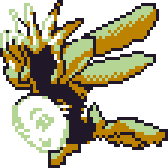</a> <a href="view/pokedex/145_ZAPGOLD.md">145 ZAPGOLD</a> NUCLEAR · MECHANIC</td><td align="center" valign="bottom"><a href="view/pokedex/146_MOLCOPY.md">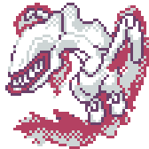</a> <a href="view/pokedex/146_MOLCOPY.md">146 MOLCOPY</a> SATANIC · MECHANIC</td><td align="center" valign="bottom"> <a href="view/pokedex/147_CHERUBIUM.md">147 CHERUBIUM</a> ANGELIC · DIVINITY</td><td align="center" valign="bottom"> <a href="view/pokedex/148_SERAPHIUM.md">148 SERAPHIUM</a> ANGELIC · DIVINITY</td></tr><tr><td align="center" valign="bottom"><a href="view/pokedex/149_CHILONGO.md">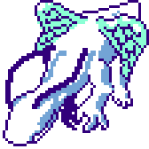</a> <a href="view/pokedex/149_CHILONGO.md">149 CHILONGO</a> ANGELIC · DIVINITY</td><td align="center" valign="bottom"> <a href="view/pokedex/150_MEWTATED.md">150 MEWTATED</a> NEURAL</td><td align="center" valign="bottom"> <a href="view/pokedex/151_TWOMEW.md">151 TWOMEW</a> NEURAL</td><td align="center" valign="bottom"><a href="view/pokedex/152_STRAMONIUM.md">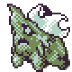</a> <a href="view/pokedex/152_STRAMONIUM.md">152 STRAMONIUM</a> DRUGS</td></tr><tr><td align="center" valign="bottom"> <a href="view/pokedex/153_DIVINORUM.md">153 DIVINORUM</a> DRUGS</td><td align="center" valign="bottom"> <a href="view/pokedex/154_AYAHUASCO.md">154 AYAHUASCO</a> DRUGS</td><td align="center" valign="bottom"> <a href="view/pokedex/155_SCARFITO.md">155 SCARFITO</a> SATANIC</td><td align="center" valign="bottom"><a href="view/pokedex/156_CRUXADO.md">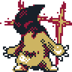</a> <a href="view/pokedex/156_CRUXADO.md">156 CRUXADO</a> SATANIC</td></tr><tr><td align="center" valign="bottom"> <a href="view/pokedex/157_INFERNATUS.md">157 INFERNATUS</a> SATANIC</td><td align="center" valign="bottom"> <a href="view/pokedex/158_BONDILE.md">158 BONDILE</a> SEX</td><td align="center" valign="bottom"> <a href="view/pokedex/159_GAGOGO.md">159 GAGOGO</a> SEX</td><td align="center" valign="bottom"> <a href="view/pokedex/160_CROCOSNUFF.md">160 CROCOSNUFF</a> SEX</td></tr><tr><td align="center" valign="bottom"> <a href="view/pokedex/161_BURQO.md">161 BURQO</a> MUTANT</td><td align="center" valign="bottom"> <a href="view/pokedex/162_JIHADO.md">162 JIHADO</a> MUTANT</td><td align="center" valign="bottom"> <a href="view/pokedex/163_BALAKLOWL.md">163 BALAKLOWL</a> MUTANT · MECHANIC</td><td align="center" valign="bottom"> <a href="view/pokedex/164_ROBBINOWL.md">164 ROBBINOWL</a> MUTANT · MECHANIC</td></tr><tr><td align="center" valign="bottom"> <a href="view/pokedex/165_SBIRETTO.md">165 SBIRETTO</a> MILITARY · MECHANIC</td><td align="center" valign="bottom"> <a href="view/pokedex/166_FACISTA.md">166 FACISTA</a> MILITARY · MECHANIC</td><td align="center" valign="bottom"> <a href="view/pokedex/167_NAZETTO.md">167 NAZETTO</a> MILITARY · MEDICAL</td><td align="center" valign="bottom"> <a href="view/pokedex/168_NAZITANK.md">168 NAZITANK</a> MILITARY · MEDICAL</td></tr><tr><td align="center" valign="bottom"> <a href="view/pokedex/169_TRIZOM.md">169 TRIZOM</a> MEDICAL · MECHANIC</td><td align="center" valign="bottom"> <a href="view/pokedex/170_RELICTOU.md">170 RELICTOU</a> SEX · NUCLEAR</td><td align="center" valign="bottom"> <a href="view/pokedex/171_SOVIETO.md">171 SOVIETO</a> SEX · NUCLEAR</td><td align="center" valign="bottom"> <a href="view/pokedex/172_BALBAC.md">172 BALBAC</a> NUCLEAR</td></tr><tr><td align="center" valign="bottom"><a href="view/pokedex/173_VOIDILIA.md">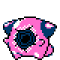</a> <a href="view/pokedex/173_VOIDILIA.md">173 VOIDILIA</a> MUTANT</td><td align="center" valign="bottom"> <a href="view/pokedex/174_RETINOL.md">174 RETINOL</a> MUTANT</td><td align="center" valign="bottom"> <a href="view/pokedex/175_VENOSO.md">175 VENOSO</a> MUTANT</td><td align="center" valign="bottom"><a href="view/pokedex/176_VENESCO.md">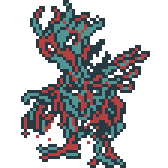</a> <a href="view/pokedex/176_VENESCO.md">176 VENESCO</a> MUTANT · MECHANIC</td></tr><tr><td align="center" valign="bottom"> <a href="view/pokedex/177_SACRILUT.md">177 SACRILUT</a> NEURAL · MECHANIC</td><td align="center" valign="bottom"> <a href="view/pokedex/178_QUELZALCOT.md">178 QUELZALCOT</a> NEURAL · MECHANIC</td><td align="center" valign="bottom"> <a href="view/pokedex/179_BINARIA.md">179 BINARIA</a> NUCLEAR</td><td align="center" valign="bottom"> <a href="view/pokedex/180_ALGOCRAT.md">180 ALGOCRAT</a> NUCLEAR</td></tr><tr><td align="center" valign="bottom"> <a href="view/pokedex/181_DICTAITOR.md">181 DICTAITOR</a> NUCLEAR</td><td align="center" valign="bottom"> <a href="view/pokedex/182_MANDELBRO.md">182 MANDELBRO</a> DRUGS</td><td align="center" valign="bottom"> <a href="view/pokedex/183_HALUAL.md">183 HALUAL</a> SEX</td><td align="center" valign="bottom"> <a href="view/pokedex/184_KONTROLIO.md">184 KONTROLIO</a> SEX</td></tr><tr><td align="center" valign="bottom"> <a href="view/pokedex/185_AOKIGAKA.md">185 AOKIGAKA</a> MINERAL</td><td align="center" valign="bottom"> <a href="view/pokedex/186_FETUSO.md">186 FETUSO</a> SEX</td><td align="center" valign="bottom"> <a href="view/pokedex/187_ABORTITO.md">187 ABORTITO</a> DRUGS · MECHANIC</td><td align="center" valign="bottom"> <a href="view/pokedex/188_INCUBATO.md">188 INCUBATO</a> DRUGS · MECHANIC</td></tr><tr><td align="center" valign="bottom"> <a href="view/pokedex/189_ITTIOSO.md">189 ITTIOSO</a> DRUGS · MECHANIC</td><td align="center" valign="bottom"> <a href="view/pokedex/190_MOLESTO.md">190 MOLESTO</a> MUTANT</td><td align="center" valign="bottom"> <a href="view/pokedex/191_GRUMO.md">191 GRUMO</a> DRUGS</td><td align="center" valign="bottom"> <a href="view/pokedex/192_OVARIAN.md">192 OVARIAN</a> DRUGS</td></tr><tr><td align="center" valign="bottom"><a href="view/pokedex/193_NAPALMYAN.md">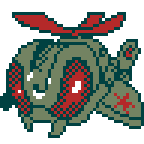</a> <a href="view/pokedex/193_NAPALMYAN.md">193 NAPALMYAN</a> MILITARY · MECHANIC</td><td align="center" valign="bottom"> <a href="view/pokedex/194_KOTZWAR.md">194 KOTZWAR</a> SEX · ORGANIC</td><td align="center" valign="bottom"> <a href="view/pokedex/195_ASPHYXIAR.md">195 ASPHYXIAR</a> SEX · ORGANIC</td><td align="center" valign="bottom"> <a href="view/pokedex/196_EMBRYEON.md">196 EMBRYEON</a> NEURAL</td></tr><tr><td align="center" valign="bottom"> <a href="view/pokedex/197_DAMNATEON.md">197 DAMNATEON</a> DOOM</td><td align="center" valign="bottom"> <a href="view/pokedex/198_SKARKROW.md">198 SKARKROW</a> DOOM · MECHANIC</td><td align="center" valign="bottom"><a href="view/pokedex/199_DEPRECLOWN.md">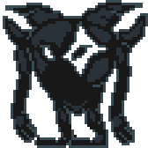</a> <a href="view/pokedex/199_DEPRECLOWN.md">199 DEPRECLOWN</a> SEX · NEURAL</td><td align="center" valign="bottom"> <a href="view/pokedex/200_HOSTED_GOO.md">200 HOSTED.GOO</a> DEATH</td></tr><tr><td align="center" valign="bottom"> <a href="view/pokedex/202_CONDOMAX.md">202 CONDOMAX</a> NEURAL</td><td align="center" valign="bottom"> <a href="view/pokedex/203_ENIGMAGUS.md">203 ENIGMAGUS</a> MUTANT · NEURAL</td><td align="center" valign="bottom"><a href="view/pokedex/204_HIDENLAYER.md">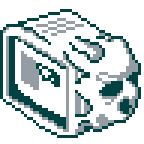</a> <a href="view/pokedex/204_HIDENLAYER.md">204 HIDENLAYER</a> MILITARY</td><td align="center" valign="bottom"> <a href="view/pokedex/205_NEURONET.md">205 /NEURONET</a> MILITARY · CYBER</td></tr><tr><td align="center" valign="bottom"> <a href="view/pokedex/206_DUOFUNTO.md">206 DUOFUNTO</a> MUTANT</td><td align="center" valign="bottom"> <a href="view/pokedex/207_TWOMEWTWO.md">207 TWOMEWTWO</a> NEURAL · MUTANT</td><td align="center" valign="bottom"> <a href="view/pokedex/208_HYDRAGYRUM.md">208 HYDRAGYRUM</a> CYBER · MEDICAL</td><td align="center" valign="bottom"> <a href="view/pokedex/209_BLEKHOLIA.md">209 BLEKHOLIA</a> MUTANT</td></tr><tr><td align="center" valign="bottom"><a href="view/pokedex/210_GALAXIAN.md">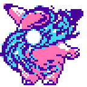</a> <a href="view/pokedex/210_GALAXIAN.md">210 GALAXIAN</a> MUTANT</td><td align="center" valign="bottom"> <a href="view/pokedex/211_NAVALMINO.md">211 NAVALMINO</a> SEX · MEDICAL</td><td align="center" valign="bottom"> <a href="view/pokedex/212_CYNOBI.md">212 CYNOBI</a> MILITARY · CYBER</td><td align="center" valign="bottom"> <a href="view/pokedex/213_PROGLOTTO.md">213 PROGLOTTO</a> MILITARY · MINERAL</td></tr><tr><td align="center" valign="bottom"> <a href="view/pokedex/214_KINBUGUBI.md">214 KINBUGUBI</a> MILITARY · VIOLENCE</td><td align="center" valign="bottom"> <a href="view/pokedex/215_KUNOIGA.md">215 KUNOIGA</a> DOOM · CHEMICAL</td><td align="center" valign="bottom"> <a href="view/pokedex/216_FLESHPLUSH.md">216 FLESHPLUSH</a> MUTANT</td><td align="center" valign="bottom"> <a href="view/pokedex/217_TAXYDERMA.md">217 TAXYDERMA</a> MUTANT</td></tr><tr><td align="center" valign="bottom"><a href="view/pokedex/218_SLUGMA.md">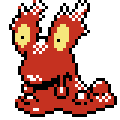</a> <a href="view/pokedex/218_SLUGMA.md">218 SLUGMA</a> SATANIC</td><td align="center" valign="bottom"> <a href="view/pokedex/219_MAGCARGO.md">219 MAGCARGO</a> SATANIC · MINERAL</td><td align="center" valign="bottom"> <a href="view/pokedex/220_SWINUB.md">220 SWINUB</a> CHEMICAL · ORGANIC</td><td align="center" valign="bottom"> <a href="view/pokedex/221_PILOSWINE.md">221 PILOSWINE</a> CHEMICAL · ORGANIC</td></tr><tr><td align="center" valign="bottom"> <a href="view/pokedex/222_NEURAPSYS.md">222 NEURAPSYS</a> SEX · MINERAL</td><td align="center" valign="bottom"> <a href="view/pokedex/223_ANIFISH.md">223 ANIFISH</a> SEX</td><td align="center" valign="bottom"> <a href="view/pokedex/224_OCTILLERY.md">224 OCTILLERY</a> SEX</td><td align="center" valign="bottom"> <a href="view/pokedex/225_ANTENNOIDE.md">225 ANTENNOIDE</a> CHEMICAL · MECHANIC</td></tr><tr><td align="center" valign="bottom"> <a href="view/pokedex/226_DADAORCA.md">226 DADAORCA</a> SEX · MECHANIC</td><td align="center" valign="bottom"> <a href="view/pokedex/227_AXIOM_APEX.md">227 AXIOM:APEX</a> CYBER · MECHANIC</td><td align="center" valign="bottom"> <a href="view/pokedex/228_HOUNDOUR.md">228 HOUNDOUR</a> DOOM · SATANIC</td><td align="center" valign="bottom"> <a href="view/pokedex/229_HOUNDOOM.md">229 HOUNDOOM</a> DOOM · SATANIC</td></tr><tr><td align="center" valign="bottom"> <a href="view/pokedex/230_HERMAPHROD.md">230 HERMAPHROD</a> SEX · DIVINITY</td><td align="center" valign="bottom"> <a href="view/pokedex/231_PHANPY.md">231 PHANPY</a> ORGANIC</td><td align="center" valign="bottom"> <a href="view/pokedex/232_DONPHAN.md">232 DONPHAN</a> ORGANIC</td><td align="center" valign="bottom"> <a href="view/pokedex/233_BIBRODO.md">233 BIBRODO</a> MUTANT</td></tr><tr><td align="center" valign="bottom"> <a href="view/pokedex/234_SPIRITUS.md">234 SPIRITUS</a> MUTANT</td><td align="center" valign="bottom"> <a href="view/pokedex/235_SMEARGLE.md">235 SMEARGLE</a> MUTANT</td><td align="center" valign="bottom"><a href="view/pokedex/236_SKOONITSO.md">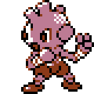</a> <a href="view/pokedex/236_SKOONITSO.md">236 SKOONITSO</a> VIOLENCE</td><td align="center" valign="bottom"> <a href="view/pokedex/237_JUTSUFAITA.md">237 JUTSUFAITA</a> VIOLENCE</td></tr><tr><td align="center" valign="bottom"> <a href="view/pokedex/238_LOLIPLEX.md">238 LOLIPLEX</a> CHEMICAL · NEURAL</td><td align="center" valign="bottom"> <a href="view/pokedex/239_PHOTOKID.md">239 PHOTOKID</a> NUCLEAR</td><td align="center" valign="bottom"> <a href="view/pokedex/240_CARBIFY.md">240 CARBIFY</a> SATANIC</td><td align="center" valign="bottom"> <a href="view/pokedex/241_INTENSIVO.md">241 INTENSIVO</a> MUTANT</td></tr><tr><td align="center" valign="bottom"> <a href="view/pokedex/242_POSTPARTOU.md">242 POSTPARTOU</a> MUTANT</td><td align="center" valign="bottom"> <a href="view/pokedex/243_ROTARAX.md">243 ROTARAX</a> NUCLEAR</td><td align="center" valign="bottom"> <a href="view/pokedex/243_ALT_FORM.md">ALT FORM (#243/#244)</a> NUCLEAR</td><td align="center" valign="bottom"> <a href="view/pokedex/244_VITATEC.md">244 VITATEC</a> SATANIC</td></tr><tr><td align="center" valign="bottom"><a href="view/pokedex/245_SKYLITE.md">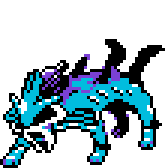</a> <a href="view/pokedex/245_SKYLITE.md">245 SKYLITE</a> SEX</td><td align="center" valign="bottom"> <a href="view/pokedex/246_SEBUTAR.md">246 SEBUTAR</a> MINERAL · ORGANIC</td><td align="center" valign="bottom"><a href="view/pokedex/247_MYCOTAR.md">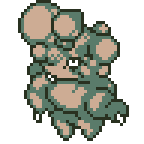</a> <a href="view/pokedex/247_MYCOTAR.md">247 MYCOTAR</a> MINERAL · ORGANIC</td><td align="center" valign="bottom"> <a href="view/pokedex/248_MELANOTAR.md">248 MELANOTAR</a> MINERAL · DOOM</td></tr><tr><td align="center" valign="bottom"><a href="view/pokedex/249_DEMEMENTIA.md">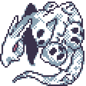</a> <a href="view/pokedex/249_DEMEMENTIA.md">249 DEMEMENTIA</a> NEURAL · DIVINITY</td><td align="center" valign="bottom"> <a href="view/pokedex/250_PAGOLDIA.md">250 PAGOLDIA</a> SATANIC · MECHANIC</td><td align="center" valign="bottom"><a href="view/pokedex/251_CEREBRI.md">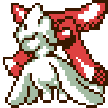</a> <a href="view/pokedex/251_CEREBRI.md">251 CEREBRI</a> NEURAL · DRUGS</td><td align="center" valign="bottom"><a href="view/pokedex/201_PARATYPE_A.md">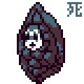</a> <a href="view/pokedex/201_PARATYPE_A.md">PARATYPE ABC</a> NEURAL</td></tr><tr><td align="center" valign="bottom"> <a href="view/pokedex/201_PARATYPE_D.md">PARATYPE DEFGHI</a> NEURAL</td><td align="center" valign="bottom"><a href="view/pokedex/201_PARATYPE_J.md">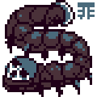</a> <a href="view/pokedex/201_PARATYPE_J.md">PARATYPE JKLMNO</a> NEURAL</td><td align="center" valign="bottom"> <a href="view/pokedex/201_PARATYPE_P.md">PARATYPE PQRSTU</a> NEURAL</td><td align="center" valign="bottom"> <a href="view/pokedex/201_PARATYPE_V.md">PARATYPE V</a> NEURAL</td></tr><tr><td align="center" valign="bottom"> <a href="view/pokedex/201_PARATYPE_W.md">PARATYPE W</a> NEURAL</td><td align="center" valign="bottom"> <a href="view/pokedex/201_PARATYPE_X.md">PARATYPE X</a> NEURAL</td><td align="center" valign="bottom"> <a href="view/pokedex/201_PARATYPE_Y.md">PARATYPE Y</a> NEURAL</td><td align="center" valign="bottom"> <a href="view/pokedex/201_PARATYPE_Z.md">PARATYPE Z</a> NEURAL</td></tr></table>

## Characters

<table><tr><td align="center" valign="top"><a href="view/characters/characters-battle.md">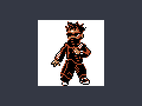</a> <a href="view/characters/characters-battle.md">Characters (Battle)</a> <a href="characters/characters-battle.png">1×</a></td><td align="center" valign="top"> <a href="view/characters/characters-overworld.md">Characters (Overworld)</a> <a href="characters/characters-overworld.png">1×</a></td></tr></table>

## Backgrounds (Routes)

<table><tr><td align="center" valign="top"> <a href="view/backgrounds/routes/route-17.md">Route 17</a> AREA 17 <a href="backgrounds/routes/route-17.png">1×</a></td><td align="center" valign="top"> <a href="view/backgrounds/routes/route-26.md">Route 26</a> AREA 26 <a href="backgrounds/routes/route-26.png">1×</a></td><td align="center" valign="top"><a href="view/backgrounds/routes/route-27.md">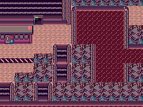</a> <a href="view/backgrounds/routes/route-27.md">Route 27</a> AREA 27 <a href="backgrounds/routes/route-27.png">1×</a></td></tr><tr><td align="center" valign="top"> <a href="view/backgrounds/routes/route-36.md">Route 36</a> AREA 36 <a href="backgrounds/routes/route-36.png">1×</a></td><td align="center" valign="top"> <a href="view/backgrounds/routes/route-40.md">Route 40</a> AREA 40 <a href="backgrounds/routes/route-40.png">1×</a></td><td align="center" valign="top"> <a href="view/backgrounds/routes/route-43.md">Route 43</a> AREA 43 <a href="backgrounds/routes/route-43.png">1×</a></td></tr></table>

## Backgrounds (Locations)

<table><tr><td align="center" valign="top"> <a href="view/backgrounds/locations/azalea-town.md">Azalea Town</a> LOS AURA <a href="backgrounds/locations/azalea-town.png">1×</a></td><td align="center" valign="top"> <a href="view/backgrounds/locations/battle-tower.md">Battle Tower</a> BATTLE TOWER <a href="backgrounds/locations/battle-tower.png">1×</a></td><td align="center" valign="top"><a href="view/backgrounds/locations/blackthorn-city.md">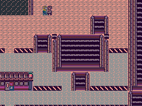</a> <a href="view/backgrounds/locations/blackthorn-city.md">Blackthorn City</a> PEAK OF DREAD <a href="backgrounds/locations/blackthorn-city.png">1×</a></td></tr><tr><td align="center" valign="top"> <a href="view/backgrounds/locations/burned-tower.md">Burned Tower</a> BURNED TOWER <a href="backgrounds/locations/burned-tower.png">1×</a></td><td align="center" valign="top"> <a href="view/backgrounds/locations/celadon-city.md">Celadon City</a> CELADON CITY <a href="backgrounds/locations/celadon-city.png">1×</a></td><td align="center" valign="top"><a href="view/backgrounds/locations/cerulean-city.md">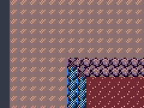</a> <a href="view/backgrounds/locations/cerulean-city.md">Cerulean City</a> CERULEAN CITY <a href="backgrounds/locations/cerulean-city.png">1×</a></td></tr><tr><td align="center" valign="top"> <a href="view/backgrounds/locations/cherrygrove-city.md">Cherrygrove City</a> NEARBYTOWN <a href="backgrounds/locations/cherrygrove-city.png">1×</a></td><td align="center" valign="top"><a href="view/backgrounds/locations/cianwood-city.md">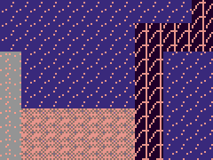</a> <a href="view/backgrounds/locations/cianwood-city.md">Cianwood City</a> OVERSEA ASYLUM <a href="backgrounds/locations/cianwood-city.png">1×</a></td><td align="center" valign="top"><a href="view/backgrounds/locations/cinnabar-island.md">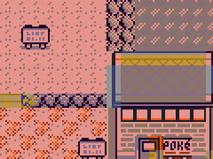</a> <a href="view/backgrounds/locations/cinnabar-island.md">Cinnabar Island</a> CINNABAR ISLAND <a href="backgrounds/locations/cinnabar-island.png">1×</a></td></tr><tr><td align="center" valign="top"> <a href="view/backgrounds/locations/daycare.md">Daycare</a> AREA 34 <a href="backgrounds/locations/daycare.png">1×</a></td><td align="center" valign="top"> <a href="view/backgrounds/locations/dragons-den.md">Dragon's Den</a> DRAGON'S DEN <a href="backgrounds/locations/dragons-den.png">1×</a></td><td align="center" valign="top"> <a href="view/backgrounds/locations/ecruteak-city.md">Ecruteak City</a> SUBURBIA <a href="backgrounds/locations/ecruteak-city.png">1×</a></td></tr><tr><td align="center" valign="top"><a href="view/backgrounds/locations/fuchsia-city.md">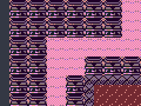</a> <a href="view/backgrounds/locations/fuchsia-city.md">Fuchsia City</a> FUCHSIA CITY <a href="backgrounds/locations/fuchsia-city.png">1×</a></td><td align="center" valign="top"> <a href="view/backgrounds/locations/glitter-lighthouse.md">Glitter Lighthouse</a> PENTAFLOOR <a href="backgrounds/locations/glitter-lighthouse.png">1×</a></td><td align="center" valign="top"> <a href="view/backgrounds/locations/goldenrod-city.md">Goldenrod City</a> METRO COMPLEX <a href="backgrounds/locations/goldenrod-city.png">1×</a></td></tr><tr><td align="center" valign="top"><a href="view/backgrounds/locations/goldenrod-radio-tower.md">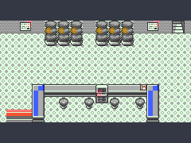</a> <a href="view/backgrounds/locations/goldenrod-radio-tower.md">Goldenrod Radio Tower</a> RADIO TOWER <a href="backgrounds/locations/goldenrod-radio-tower.png">1×</a></td><td align="center" valign="top"> <a href="view/backgrounds/locations/ice-path.md">Ice Path</a> PARKING LOT <a href="backgrounds/locations/ice-path.png">1×</a></td><td align="center" valign="top"><a href="view/backgrounds/locations/ilex-forest.md">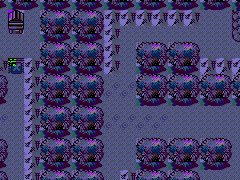</a> <a href="view/backgrounds/locations/ilex-forest.md">Ilex Forest</a> SUICIDE FOREST <a href="backgrounds/locations/ilex-forest.png">1×</a></td></tr><tr><td align="center" valign="top"> <a href="view/backgrounds/locations/indigo-plateau.md">Indigo Plateau</a> INDIGO PLATEAU <a href="backgrounds/locations/indigo-plateau.png">1×</a></td><td align="center" valign="top"> <a href="view/backgrounds/locations/lavender-town.md">Lavender Town</a> LAVENDER TOWN <a href="backgrounds/locations/lavender-town.png">1×</a></td><td align="center" valign="top"> <a href="view/backgrounds/locations/mahogany-town.md">Mahogany Town</a> LONELY WOODS <a href="backgrounds/locations/mahogany-town.png">1×</a></td></tr><tr><td align="center" valign="top"><a href="view/backgrounds/locations/mt-mortar.md">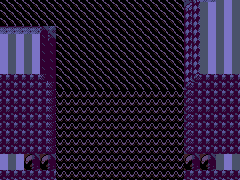</a> <a href="view/backgrounds/locations/mt-mortar.md">Mt. Mortar</a> MT.MORTAR <a href="backgrounds/locations/mt-mortar.png">1×</a></td><td align="center" valign="top"> <a href="view/backgrounds/locations/mt-silver.md">Mt. Silver</a> SILVER CAVE <a href="backgrounds/locations/mt-silver.png">1×</a></td><td align="center" valign="top"> <a href="view/backgrounds/locations/national-park.md">National Park</a> NATIONAL PARK <a href="backgrounds/locations/national-park.png">1×</a></td></tr><tr><td align="center" valign="top"> <a href="view/backgrounds/locations/new-bark-town.md">New Bark Town</a> HOMETOWN <a href="backgrounds/locations/new-bark-town.png">1×</a></td><td align="center" valign="top"> <a href="view/backgrounds/locations/olivine-city.md">Olivine City</a> GOVERNMENT <a href="backgrounds/locations/olivine-city.png">1×</a></td><td align="center" valign="top"> <a href="view/backgrounds/locations/pallet-town.md">Pallet Town</a> PALLET TOWN <a href="backgrounds/locations/pallet-town.png">1×</a></td></tr><tr><td align="center" valign="top"> <a href="view/backgrounds/locations/pewter-city.md">Pewter City</a> PEWTER CITY <a href="backgrounds/locations/pewter-city.png">1×</a></td><td align="center" valign="top"><a href="view/backgrounds/locations/pokemon-center-mart.md">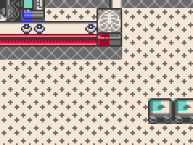</a> <a href="view/backgrounds/locations/pokemon-center-mart.md">Pokémon Center / Mart</a> NEARBYTOWN <a href="backgrounds/locations/pokemon-center-mart.png">1×</a></td><td align="center" valign="top"> <a href="view/backgrounds/locations/rocket-hideout.md">Rocket Hideout</a> LONELY WOODS <a href="backgrounds/locations/rocket-hideout.png">1×</a></td></tr><tr><td align="center" valign="top"><a href="view/backgrounds/locations/ruins-of-alph.md">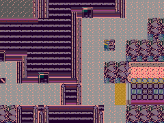</a> <a href="view/backgrounds/locations/ruins-of-alph.md">Ruins of Alph</a> BIO IMPACT <a href="backgrounds/locations/ruins-of-alph.png">1×</a></td><td align="center" valign="top"> <a href="view/backgrounds/locations/s-s-aqua.md">S.S. Aqua</a> FAST SHIP <a href="backgrounds/locations/s-s-aqua.png">1×</a></td><td align="center" valign="top"> <a href="view/backgrounds/locations/saffron-city.md">Saffron City</a> SAFFRON CITY <a href="backgrounds/locations/saffron-city.png">1×</a></td></tr><tr><td align="center" valign="top"> <a href="view/backgrounds/locations/slowpoke-well.md">Slowpoke Well</a> SLOWPOKE WELL <a href="backgrounds/locations/slowpoke-well.png">1×</a></td><td align="center" valign="top"> <a href="view/backgrounds/locations/sprout-tower.md">Sprout Tower</a> SPROUT TOWER <a href="backgrounds/locations/sprout-tower.png">1×</a></td><td align="center" valign="top"> <a href="view/backgrounds/locations/unused-maps.md">Unused Maps</a> GOVERNMENT <a href="backgrounds/locations/unused-maps.png">1×</a></td></tr><tr><td align="center" valign="top"> <a href="view/backgrounds/locations/vermilion-city.md">Vermilion City</a> VERMILION CITY <a href="backgrounds/locations/vermilion-city.png">1×</a></td><td align="center" valign="top"> <a href="view/backgrounds/locations/violet-city.md">Violet City</a> NOSTALGOTHIA <a href="backgrounds/locations/violet-city.png">1×</a></td><td align="center" valign="top"> <a href="view/backgrounds/locations/viridian-city.md">Viridian City</a> VIRIDIAN CITY <a href="backgrounds/locations/viridian-city.png">1×</a></td></tr></table>

## More maps

Every other map in the game, by its in-game place name.

<table><tr><td align="center" valign="top"> <a href="view/more/maps/area-1.md">Area 1</a> <a href="more/maps/area-1.png">1×</a></td><td align="center" valign="top"> <a href="view/more/maps/area-10.md">Area 10</a> <a href="more/maps/area-10.png">1×</a></td><td align="center" valign="top"> <a href="view/more/maps/area-11.md">Area 11</a> <a href="more/maps/area-11.png">1×</a></td></tr><tr><td align="center" valign="top"><a href="view/more/maps/area-12.md">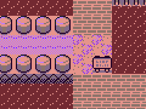</a> <a href="view/more/maps/area-12.md">Area 12</a> <a href="more/maps/area-12.png">1×</a></td><td align="center" valign="top"> <a href="view/more/maps/area-13.md">Area 13</a> <a href="more/maps/area-13.png">1×</a></td><td align="center" valign="top"> <a href="view/more/maps/area-14.md">Area 14</a> <a href="more/maps/area-14.png">1×</a></td></tr><tr><td align="center" valign="top"><a href="view/more/maps/area-15.md">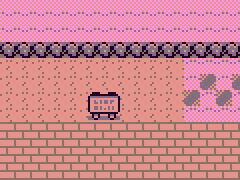</a> <a href="view/more/maps/area-15.md">Area 15</a> <a href="more/maps/area-15.png">1×</a></td><td align="center" valign="top"> <a href="view/more/maps/area-16.md">Area 16</a> <a href="more/maps/area-16.png">1×</a></td><td align="center" valign="top"> <a href="view/more/maps/area-17.md">Area 17</a> <a href="more/maps/area-17.png">1×</a></td></tr><tr><td align="center" valign="top"> <a href="view/more/maps/area-18.md">Area 18</a> <a href="more/maps/area-18.png">1×</a></td><td align="center" valign="top"> <a href="view/more/maps/area-19.md">Area 19</a> <a href="more/maps/area-19.png">1×</a></td><td align="center" valign="top"> <a href="view/more/maps/area-2.md">Area 2</a> <a href="more/maps/area-2.png">1×</a></td></tr><tr><td align="center" valign="top"> <a href="view/more/maps/area-20.md">Area 20</a> <a href="more/maps/area-20.png">1×</a></td><td align="center" valign="top"> <a href="view/more/maps/area-21.md">Area 21</a> <a href="more/maps/area-21.png">1×</a></td><td align="center" valign="top"><a href="view/more/maps/area-22.md">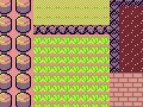</a> <a href="view/more/maps/area-22.md">Area 22</a> <a href="more/maps/area-22.png">1×</a></td></tr><tr><td align="center" valign="top"> <a href="view/more/maps/area-23.md">Area 23</a> <a href="more/maps/area-23.png">1×</a></td><td align="center" valign="top"><a href="view/more/maps/area-24.md">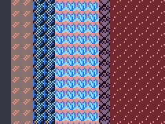</a> <a href="view/more/maps/area-24.md">Area 24</a> <a href="more/maps/area-24.png">1×</a></td><td align="center" valign="top"> <a href="view/more/maps/area-25.md">Area 25</a> <a href="more/maps/area-25.png">1×</a></td></tr><tr><td align="center" valign="top"><a href="view/more/maps/area-26.md">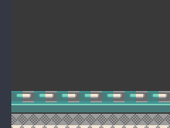</a> <a href="view/more/maps/area-26.md">Area 26</a> <a href="more/maps/area-26.png">1×</a></td><td align="center" valign="top"> <a href="view/more/maps/area-27.md">Area 27</a> <a href="more/maps/area-27.png">1×</a></td><td align="center" valign="top"> <a href="view/more/maps/area-28.md">Area 28</a> <a href="more/maps/area-28.png">1×</a></td></tr><tr><td align="center" valign="top"> <a href="view/more/maps/area-29.md">Area 29</a> <a href="more/maps/area-29.png">1×</a></td><td align="center" valign="top"> <a href="view/more/maps/area-3.md">Area 3</a> <a href="more/maps/area-3.png">1×</a></td><td align="center" valign="top"> <a href="view/more/maps/area-30.md">Area 30</a> <a href="more/maps/area-30.png">1×</a></td></tr><tr><td align="center" valign="top"> <a href="view/more/maps/area-31.md">Area 31</a> <a href="more/maps/area-31.png">1×</a></td><td align="center" valign="top"> <a href="view/more/maps/area-32.md">Area 32</a> <a href="more/maps/area-32.png">1×</a></td><td align="center" valign="top"><a href="view/more/maps/area-33.md">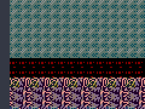</a> <a href="view/more/maps/area-33.md">Area 33</a> <a href="more/maps/area-33.png">1×</a></td></tr><tr><td align="center" valign="top"> <a href="view/more/maps/area-34.md">Area 34</a> <a href="more/maps/area-34.png">1×</a></td><td align="center" valign="top"> <a href="view/more/maps/area-35.md">Area 35</a> <a href="more/maps/area-35.png">1×</a></td><td align="center" valign="top"><a href="view/more/maps/area-36.md">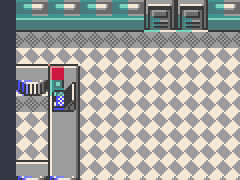</a> <a href="view/more/maps/area-36.md">Area 36</a> <a href="more/maps/area-36.png">1×</a></td></tr><tr><td align="center" valign="top"> <a href="view/more/maps/area-37.md">Area 37</a> <a href="more/maps/area-37.png">1×</a></td><td align="center" valign="top"> <a href="view/more/maps/area-38.md">Area 38</a> <a href="more/maps/area-38.png">1×</a></td><td align="center" valign="top"> <a href="view/more/maps/area-39.md">Area 39</a> <a href="more/maps/area-39.png">1×</a></td></tr><tr><td align="center" valign="top"> <a href="view/more/maps/area-4.md">Area 4</a> <a href="more/maps/area-4.png">1×</a></td><td align="center" valign="top"> <a href="view/more/maps/area-41.md">Area 41</a> <a href="more/maps/area-41.png">1×</a></td><td align="center" valign="top"> <a href="view/more/maps/area-42.md">Area 42</a> <a href="more/maps/area-42.png">1×</a></td></tr><tr><td align="center" valign="top"> <a href="view/more/maps/area-43.md">Area 43</a> <a href="more/maps/area-43.png">1×</a></td><td align="center" valign="top"> <a href="view/more/maps/area-44.md">Area 44</a> <a href="more/maps/area-44.png">1×</a></td><td align="center" valign="top"> <a href="view/more/maps/area-45.md">Area 45</a> <a href="more/maps/area-45.png">1×</a></td></tr><tr><td align="center" valign="top"> <a href="view/more/maps/area-46.md">Area 46</a> <a href="more/maps/area-46.png">1×</a></td><td align="center" valign="top"> <a href="view/more/maps/area-5.md">Area 5</a> <a href="more/maps/area-5.png">1×</a></td><td align="center" valign="top"> <a href="view/more/maps/area-6.md">Area 6</a> <a href="more/maps/area-6.png">1×</a></td></tr><tr><td align="center" valign="top"> <a href="view/more/maps/area-7.md">Area 7</a> <a href="more/maps/area-7.png">1×</a></td><td align="center" valign="top"> <a href="view/more/maps/area-8.md">Area 8</a> <a href="more/maps/area-8.png">1×</a></td><td align="center" valign="top"> <a href="view/more/maps/area-9.md">Area 9</a> <a href="more/maps/area-9.png">1×</a></td></tr><tr><td align="center" valign="top"> <a href="view/more/maps/digletts-cave.md">Diglett'S Cave</a> <a href="more/maps/digletts-cave.png">1×</a></td><td align="center" valign="top"> <a href="view/more/maps/mt-moon.md">Mt.Moon</a> <a href="more/maps/mt-moon.png">1×</a></td><td align="center" valign="top"> <a href="view/more/maps/power-plant.md">Power Plant</a> <a href="more/maps/power-plant.png">1×</a></td></tr><tr><td align="center" valign="top"> <a href="view/more/maps/rock-tunnel.md">Rock Tunnel</a> <a href="more/maps/rock-tunnel.png">1×</a></td><td align="center" valign="top"> <a href="view/more/maps/sewers.md">Sewers</a> <a href="more/maps/sewers.png">1×</a></td><td align="center" valign="top"> <a href="view/more/maps/source-of-plasma.md">Source Of Plasma</a> <a href="more/maps/source-of-plasma.png">1×</a></td></tr><tr><td align="center" valign="top"> <a href="view/more/maps/tin-tower.md">Tin Tower</a> <a href="more/maps/tin-tower.png">1×</a></td><td align="center" valign="top"> <a href="view/more/maps/tohjo-falls.md">Tohjo Falls</a> <a href="more/maps/tohjo-falls.png">1×</a></td><td align="center" valign="top"> <a href="view/more/maps/underground.md">Underground</a> <a href="more/maps/underground.png">1×</a></td></tr><tr><td align="center" valign="top"> <a href="view/more/maps/union-cave.md">Union Cave</a> <a href="more/maps/union-cave.png">1×</a></td><td align="center" valign="top"> <a href="view/more/maps/victory-road.md">Victory Road</a> <a href="more/maps/victory-road.png">1×</a></td><td align="center" valign="top"> <a href="view/more/maps/whirl-islands.md">Whirl Islands</a> <a href="more/maps/whirl-islands.png">1×</a></td></tr></table>

## Miscellaneous

<table><tr><td align="center" valign="top"> <a href="view/miscellaneous/bag-interface.md">Bag Interface</a> <a href="miscellaneous/bag-interface.png">1×</a></td><td align="center" valign="top"> <a href="view/miscellaneous/font.md">Font</a> <a href="miscellaneous/font.png">1×</a></td><td align="center" valign="top"> <a href="view/miscellaneous/game-freak-intro.md">Game Freak Intro</a> <a href="miscellaneous/game-freak-intro.png">1×</a></td></tr><tr><td align="center" valign="top"> <a href="view/miscellaneous/intro-backgrounds.md">Intro Backgrounds</a> <a href="miscellaneous/intro-backgrounds.png">1×</a></td><td align="center" valign="top"> <a href="view/miscellaneous/pokegear.md">Pokégear</a> PLAGUETEK <a href="miscellaneous/pokegear.png">1×</a></td><td align="center" valign="top"> <a href="view/miscellaneous/pokemon-egg.md">Pokémon Egg</a> <a href="miscellaneous/pokemon-egg.png">1×</a></td></tr><tr><td align="center" valign="top"> <a href="view/miscellaneous/professor-oaks-opening-lecture.md">Professor Oak's Opening Lecture</a> <a href="miscellaneous/professor-oaks-opening-lecture.png">1×</a></td><td align="center" valign="top"> <a href="view/miscellaneous/tileset-day.md">Tileset (Day)</a> <a href="miscellaneous/tileset-day.png">1×</a></td><td align="center" valign="top"> <a href="view/miscellaneous/tileset-morning.md">Tileset (Morning)</a> <a href="miscellaneous/tileset-morning.png">1×</a></td></tr><tr><td align="center" valign="top"> <a href="view/miscellaneous/tileset-night.md">Tileset (Night)</a> <a href="miscellaneous/tileset-night.png">1×</a></td><td align="center" valign="top"> <a href="view/miscellaneous/trainer-card.md">Trainer Card</a> <a href="miscellaneous/trainer-card.png">1×</a></td><td align="center" valign="top"> <a href="view/more/title-screen.md">Title Screen</a> <a href="more/title-screen.png">1×</a></td></tr></table>

Click a sheet to view it enlarged; **1×** is the original.

## Credits

- Plaguemon II: The AfterWorld by Hikikomori @ [Plague Labs](https://plaguelabs.com).
- Pokémon © Nintendo / Creatures Inc. / GAME FREAK inc.
- Extracted with tools built on the formats documented by [pret/pokecrystal](https://github.com/pret/pokecrystal).
- Unofficial fan archive, not affiliated with either. No ROM or game code is included.
