# Plaguemon II: The AfterWorld

Sprite sheets for v0.1.0, laid out like the Pokémon Crystal page on [The Spriters Resource](https://www.spriters-resource.com/game_boy_gbc/pokemoncrystal/).

Graphics unchanged from Pokémon Crystal are left out.

## Characters

<table><tr><td align="center" valign="top"><a href="characters/characters-battle.png">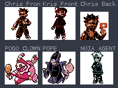</a> Characters (Battle)</td><td align="center" valign="top"><a href="characters/characters-overworld.png">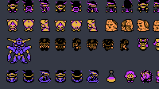</a> Characters (Overworld)</td></tr></table>

## Pokémon

<table><tr><td align="center" valign="top"><a href="pokemon/generation-1-pokemon.png">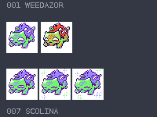</a> Generation 1 Pokémon</td><td align="center" valign="top"><a href="pokemon/generation-2-pokemon.png">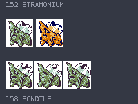</a> Generation 2 Pokémon</td><td align="center" valign="top"><a href="pokemon/unown-formes.png">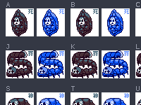</a> Unown Formes Paratypes</td></tr></table>

## Backgrounds (Routes)

<table><tr><td align="center" valign="top"><a href="backgrounds/routes/route-17.png">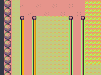</a> Route 17 AREA 17</td><td align="center" valign="top"><a href="backgrounds/routes/route-26.png">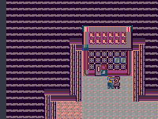</a> Route 26 AREA 26</td><td align="center" valign="top"><a href="backgrounds/routes/route-27.png">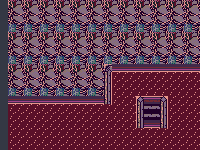</a> Route 27 AREA 27</td><td align="center" valign="top"><a href="backgrounds/routes/route-36.png">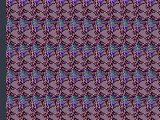</a> Route 36 AREA 36</td></tr><tr><td align="center" valign="top"><a href="backgrounds/routes/route-40.png">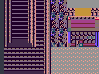</a> Route 40 AREA 40</td><td align="center" valign="top"><a href="backgrounds/routes/route-43.png">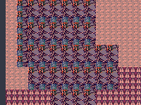</a> Route 43 AREA 43</td></tr></table>

## Backgrounds (Locations)

<table><tr><td align="center" valign="top"><a href="backgrounds/locations/azalea-town.png">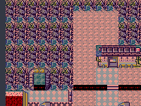</a> Azalea Town LOS AURA</td><td align="center" valign="top"><a href="backgrounds/locations/battle-tower.png">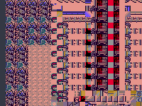</a> Battle Tower BATTLE TOWER</td><td align="center" valign="top"><a href="backgrounds/locations/blackthorn-city.png">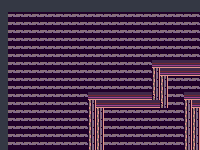</a> Blackthorn City PEAK OF DREAD</td><td align="center" valign="top"><a href="backgrounds/locations/burned-tower.png">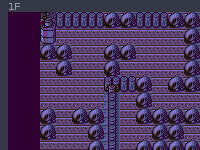</a> Burned Tower BURNED TOWER</td></tr><tr><td align="center" valign="top"><a href="backgrounds/locations/celadon-city.png">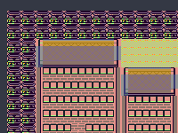</a> Celadon City CELADON CITY</td><td align="center" valign="top"><a href="backgrounds/locations/cerulean-city.png">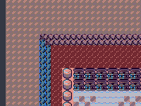</a> Cerulean City CERULEAN CITY</td><td align="center" valign="top"><a href="backgrounds/locations/cherrygrove-city.png">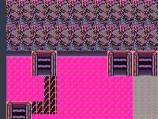</a> Cherrygrove City NEARBYTOWN</td><td align="center" valign="top"><a href="backgrounds/locations/cianwood-city.png">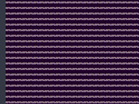</a> Cianwood City OVERSEA ASYLUM</td></tr><tr><td align="center" valign="top"><a href="backgrounds/locations/cinnabar-island.png">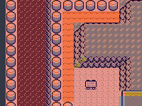</a> Cinnabar Island CINNABAR ISLAND</td><td align="center" valign="top"><a href="backgrounds/locations/daycare.png">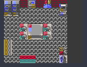</a> Daycare AREA 34</td><td align="center" valign="top"><a href="backgrounds/locations/dragons-den.png">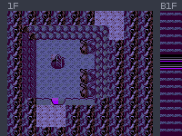</a> Dragon's Den DRAGON'S DEN</td><td align="center" valign="top"><a href="backgrounds/locations/ecruteak-city.png">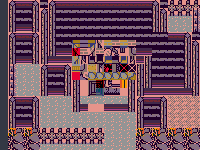</a> Ecruteak City SUBURBIA</td></tr><tr><td align="center" valign="top"><a href="backgrounds/locations/fuchsia-city.png">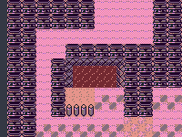</a> Fuchsia City FUCHSIA CITY</td><td align="center" valign="top"><a href="backgrounds/locations/glitter-lighthouse.png">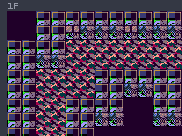</a> Glitter Lighthouse PENTAFLOOR</td><td align="center" valign="top"><a href="backgrounds/locations/goldenrod-city.png">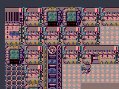</a> Goldenrod City METRO COMPLEX</td><td align="center" valign="top"><a href="backgrounds/locations/goldenrod-radio-tower.png">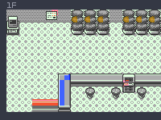</a> Goldenrod Radio Tower RADIO TOWER</td></tr><tr><td align="center" valign="top"><a href="backgrounds/locations/ice-path.png">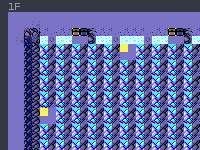</a> Ice Path PARKING LOT</td><td align="center" valign="top"><a href="backgrounds/locations/ilex-forest.png">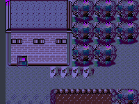</a> Ilex Forest SUICIDE FOREST</td><td align="center" valign="top"><a href="backgrounds/locations/indigo-plateau.png">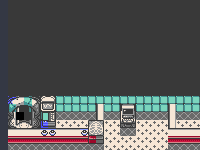</a> Indigo Plateau INDIGO PLATEAU</td><td align="center" valign="top"><a href="backgrounds/locations/lavender-town.png">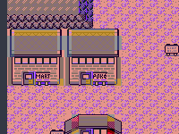</a> Lavender Town LAVENDER TOWN</td></tr><tr><td align="center" valign="top"><a href="backgrounds/locations/mahogany-town.png">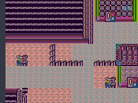</a> Mahogany Town LONELY WOODS</td><td align="center" valign="top"><a href="backgrounds/locations/mt-mortar.png">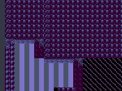</a> Mt. Mortar MT.MORTAR</td><td align="center" valign="top"><a href="backgrounds/locations/mt-silver.png">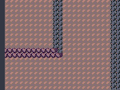</a> Mt. Silver SILVER CAVE</td><td align="center" valign="top"><a href="backgrounds/locations/national-park.png">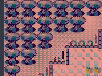</a> National Park NATIONAL PARK</td></tr><tr><td align="center" valign="top"><a href="backgrounds/locations/new-bark-town.png">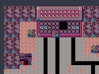</a> New Bark Town HOMETOWN</td><td align="center" valign="top"><a href="backgrounds/locations/olivine-city.png">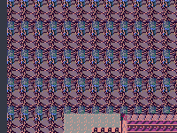</a> Olivine City GOVERNMENT</td><td align="center" valign="top"><a href="backgrounds/locations/pallet-town.png">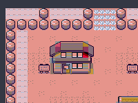</a> Pallet Town PALLET TOWN</td><td align="center" valign="top"><a href="backgrounds/locations/pewter-city.png">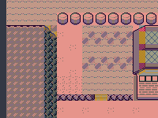</a> Pewter City PEWTER CITY</td></tr><tr><td align="center" valign="top"><a href="backgrounds/locations/pokemon-center-mart.png">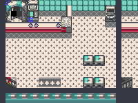</a> Pokémon Center / Mart NEARBYTOWN</td><td align="center" valign="top"><a href="backgrounds/locations/rocket-hideout.png">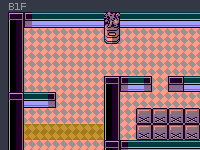</a> Rocket Hideout LONELY WOODS</td><td align="center" valign="top"><a href="backgrounds/locations/ruins-of-alph.png">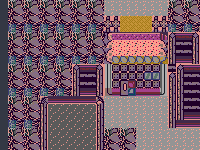</a> Ruins of Alph BIO IMPACT</td><td align="center" valign="top"><a href="backgrounds/locations/s-s-aqua.png">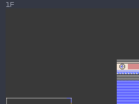</a> S.S. Aqua FAST SHIP</td></tr><tr><td align="center" valign="top"><a href="backgrounds/locations/saffron-city.png">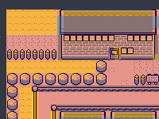</a> Saffron City SAFFRON CITY</td><td align="center" valign="top"><a href="backgrounds/locations/slowpoke-well.png">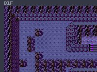</a> Slowpoke Well SLOWPOKE WELL</td><td align="center" valign="top"><a href="backgrounds/locations/sprout-tower.png">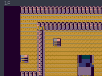</a> Sprout Tower SPROUT TOWER</td><td align="center" valign="top"><a href="backgrounds/locations/unused-maps.png">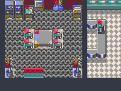</a> Unused Maps GOVERNMENT</td></tr><tr><td align="center" valign="top"><a href="backgrounds/locations/vermilion-city.png">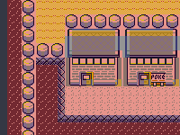</a> Vermilion City VERMILION CITY</td><td align="center" valign="top"><a href="backgrounds/locations/violet-city.png">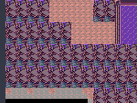</a> Violet City NOSTALGOTHIA</td><td align="center" valign="top"><a href="backgrounds/locations/viridian-city.png">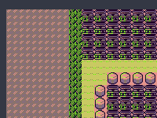</a> Viridian City VIRIDIAN CITY</td></tr></table>

Not yet: Magnet Train Tracks

## Miscellaneous

<table><tr><td align="center" valign="top"> Font</td><td align="center" valign="top"> Game Freak Intro</td><td align="center" valign="top"> Intro Backgrounds</td><td align="center" valign="top"> Pokémon Egg</td></tr><tr><td align="center" valign="top"> Professor Oak's Opening Lecture</td><td align="center" valign="top"> Tileset (Day)</td><td align="center" valign="top"> Tileset (Morning)</td><td align="center" valign="top"> Tileset (Night)</td></tr></table>

Not yet: Bag Interface, Bill's PC Interface, Credits, Intro Sprites, Mail, Minigames, Mobile Content, Mystery Gift Screen, Pokégear, Super Game Boy Error Message, Trading Sequence, Trainer Card

## More

Not on the Crystal page: the title screen and every other map, by in-game place name.

<table><tr><td align="center" valign="top"> Title Screen</td><td align="center" valign="top"> Area 1</td><td align="center" valign="top"> Area 10</td><td align="center" valign="top"> Area 11</td></tr><tr><td align="center" valign="top"> Area 12</td><td align="center" valign="top"> Area 13</td><td align="center" valign="top"> Area 14</td><td align="center" valign="top"> Area 15</td></tr><tr><td align="center" valign="top"> Area 16</td><td align="center" valign="top"> Area 17</td><td align="center" valign="top"> Area 18</td><td align="center" valign="top"> Area 19</td></tr><tr><td align="center" valign="top"> Area 2</td><td align="center" valign="top"> Area 20</td><td align="center" valign="top"> Area 21</td><td align="center" valign="top"> Area 22</td></tr><tr><td align="center" valign="top"> Area 23</td><td align="center" valign="top"> Area 24</td><td align="center" valign="top"> Area 25</td><td align="center" valign="top"> Area 26</td></tr><tr><td align="center" valign="top"> Area 27</td><td align="center" valign="top"> Area 28</td><td align="center" valign="top"> Area 29</td><td align="center" valign="top"> Area 3</td></tr><tr><td align="center" valign="top"> Area 30</td><td align="center" valign="top"> Area 31</td><td align="center" valign="top"> Area 32</td><td align="center" valign="top"> Area 33</td></tr><tr><td align="center" valign="top"> Area 34</td><td align="center" valign="top"> Area 35</td><td align="center" valign="top"> Area 36</td><td align="center" valign="top"> Area 37</td></tr><tr><td align="center" valign="top"> Area 38</td><td align="center" valign="top"> Area 39</td><td align="center" valign="top"> Area 4</td><td align="center" valign="top"> Area 41</td></tr><tr><td align="center" valign="top"> Area 42</td><td align="center" valign="top"> Area 43</td><td align="center" valign="top"> Area 44</td><td align="center" valign="top"> Area 45</td></tr><tr><td align="center" valign="top"> Area 46</td><td align="center" valign="top"> Area 5</td><td align="center" valign="top"> Area 6</td><td align="center" valign="top"> Area 7</td></tr><tr><td align="center" valign="top"> Area 8</td><td align="center" valign="top"> Area 9</td><td align="center" valign="top"> Diglett'S Cave</td><td align="center" valign="top"> Mt.Moon</td></tr><tr><td align="center" valign="top"> Power Plant</td><td align="center" valign="top"> Rock Tunnel</td><td align="center" valign="top"> Sewers</td><td align="center" valign="top"> Source Of Plasma</td></tr><tr><td align="center" valign="top"> Tin Tower</td><td align="center" valign="top"> Tohjo Falls</td><td align="center" valign="top"> Underground</td><td align="center" valign="top"> Union Cave</td></tr><tr><td align="center" valign="top"> Victory Road</td><td align="center" valign="top"> Whirl Islands</td></tr></table>

Not yet: Battle Screen, Battle Backgrounds

Animated battle sprites: [`pokemon/animated/`](pokemon/animated/).

---

Plaguemon II © Hikikomori / Plague Labs. Pokémon © Nintendo / Creatures / GAME FREAK. Unofficial; no ROM data included.
