# Plaguemon II: The AfterWorld sprite rip

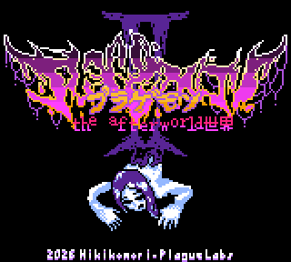

 

*Plaguemon II: The AfterWorld* (プラゲモンII後の世界) is a cyberpunk horror hack of Pokémon Crystal and the sequel to *Plaguemon: Lost Diaries* (2018). This archive collects the sprites, battle backgrounds, maps, music, and game data from v0.1.1.

&gt; **by** [Hikikomori](https://github.com/PlaguedHikikomori) ([Plague Labs](https://plaguelabs.com)) 
&gt; **patch** [plaguemon.com](https://plaguemon.com) 
&gt; **base ROM** Pokémon Crystal (USA/Europe) 
&gt; [**gallery**](https://aaaaaaaaaaway.github.io/plaguemon2-sprites/)

## File guide

| Path | Contents |
|---|---|
| [`sprites/front/`](sprites/front/) and [`sprites/shiny/`](sprites/shiny/) | Battle sprites by Pokédex number, with transparent copies in each folder |
| [`sprites/animated/`](sprites/animated/) | Battle animations, including shiny versions |
| [`sprites/frames/`](sprites/frames/) | Animation frame strips, starting with the base frame |
| [`sprites/icons/`](sprites/icons/) | Both frames of each party icon |
| [`sprites/intro/`](sprites/intro/) | Intro animations and title screen |
| [`data/pokedex.json`](data/pokedex.json) | Types, stats, Pokédex entries, evolutions, moves, wild encounters, palettes, and sprite paths |
| [`sprites/battle-backgrounds/`](sprites/battle-backgrounds/) | Battle backdrops in their in-game palettes |
| [`data/battle-backgrounds.json`](data/battle-backgrounds.json) | Backdrop selection rules and ROM addresses |
| [`sprites/trainers/`](sprites/trainers/) | Trainer class sprites |
| [`data/trainers.json`](data/trainers.json) | 542 trainer teams, with known locations for 468 |
| [`data/items.json`](data/items.json) | Item descriptions, prices, pockets, and TM/HM moves |
| [`data/type-chart.json`](data/type-chart.json) | Type matchups |
| [`music/`](music/) | MP3 recordings by music slot |
| [`pokemon/`](pokemon/), [`characters/`](characters/), [`backgrounds/`](backgrounds/), [`miscellaneous/`](miscellaneous/), [`more/`](more/) | Full-size sprite sheets |
| [`view/`](view/) | Illustrated pages for browsing on GitHub |

 

## Intro

 &nbsp; 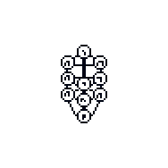 &nbsp; 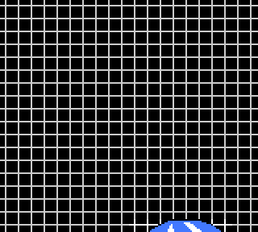

 

## Pokémon

<table><tr><td align="center" valign="bottom"> <a href="view/pokedex/001_WEEDAZOR.md">001 WEEDAZOR</a> DRUGS · MEDICAL</td><td align="center" valign="bottom"> <a href="view/pokedex/002_COCAZOR.md">002 COCAZOR</a> DRUGS · MEDICAL</td><td align="center" valign="bottom"> <a href="view/pokedex/003_OPIUMZOR.md">003 OPIUMZOR</a> DRUGS · MEDICAL</td><td align="center" valign="bottom"> <a href="view/pokedex/004_CHARMHELL.md">004 CHARMHELL</a> SATANIC</td></tr><tr><td align="center" valign="bottom"> <a href="view/pokedex/005_BELIALEON.md">005 BELIALEON</a> SATANIC</td><td align="center" valign="bottom"> <a href="view/pokedex/006_LUCIFERION.md">006 LUCIFERION</a> SATANIC · DIVINITY</td><td align="center" valign="bottom"> <a href="view/pokedex/007_SCOLINA.md">007 SCOLINA</a> DEATH</td><td align="center" valign="bottom"><a href="view/pokedex/008_SCOLANO.md">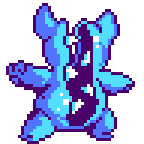</a> <a href="view/pokedex/008_SCOLANO.md">008 SCOLANO</a> DEATH</td></tr><tr><td align="center" valign="bottom"> <a href="view/pokedex/009_SCOLENE.md">009 SCOLENE</a> DEATH · MILITARY</td><td align="center" valign="bottom"> <a href="view/pokedex/010_GUNBAG.md">010 GUNBAG</a> MILITARY</td><td align="center" valign="bottom"><a href="view/pokedex/011_MUTAPUD.md">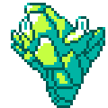</a> <a href="view/pokedex/011_MUTAPUD.md">011 MUTAPUD</a> MILITARY</td><td align="center" valign="bottom"> <a href="view/pokedex/012_MONASIGHT.md">012 MONASIGHT</a> MILITARY · MECHANIC</td></tr><tr><td align="center" valign="bottom"><a href="view/pokedex/013_WERMIX.md">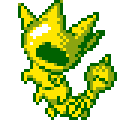</a> <a href="view/pokedex/013_WERMIX.md">013 WERMIX</a> MILITARY · MEDICAL</td><td align="center" valign="bottom"> <a href="view/pokedex/014_KAKUZI.md">014 KAKUZI</a> MILITARY · MEDICAL</td><td align="center" valign="bottom"> <a href="view/pokedex/015_CAMOGATL.md">015 CAMOGATL</a> MILITARY · MEDICAL</td><td align="center" valign="bottom"> <a href="view/pokedex/016_CIKKAN.md">016 CIKKAN</a> MUTANT · MECHANIC</td></tr><tr><td align="center" valign="bottom"> <a href="view/pokedex/017_UBERBIRO.md">017 UBERBIRO</a> MUTANT · MECHANIC</td><td align="center" valign="bottom"> <a href="view/pokedex/018_HEPOCORPS.md">018 HEPOCORPS</a> MUTANT · MECHANIC</td><td align="center" valign="bottom"> <a href="view/pokedex/019_FOGNUS.md">019 FOGNUS</a> MUTANT</td><td align="center" valign="bottom"> <a href="view/pokedex/020_RATOZZO.md">020 RATOZZO</a> MUTANT</td></tr><tr><td align="center" valign="bottom"> <a href="view/pokedex/021_SBLARFO.md">021 SBLARFO</a> MUTANT · MECHANIC</td><td align="center" valign="bottom"> <a href="view/pokedex/022_SGLARFO.md">022 SGLARFO</a> MUTANT · MECHANIC</td><td align="center" valign="bottom"> <a href="view/pokedex/023_ANFESIBO.md">023 ANFESIBO</a> MEDICAL</td><td align="center" valign="bottom"> <a href="view/pokedex/024_URBOROK.md">024 URBOROK</a> MEDICAL</td></tr><tr><td align="center" valign="bottom"> <a href="view/pokedex/025_PIKACHEWED.md">025 PIKACHEWED</a> CYBER · NUCLEAR</td><td align="center" valign="bottom"> <a href="view/pokedex/026_RAICHEWEDZ.md">026 RAICHEWEDZ</a> NUCLEAR</td><td align="center" valign="bottom"> <a href="view/pokedex/027_PAPYRYU.md">027 PAPYRYU</a> ORGANIC</td><td align="center" valign="bottom"><a href="view/pokedex/028_SPHINXO.md">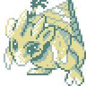</a> <a href="view/pokedex/028_SPHINXO.md">028 SPHINXO</a> ORGANIC</td></tr><tr><td align="center" valign="bottom"> <a href="view/pokedex/029_FINGAH.md">029 FINGAH</a> MEDICAL</td><td align="center" valign="bottom"> <a href="view/pokedex/030_HANDA.md">030 HANDA</a> MEDICAL</td><td align="center" valign="bottom"> <a href="view/pokedex/031_KALEDENDS.md">031 KALEDENDS</a> MEDICAL · ORGANIC</td><td align="center" valign="bottom"> <a href="view/pokedex/032_SCRAMBLO.md">032 SCRAMBLO</a> MEDICAL</td></tr><tr><td align="center" valign="bottom"> <a href="view/pokedex/033_GRABOIDO.md">033 GRABOIDO</a> MEDICAL</td><td align="center" valign="bottom"><a href="view/pokedex/034_KESARUS.md">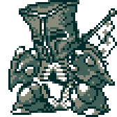</a> <a href="view/pokedex/034_KESARUS.md">034 KESARUS</a> MEDICAL · ORGANIC</td><td align="center" valign="bottom"> <a href="view/pokedex/035_CRISTALIA.md">035 CRISTALIA</a> MUTANT</td><td align="center" valign="bottom"> <a href="view/pokedex/036_AMELITA.md">036 AMELITA</a> MUTANT</td></tr><tr><td align="center" valign="bottom"><a href="view/pokedex/037_NYMPHAX.md">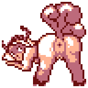</a> <a href="view/pokedex/037_NYMPHAX.md">037 NYMPHAX</a> SATANIC</td><td align="center" valign="bottom"> <a href="view/pokedex/038_KITSUNAIL.md">038 KITSUNAIL</a> SATANIC · DEATH</td><td align="center" valign="bottom"> <a href="view/pokedex/039_EYEBALLY.md">039 EYEBALLY</a> MUTANT</td><td align="center" valign="bottom"><a href="view/pokedex/040_KAWAIKAGO.md">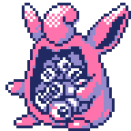</a> <a href="view/pokedex/040_KAWAIKAGO.md">040 KAWAIKAGO</a> MUTANT</td></tr><tr><td align="center" valign="bottom"> <a href="view/pokedex/041_GOTCHICK.md">041 GOTCHICK</a> MEDICAL · MECHANIC</td><td align="center" valign="bottom"> <a href="view/pokedex/042_VAMPESSA.md">042 VAMPESSA</a> MEDICAL · MECHANIC</td><td align="center" valign="bottom"> <a href="view/pokedex/043_ODDGLITCH.md">043 ODDGLITCH</a> DRUGS · MEDICAL</td><td align="center" valign="bottom"><a href="view/pokedex/044_INFECTO.md">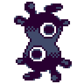</a> <a href="view/pokedex/044_INFECTO.md">044 INFECTO</a> DRUGS · MEDICAL</td></tr><tr><td align="center" valign="bottom"> <a href="view/pokedex/045_LARSENEF.md">045 LARSENEF</a> DRUGS · MEDICAL</td><td align="center" valign="bottom"> <a href="view/pokedex/046_PARASITO.md">046 PARASITO</a> MILITARY · DRUGS</td><td align="center" valign="bottom"> <a href="view/pokedex/047_PSILOCYBO.md">047 PSILOCYBO</a> MILITARY · DRUGS</td><td align="center" valign="bottom"> <a href="view/pokedex/048_GNAKGNAK.md">048 GNAKGNAK</a> MILITARY · MEDICAL</td></tr><tr><td align="center" valign="bottom"> <a href="view/pokedex/049_CHORDYCEPS.md">049 CHORDYCEPS</a> MILITARY · MEDICAL</td><td align="center" valign="bottom"><a href="view/pokedex/050_KAZETTO.md">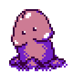</a> <a href="view/pokedex/050_KAZETTO.md">050 KAZETTO</a> ORGANIC</td><td align="center" valign="bottom"> <a href="view/pokedex/051_GANGBANGO.md">051 GANGBANGO</a> ORGANIC</td><td align="center" valign="bottom"> <a href="view/pokedex/052_NIGGA.md">052 NIGGA</a> MUTANT</td></tr><tr><td align="center" valign="bottom"> <a href="view/pokedex/053_TENKA.md">053 TENKA</a> MUTANT</td><td align="center" valign="bottom"> <a href="view/pokedex/054_WORMACK.md">054 WORMACK</a> DEATH</td><td align="center" valign="bottom"> <a href="view/pokedex/055_DUKAKIS.md">055 DUKAKIS</a> DEATH</td><td align="center" valign="bottom"><a href="view/pokedex/056_HIROOSH.md">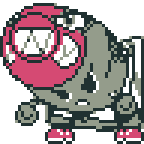</a> <a href="view/pokedex/056_HIROOSH.md">056 HIROOSH</a> VIOLENCE</td></tr><tr><td align="center" valign="bottom"> <a href="view/pokedex/057_NAGASAK.md">057 NAGASAK</a> VIOLENCE</td><td align="center" valign="bottom"> <a href="view/pokedex/058_SCRATCHY.md">058 SCRATCHY</a> SATANIC</td><td align="center" valign="bottom"><a href="view/pokedex/059_BJORN.md">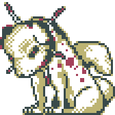</a> <a href="view/pokedex/059_BJORN.md">059 BJORN</a> SATANIC</td><td align="center" valign="bottom"> <a href="view/pokedex/060_SPERMOTZ.md">060 SPERMOTZ</a> DEATH</td></tr><tr><td align="center" valign="bottom"> <a href="view/pokedex/061_PROLIFIK.md">061 PROLIFIK</a> DEATH</td><td align="center" valign="bottom"> <a href="view/pokedex/062_SMEGMATIC.md">062 SMEGMATIC</a> DEATH · VIOLENCE</td><td align="center" valign="bottom"> <a href="view/pokedex/063_GENESUS.md">063 GENESUS</a> NEURAL</td><td align="center" valign="bottom"> <a href="view/pokedex/064_PROFETUS.md">064 PROFETUS</a> NEURAL</td></tr><tr><td align="center" valign="bottom"> <a href="view/pokedex/065_MARTIRUS.md">065 MARTIRUS</a> NEURAL</td><td align="center" valign="bottom"> <a href="view/pokedex/066_ANOREX.md">066 ANOREX</a> VIOLENCE</td><td align="center" valign="bottom"><a href="view/pokedex/067_STERODO.md">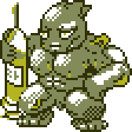</a> <a href="view/pokedex/067_STERODO.md">067 STERODO</a> VIOLENCE</td><td align="center" valign="bottom"> <a href="view/pokedex/068_KONGORISH.md">068 KONGORISH</a> VIOLENCE</td></tr><tr><td align="center" valign="bottom"> <a href="view/pokedex/069_PILLORYD.md">069 PILLORYD</a> DRUGS · MEDICAL</td><td align="center" valign="bottom"> <a href="view/pokedex/070_GUILTYOTIN.md">070 GUILTYOTIN</a> DRUGS · MEDICAL</td><td align="center" valign="bottom"> <a href="view/pokedex/071_NORIMBERGU.md">071 NORIMBERGU</a> DRUGS · MEDICAL</td><td align="center" valign="bottom"> <a href="view/pokedex/072_HENTAICOOL.md">072 HENTAICOOL</a> DEATH · MEDICAL</td></tr><tr><td align="center" valign="bottom"> <a href="view/pokedex/073_HENTAIGORE.md">073 HENTAIGORE</a> DEATH · MEDICAL</td><td align="center" valign="bottom"> <a href="view/pokedex/074_URANIUM.md">074 URANIUM</a> MINERAL · ORGANIC</td><td align="center" valign="bottom"> <a href="view/pokedex/075_PLUTONIUM.md">075 PLUTONIUM</a> MINERAL · ORGANIC</td><td align="center" valign="bottom"> <a href="view/pokedex/076_ATOMIUM.md">076 ATOMIUM</a> MINERAL · ORGANIC</td></tr><tr><td align="center" valign="bottom"> <a href="view/pokedex/077_HELLESTO.md">077 HELLESTO</a> SATANIC</td><td align="center" valign="bottom"><a href="view/pokedex/078_FAXHIRO.md">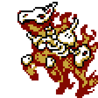</a> <a href="view/pokedex/078_FAXHIRO.md">078 FAXHIRO</a> SATANIC</td><td align="center" valign="bottom"> <a href="view/pokedex/079_SLOWGHOST.md">079 SLOWGHOST</a> DEATH · NEURAL</td><td align="center" valign="bottom"> <a href="view/pokedex/080_KORNUPIAK.md">080 KORNUPIAK</a> DEATH · NEURAL</td></tr><tr><td align="center" valign="bottom"> <a href="view/pokedex/081_GHOSHELLO.md">081 GHOSHELLO</a> NUCLEAR · CYBER</td><td align="center" valign="bottom"> <a href="view/pokedex/082_SORAYAMBOT.md">082 SORAYAMBOT</a> NUCLEAR · CYBER</td><td align="center" valign="bottom"> <a href="view/pokedex/083_BONDAGEDOG.md">083 BONDAGEDOG</a> MUTANT · MECHANIC</td><td align="center" valign="bottom"> <a href="view/pokedex/084_BIPOLARIO.md">084 BIPOLARIO</a> MUTANT · MECHANIC</td></tr><tr><td align="center" valign="bottom"> <a href="view/pokedex/085_PSICOTO.md">085 PSICOTO</a> MUTANT · MECHANIC</td><td align="center" valign="bottom"> <a href="view/pokedex/086_MEGADIL.md">086 MEGADIL</a> DEATH</td><td align="center" valign="bottom"> <a href="view/pokedex/087_MEGADIL500.md">087 MEGADIL500</a> DEATH · CHEMICAL</td><td align="center" valign="bottom"><a href="view/pokedex/088_GRINDED.md">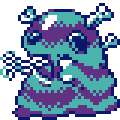</a> <a href="view/pokedex/088_GRINDED.md">088 GRINDED</a> MEDICAL</td></tr><tr><td align="center" valign="bottom"><a href="view/pokedex/089_KUMORAH.md">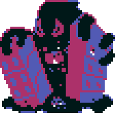</a> <a href="view/pokedex/089_KUMORAH.md">089 KUMORAH</a> MEDICAL</td><td align="center" valign="bottom"> <a href="view/pokedex/090_SHELLDER.md">090 SHELLDER</a> DEATH</td><td align="center" valign="bottom"> <a href="view/pokedex/091_VAGINDAM.md">091 VAGINDAM</a> DEATH · CHEMICAL</td><td align="center" valign="bottom"> <a href="view/pokedex/092_GOSBAMP.md">092 GOSBAMP</a> SEX · MEDICAL</td></tr><tr><td align="center" valign="bottom"> <a href="view/pokedex/093_WRAITARL.md">093 WRAITARL</a> SEX · MEDICAL</td><td align="center" valign="bottom"> <a href="view/pokedex/094_TREROR.md">094 TREROR</a> SEX · MEDICAL</td><td align="center" valign="bottom"> <a href="view/pokedex/095_OBSIDIAN.md">095 OBSIDIAN</a> MINERAL · ORGANIC</td><td align="center" valign="bottom"> <a href="view/pokedex/096_DUPUPETT.md">096 DUPUPETT</a> NEURAL · PUPPET</td></tr><tr><td align="center" valign="bottom"> <a href="view/pokedex/097_BURHAT.md">097 BURHAT</a> NEURAL · PUPPET</td><td align="center" valign="bottom"> <a href="view/pokedex/098_TOXIWASTE.md">098 TOXIWASTE</a> DEATH</td><td align="center" valign="bottom"> <a href="view/pokedex/099_NUKEBARL.md">099 NUKEBARL</a> DEATH</td><td align="center" valign="bottom"> <a href="view/pokedex/100_KOWARENING.md">100 KOWARENING</a> NUCLEAR</td></tr><tr><td align="center" valign="bottom"> <a href="view/pokedex/101_NINGOGORE.md">101 NINGOGORE</a> NUCLEAR</td><td align="center" valign="bottom"><a href="view/pokedex/102_DARUMORT.md">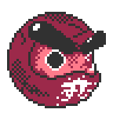</a> <a href="view/pokedex/102_DARUMORT.md">102 DARUMORT</a> DRUGS · NEURAL</td><td align="center" valign="bottom"><a href="view/pokedex/103_MASKABUKI.md">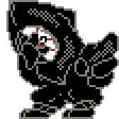</a> <a href="view/pokedex/103_MASKABUKI.md">103 MASKABUKI</a> DRUGS · NEURAL</td><td align="center" valign="bottom"> <a href="view/pokedex/104_RIOTTO.md">104 RIOTTO</a> ORGANIC</td></tr><tr><td align="center" valign="bottom"><a href="view/pokedex/105_TERORISTO.md">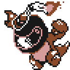</a> <a href="view/pokedex/105_TERORISTO.md">105 TERORISTO</a> ORGANIC</td><td align="center" valign="bottom"> <a href="view/pokedex/106_THAIFAITA.md">106 THAIFAITA</a> VIOLENCE</td><td align="center" valign="bottom"> <a href="view/pokedex/107_MIKEFAITA.md">107 MIKEFAITA</a> VIOLENCE</td><td align="center" valign="bottom"> <a href="view/pokedex/108_PUKALOT.md">108 PUKALOT</a> MUTANT</td></tr><tr><td align="center" valign="bottom"> <a href="view/pokedex/109_SARSARAS.md">109 SARSARAS</a> MEDICAL</td><td align="center" valign="bottom"> <a href="view/pokedex/110_LUNGANSER.md">110 LUNGANSER</a> MEDICAL</td><td align="center" valign="bottom"> <a href="view/pokedex/111_ELICORPS.md">111 ELICORPS</a> ORGANIC · MINERAL</td><td align="center" valign="bottom"> <a href="view/pokedex/112_MEDUCUNT.md">112 MEDUCUNT</a> ORGANIC · MINERAL</td></tr><tr><td align="center" valign="bottom"> <a href="view/pokedex/113_PREGNANTA.md">113 PREGNANTA</a> MUTANT</td><td align="center" valign="bottom"> <a href="view/pokedex/114_WORMICELLI.md">114 WORMICELLI</a> DRUGS</td><td align="center" valign="bottom"> <a href="view/pokedex/115_HELLTECH.md">115 HELLTECH</a> MUTANT</td><td align="center" valign="bottom"> <a href="view/pokedex/116_COCKY.md">116 COCKY</a> DEATH</td></tr><tr><td align="center" valign="bottom"> <a href="view/pokedex/117_SCROTRA.md">117 SCROTRA</a> DEATH</td><td align="center" valign="bottom"> <a href="view/pokedex/118_BLINKY.md">118 BLINKY</a> DEATH</td><td align="center" valign="bottom"><a href="view/pokedex/119_HOGEROT.md">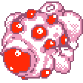</a> <a href="view/pokedex/119_HOGEROT.md">119 HOGEROT</a> DEATH</td><td align="center" valign="bottom"> <a href="view/pokedex/120_MALOKINGI.md">120 MALOKINGI</a> DEATH</td></tr><tr><td align="center" valign="bottom"> <a href="view/pokedex/121_IRUKUNJI.md">121 IRUKUNJI</a> DEATH · NEURAL</td><td align="center" valign="bottom"> <a href="view/pokedex/122_MR_SHADOW.md">122 MR.SHADOW</a> NEURAL</td><td align="center" valign="bottom"> <a href="view/pokedex/123_HANZORU.md">123 HANZORU</a> MILITARY · MECHANIC</td><td align="center" valign="bottom"> <a href="view/pokedex/124_JYZZO.md">124 JYZZO</a> CHEMICAL · NEURAL</td></tr><tr><td align="center" valign="bottom"> <a href="view/pokedex/125_VOLCUTION.md">125 VOLCUTION</a> NUCLEAR</td><td align="center" valign="bottom"><a href="view/pokedex/126_BURNAR.md">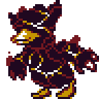</a> <a href="view/pokedex/126_BURNAR.md">126 BURNAR</a> SATANIC</td><td align="center" valign="bottom"> <a href="view/pokedex/127_SHAMABOO.md">127 SHAMABOO</a> MILITARY</td><td align="center" valign="bottom"> <a href="view/pokedex/128_DIGESTOR.md">128 DIGESTOR</a> MUTANT</td></tr><tr><td align="center" valign="bottom"> <a href="view/pokedex/129_ROKUJOSHI.md">129 ROKUJOSHI</a> DEATH</td><td align="center" valign="bottom"> <a href="view/pokedex/130_HANNYADOS.md">130 HANNYADOS</a> DEATH · MECHANIC</td><td align="center" valign="bottom"> <a href="view/pokedex/131_KARONTIS.md">131 KARONTIS</a> DEATH · CHEMICAL</td><td align="center" valign="bottom"> <a href="view/pokedex/132_SHITTO.md">132 SHITTO</a> MUTANT</td></tr><tr><td align="center" valign="bottom"> <a href="view/pokedex/133_DEADDOG.md">133 DEADDOG</a> MUTANT</td><td align="center" valign="bottom"> <a href="view/pokedex/134_VENEREON.md">134 VENEREON</a> DEATH</td><td align="center" valign="bottom"> <a href="view/pokedex/135_NUKENION.md">135 NUKENION</a> NUCLEAR</td><td align="center" valign="bottom"> <a href="view/pokedex/136_CERBERION.md">136 CERBERION</a> SATANIC</td></tr><tr><td align="center" valign="bottom"><a href="view/pokedex/137_TERMINALIX.md">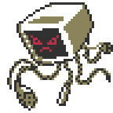</a> <a href="view/pokedex/137_TERMINALIX.md">137 TERMINALIX</a> CYBER</td><td align="center" valign="bottom"> <a href="view/pokedex/138_SHARPIDER.md">138 SHARPIDER</a> MINERAL · DEATH</td><td align="center" valign="bottom"> <a href="view/pokedex/139_MECHANIGAL.md">139 MECHANIGAL</a> MINERAL · DEATH</td><td align="center" valign="bottom"> <a href="view/pokedex/140_ZIRLORG.md">140 ZIRLORG</a> MINERAL · DEATH</td></tr><tr><td align="center" valign="bottom"><a href="view/pokedex/141_ZILOSNAK.md">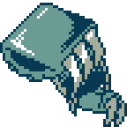</a> <a href="view/pokedex/141_ZILOSNAK.md">141 ZILOSNAK</a> MINERAL · DEATH</td><td align="center" valign="bottom"> <a href="view/pokedex/142_PTEROXIS.md">142 PTEROXIS</a> MINERAL · MECHANIC</td><td align="center" valign="bottom"> <a href="view/pokedex/143_PUTREFACTO.md">143 PUTREFACTO</a> MUTANT</td><td align="center" valign="bottom"> <a href="view/pokedex/144_ARTICLONE.md">144 ARTICLONE</a> CHEMICAL · MECHANIC</td></tr><tr><td align="center" valign="bottom"> <a href="view/pokedex/145_ZAPGOLD.md">145 ZAPGOLD</a> NUCLEAR · MECHANIC</td><td align="center" valign="bottom"> <a href="view/pokedex/146_MOLCOPY.md">146 MOLCOPY</a> SATANIC · MECHANIC</td><td align="center" valign="bottom"> <a href="view/pokedex/147_CHERUBIUM.md">147 CHERUBIUM</a> ANGELIC · DIVINITY</td><td align="center" valign="bottom"> <a href="view/pokedex/148_SERAPHIUM.md">148 SERAPHIUM</a> ANGELIC · DIVINITY</td></tr><tr><td align="center" valign="bottom"> <a href="view/pokedex/149_CHILONGO.md">149 CHILONGO</a> ANGELIC · DIVINITY</td><td align="center" valign="bottom"> <a href="view/pokedex/150_MEWTATED.md">150 MEWTATED</a> NEURAL</td><td align="center" valign="bottom"><a href="view/pokedex/151_TWOMEW.md">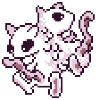</a> <a href="view/pokedex/151_TWOMEW.md">151 TWOMEW</a> NEURAL</td><td align="center" valign="bottom"> <a href="view/pokedex/152_STRAMONIUM.md">152 STRAMONIUM</a> DRUGS</td></tr><tr><td align="center" valign="bottom"> <a href="view/pokedex/153_DIVINORUM.md">153 DIVINORUM</a> DRUGS</td><td align="center" valign="bottom"> <a href="view/pokedex/154_AYAHUASCO.md">154 AYAHUASCO</a> NEURAL · DRUGS</td><td align="center" valign="bottom"><a href="view/pokedex/155_SCARFITO.md">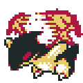</a> <a href="view/pokedex/155_SCARFITO.md">155 SCARFITO</a> SATANIC</td><td align="center" valign="bottom"> <a href="view/pokedex/156_CRUXADO.md">156 CRUXADO</a> SATANIC</td></tr><tr><td align="center" valign="bottom"> <a href="view/pokedex/157_INFERNATUS.md">157 INFERNATUS</a> SATANIC · DOOM</td><td align="center" valign="bottom"> <a href="view/pokedex/158_BONDILE.md">158 BONDILE</a> DEATH</td><td align="center" valign="bottom"> <a href="view/pokedex/159_GAGOGO.md">159 GAGOGO</a> DEATH</td><td align="center" valign="bottom"> <a href="view/pokedex/160_CROCOSNUFF.md">160 CROCOSNUFF</a> DEATH · VIOLENCE</td></tr><tr><td align="center" valign="bottom"> <a href="view/pokedex/161_BURQO.md">161 BURQO</a> MUTANT</td><td align="center" valign="bottom"> <a href="view/pokedex/162_JIHADO.md">162 JIHADO</a> MUTANT</td><td align="center" valign="bottom"> <a href="view/pokedex/163_BALAKLOWL.md">163 BALAKLOWL</a> MUTANT · MECHANIC</td><td align="center" valign="bottom"> <a href="view/pokedex/164_ROBBINOWL.md">164 ROBBINOWL</a> MUTANT · MECHANIC</td></tr><tr><td align="center" valign="bottom"> <a href="view/pokedex/165_SBIRETTO.md">165 SBIRETTO</a> MILITARY · MECHANIC</td><td align="center" valign="bottom"> <a href="view/pokedex/166_FACISTA.md">166 FACISTA</a> MILITARY · MECHANIC</td><td align="center" valign="bottom"> <a href="view/pokedex/167_NAZETTO.md">167 NAZETTO</a> MILITARY · MEDICAL</td><td align="center" valign="bottom"> <a href="view/pokedex/168_NAZITANK.md">168 NAZITANK</a> MILITARY · MEDICAL</td></tr><tr><td align="center" valign="bottom"><a href="view/pokedex/169_TRIZOM.md">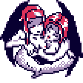</a> <a href="view/pokedex/169_TRIZOM.md">169 TRIZOM</a> MEDICAL · MECHANIC</td><td align="center" valign="bottom"> <a href="view/pokedex/170_RELICTOU.md">170 RELICTOU</a> DEATH · NUCLEAR</td><td align="center" valign="bottom"> <a href="view/pokedex/171_SOVIETO.md">171 SOVIETO</a> DEATH · NUCLEAR</td><td align="center" valign="bottom"><a href="view/pokedex/172_BALBAC.md">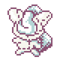</a> <a href="view/pokedex/172_BALBAC.md">172 BALBAC</a> NUCLEAR</td></tr><tr><td align="center" valign="bottom"> <a href="view/pokedex/173_VOIDILIA.md">173 VOIDILIA</a> MUTANT</td><td align="center" valign="bottom"> <a href="view/pokedex/174_RETINOL.md">174 RETINOL</a> MUTANT</td><td align="center" valign="bottom"> <a href="view/pokedex/175_VENOSO.md">175 VENOSO</a> MUTANT</td><td align="center" valign="bottom"> <a href="view/pokedex/176_VENESCO.md">176 VENESCO</a> MUTANT · MECHANIC</td></tr><tr><td align="center" valign="bottom"> <a href="view/pokedex/177_SACRILUT.md">177 SACRILUT</a> NEURAL · MECHANIC</td><td align="center" valign="bottom"> <a href="view/pokedex/178_QUELZALCOT.md">178 QUELZALCOT</a> NEURAL · MECHANIC</td><td align="center" valign="bottom"> <a href="view/pokedex/179_BINARIA.md">179 BINARIA</a> NUCLEAR</td><td align="center" valign="bottom"> <a href="view/pokedex/180_ALGOCRAT.md">180 ALGOCRAT</a> NUCLEAR</td></tr><tr><td align="center" valign="bottom"> <a href="view/pokedex/181_DICTAITOR.md">181 DICTAITOR</a> NUCLEAR</td><td align="center" valign="bottom"> <a href="view/pokedex/182_MANDELBRO.md">182 MANDELBRO</a> DRUGS</td><td align="center" valign="bottom"> <a href="view/pokedex/183_HALUAL.md">183 HALUAL</a> DEATH</td><td align="center" valign="bottom"> <a href="view/pokedex/184_KONTROLIO.md">184 KONTROLIO</a> DEATH</td></tr><tr><td align="center" valign="bottom"><a href="view/pokedex/185_AOKIGAKA.md">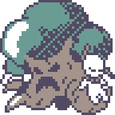</a> <a href="view/pokedex/185_AOKIGAKA.md">185 AOKIGAKA</a> MINERAL</td><td align="center" valign="bottom"> <a href="view/pokedex/186_FETUSO.md">186 FETUSO</a> DEATH</td><td align="center" valign="bottom"> <a href="view/pokedex/187_ABORTITO.md">187 ABORTITO</a> DRUGS · MECHANIC</td><td align="center" valign="bottom"> <a href="view/pokedex/188_INCUBATO.md">188 INCUBATO</a> DRUGS · MECHANIC</td></tr><tr><td align="center" valign="bottom"> <a href="view/pokedex/189_ITTIOSO.md">189 ITTIOSO</a> DRUGS · MECHANIC</td><td align="center" valign="bottom"> <a href="view/pokedex/190_MOLESTO.md">190 MOLESTO</a> MUTANT</td><td align="center" valign="bottom"><a href="view/pokedex/191_GRUMO.md">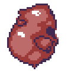</a> <a href="view/pokedex/191_GRUMO.md">191 GRUMO</a> DRUGS</td><td align="center" valign="bottom"> <a href="view/pokedex/192_OVARIAN.md">192 OVARIAN</a> DRUGS</td></tr><tr><td align="center" valign="bottom"> <a href="view/pokedex/193_NAPALMYAN.md">193 NAPALMYAN</a> MILITARY · MECHANIC</td><td align="center" valign="bottom"> <a href="view/pokedex/194_KOTZWAR.md">194 KOTZWAR</a> DEATH · ORGANIC</td><td align="center" valign="bottom"> <a href="view/pokedex/195_ASPHYXIAR.md">195 ASPHYXIAR</a> DEATH · ORGANIC</td><td align="center" valign="bottom"> <a href="view/pokedex/196_EMBRYEON.md">196 EMBRYEON</a> NEURAL</td></tr><tr><td align="center" valign="bottom"> <a href="view/pokedex/197_DAMNATEON.md">197 DAMNATEON</a> DOOM</td><td align="center" valign="bottom"> <a href="view/pokedex/198_SKARKROW.md">198 SKARKROW</a> DOOM · MECHANIC</td><td align="center" valign="bottom"> <a href="view/pokedex/199_DEPRECLOWN.md">199 DEPRECLOWN</a> DEATH · NEURAL</td><td align="center" valign="bottom"><a href="view/pokedex/200_HOSTED_GOO.md">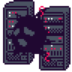</a> <a href="view/pokedex/200_HOSTED_GOO.md">200 HOSTED.GOO</a> SEX</td></tr><tr><td align="center" valign="bottom"> <a href="view/pokedex/202_CONDOMAX.md">202 CONDOMAX</a> NEURAL</td><td align="center" valign="bottom"> <a href="view/pokedex/203_ENIGMAGUS.md">203 ENIGMAGUS</a> MUTANT · NEURAL</td><td align="center" valign="bottom"> <a href="view/pokedex/204_HIDENLAYER.md">204 HIDENLAYER</a> MILITARY</td><td align="center" valign="bottom"> <a href="view/pokedex/205_NEURONET.md">205 /NEURONET</a> MILITARY · CYBER</td></tr><tr><td align="center" valign="bottom"><a href="view/pokedex/206_DUOFUNTO.md">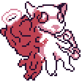</a> <a href="view/pokedex/206_DUOFUNTO.md">206 DUOFUNTO</a> MUTANT</td><td align="center" valign="bottom"> <a href="view/pokedex/207_TWOMEWTWO.md">207 TWOMEWTWO</a> NEURAL · MUTANT</td><td align="center" valign="bottom"> <a href="view/pokedex/208_HYDRAGYRUM.md">208 HYDRAGYRUM</a> CYBER · MEDICAL</td><td align="center" valign="bottom"> <a href="view/pokedex/209_BLEKHOLIA.md">209 BLEKHOLIA</a> MUTANT</td></tr><tr><td align="center" valign="bottom"> <a href="view/pokedex/210_GALAXIAN.md">210 GALAXIAN</a> MUTANT</td><td align="center" valign="bottom"> <a href="view/pokedex/211_NAVALMINO.md">211 NAVALMINO</a> DEATH · MEDICAL</td><td align="center" valign="bottom"><a href="view/pokedex/212_CYNOBI.md">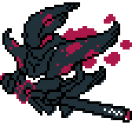</a> <a href="view/pokedex/212_CYNOBI.md">212 CYNOBI</a> CYBER · MILITARY</td><td align="center" valign="bottom"> <a href="view/pokedex/213_PROGLOTTO.md">213 PROGLOTTO</a> MILITARY · MINERAL</td></tr><tr><td align="center" valign="bottom"> <a href="view/pokedex/214_KINBUGUBI.md">214 KINBUGUBI</a> MILITARY · VIOLENCE</td><td align="center" valign="bottom"> <a href="view/pokedex/215_KUNOIGA.md">215 KUNOIGA</a> DOOM · DEATH</td><td align="center" valign="bottom"> <a href="view/pokedex/216_FLESHPLUSH.md">216 FLESHPLUSH</a> MUTANT</td><td align="center" valign="bottom"> <a href="view/pokedex/217_TAXYDERMA.md">217 TAXYDERMA</a> MUTANT</td></tr><tr><td align="center" valign="bottom"> <a href="view/pokedex/218_MELTEFAS.md">218 MELTEFAS</a> SATANIC</td><td align="center" valign="bottom"> <a href="view/pokedex/219_MAGCARGO.md">219 MAGCARGO</a> SATANIC · MINERAL</td><td align="center" valign="bottom"> <a href="view/pokedex/220_SWINUB.md">220 SWINUB</a> CHEMICAL · ORGANIC</td><td align="center" valign="bottom"> <a href="view/pokedex/221_PILOSWINE.md">221 PILOSWINE</a> CHEMICAL · ORGANIC</td></tr><tr><td align="center" valign="bottom"> <a href="view/pokedex/222_NEURAPSYS.md">222 NEURAPSYS</a> DEATH · MINERAL</td><td align="center" valign="bottom"> <a href="view/pokedex/223_ANIFISH.md">223 ANIFISH</a> DEATH</td><td align="center" valign="bottom"> <a href="view/pokedex/224_TOSHIOKI.md">224 TOSHIOKI</a> DEATH</td><td align="center" valign="bottom"> <a href="view/pokedex/225_ANTENNOIDE.md">225 ANTENNOIDE</a> CHEMICAL · MECHANIC</td></tr><tr><td align="center" valign="bottom"> <a href="view/pokedex/226_DADAORCA.md">226 DADAORCA</a> DEATH · MECHANIC</td><td align="center" valign="bottom"> <a href="view/pokedex/227_AXIOM_APEX.md">227 AXIOM:APEX</a> CYBER · MECHANIC</td><td align="center" valign="bottom"> <a href="view/pokedex/228_HOUNDOUR.md">228 HOUNDOUR</a> DOOM · SATANIC</td><td align="center" valign="bottom"><a href="view/pokedex/229_HOUNDOOM.md">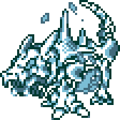</a> <a href="view/pokedex/229_HOUNDOOM.md">229 HOUNDOOM</a> DOOM · SATANIC</td></tr><tr><td align="center" valign="bottom"><a href="view/pokedex/230_HERMAPHROD.md">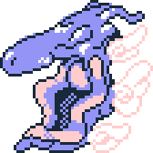</a> <a href="view/pokedex/230_HERMAPHROD.md">230 HERMAPHROD</a> DEATH · DIVINITY</td><td align="center" valign="bottom"> <a href="view/pokedex/231_PHANPY.md">231 PHANPY</a> ORGANIC</td><td align="center" valign="bottom"> <a href="view/pokedex/232_DONPHAN.md">232 DONPHAN</a> ORGANIC</td><td align="center" valign="bottom"> <a href="view/pokedex/233_BIBRODO.md">233 BIBRODO</a> MUTANT</td></tr><tr><td align="center" valign="bottom"> <a href="view/pokedex/234_SPIRITUS.md">234 SPIRITUS</a> MUTANT</td><td align="center" valign="bottom"> <a href="view/pokedex/235_SMEARGLE.md">235 SMEARGLE</a> MUTANT</td><td align="center" valign="bottom"> <a href="view/pokedex/236_SKOONITSO.md">236 SKOONITSO</a> VIOLENCE</td><td align="center" valign="bottom"> <a href="view/pokedex/237_JUTSUFAITA.md">237 JUTSUFAITA</a> VIOLENCE</td></tr><tr><td align="center" valign="bottom"> <a href="view/pokedex/238_LOLIPLEX.md">238 LOLIPLEX</a> CHEMICAL · NEURAL</td><td align="center" valign="bottom"> <a href="view/pokedex/239_PHOTOKID.md">239 PHOTOKID</a> NUCLEAR</td><td align="center" valign="bottom"> <a href="view/pokedex/240_CARBIFY.md">240 CARBIFY</a> SATANIC</td><td align="center" valign="bottom"> <a href="view/pokedex/241_INTENSIVO.md">241 INTENSIVO</a> MUTANT</td></tr><tr><td align="center" valign="bottom"> <a href="view/pokedex/242_POSTPARTOU.md">242 POSTPARTOU</a> MUTANT</td><td align="center" valign="bottom"> <a href="view/pokedex/243_ROTARAX.md">243 ROTARAX</a> NUCLEAR</td><td align="center" valign="bottom"> <a href="view/pokedex/244_VITATEC.md">244 VITATEC</a> SATANIC</td><td align="center" valign="bottom"> <a href="view/pokedex/245_SKYLITE.md">245 SKYLITE</a> DEATH</td></tr><tr><td align="center" valign="bottom"> <a href="view/pokedex/246_SEBUTAR.md">246 SEBUTAR</a> MINERAL · ORGANIC</td><td align="center" valign="bottom"> <a href="view/pokedex/247_MYCOTAR.md">247 MYCOTAR</a> MINERAL · ORGANIC</td><td align="center" valign="bottom"> <a href="view/pokedex/248_MELANOTAR.md">248 MELANOTAR</a> MINERAL · DOOM</td><td align="center" valign="bottom"> <a href="view/pokedex/249_DEMEMENTIA.md">249 DEMEMENTIA</a> NEURAL · DIVINITY</td></tr><tr><td align="center" valign="bottom"><a href="view/pokedex/250_PAGOLDIA.md">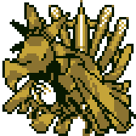</a> <a href="view/pokedex/250_PAGOLDIA.md">250 PAGOLDIA</a> SATANIC · MECHANIC</td><td align="center" valign="bottom"> <a href="view/pokedex/251_CEREBRI.md">251 CEREBRI</a> NEURAL · DRUGS</td><td align="center" valign="bottom"> <a href="view/pokedex/201_PARATYPE_A.md">PARATYPE ABC</a> NEURAL</td><td align="center" valign="bottom"> <a href="view/pokedex/201_PARATYPE_D.md">PARATYPE DEFGHI</a> NEURAL</td></tr><tr><td align="center" valign="bottom"> <a href="view/pokedex/201_PARATYPE_J.md">PARATYPE JKLMNO</a> NEURAL</td><td align="center" valign="bottom"> <a href="view/pokedex/201_PARATYPE_P.md">PARATYPE PQRSTU</a> NEURAL</td><td align="center" valign="bottom"> <a href="view/pokedex/201_PARATYPE_V.md">PARATYPE V</a> NEURAL</td><td align="center" valign="bottom"><a href="view/pokedex/201_PARATYPE_W.md">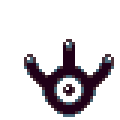</a> <a href="view/pokedex/201_PARATYPE_W.md">PARATYPE W</a> NEURAL</td></tr><tr><td align="center" valign="bottom"> <a href="view/pokedex/201_PARATYPE_X.md">PARATYPE X</a> NEURAL</td><td align="center" valign="bottom"> <a href="view/pokedex/201_PARATYPE_Y.md">PARATYPE Y</a> NEURAL</td><td align="center" valign="bottom"> <a href="view/pokedex/201_PARATYPE_Z.md">PARATYPE Z</a> NEURAL</td><td align="center" valign="bottom">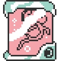 EGG</td></tr></table>

 

## Characters

<table><tr><td align="center" valign="top"> <a href="view/characters/characters-battle.md">Characters (Battle)</a> <a href="characters/characters-battle.png">1×</a></td><td align="center" valign="top"><a href="view/characters/characters-overworld.md">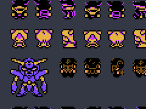</a> <a href="view/characters/characters-overworld.md">Characters (Overworld)</a> <a href="characters/characters-overworld.png">1×</a></td><td align="center" valign="top"><a href="view/trainers.md">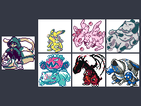</a> <a href="view/trainers.md">Trainer teams</a> <a href="data/trainers.json">JSON</a></td></tr></table>

 

## Trainers

<table>
<tr><td align="center" valign="bottom"><a href="view/trainers.md#01-eric-dylan">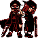 ERIC&amp;DYLAN</a></td><td align="center" valign="bottom"><a href="view/trainers.md#02-inmate">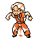 INMATE (AILEEN)</a></td><td align="center" valign="bottom"><a href="view/trainers.md#03-inmate">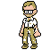 INMATE (JEFFREY)</a></td><td align="center" valign="bottom"><a href="view/trainers.md#04-cult-leader"> CULT LEADER</a></td></tr>
<tr><td align="center" valign="bottom"><a href="view/trainers.md#05-u-n-a">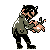 U.N.A.</a></td><td align="center" valign="bottom"><a href="view/trainers.md#06-jihadist">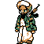 JIHADIST</a></td><td align="center" valign="bottom"><a href="view/trainers.md#07-pogo-clown"> POGO CLOWN</a></td><td align="center" valign="bottom"><a href="view/trainers.md#08-pope">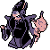 POPE</a></td></tr>
<tr><td align="center" valign="bottom"><a href="view/trainers.md#09-noia-agent"> NOIA AGENT</a></td><td align="center" valign="bottom"><a href="view/trainers.md#10-pokemon-prof">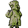 POKéMON PROF.</a></td><td align="center" valign="bottom"><a href="view/trainers.md#11-digital">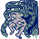 DIGITAL世界</a></td><td align="center" valign="bottom"><a href="view/trainers.md#12-pkmn-trainer">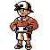 PKMN TRAINER</a></td></tr>
<tr><td align="center" valign="bottom"><a href="view/trainers.md#13-elite-four"> ELITE FOUR (BRUNO)</a></td><td align="center" valign="bottom"><a href="view/trainers.md#14-elite-four"> ELITE FOUR (KAREN)</a></td><td align="center" valign="bottom"><a href="view/trainers.md#15-elite-four"> ELITE FOUR (KOGA)</a></td><td align="center" valign="bottom"><a href="view/trainers.md#16-pure-math"> PURE MATH</a></td></tr>
<tr><td align="center" valign="bottom"><a href="view/trainers.md#17-leader"> LEADER (BROCK)</a></td><td align="center" valign="bottom"><a href="view/trainers.md#18-leader"> LEADER (MISTY)</a></td><td align="center" valign="bottom"><a href="view/trainers.md#19-leader"> LEADER (LT.SURGE)</a></td><td align="center" valign="bottom"><a href="view/trainers.md#20-scientist"> SCIENTIST</a></td></tr>
<tr><td align="center" valign="bottom"><a href="view/trainers.md#21-leader"> LEADER (ERIKA)</a></td><td align="center" valign="bottom"><a href="view/trainers.md#22-menino-d-rua"> MENINO D RUA</a></td><td align="center" valign="bottom"><a href="view/trainers.md#23-gooner"> GOONER</a></td><td align="center" valign="bottom"><a href="view/trainers.md#24-mass-shooter"> MASS SHOOTER</a></td></tr>
<tr><td align="center" valign="bottom"><a href="view/trainers.md#25-femboy"> FEMBOY</a></td><td align="center" valign="bottom"><a href="view/trainers.md#26-leader"> LEADER (JANINE)</a></td><td align="center" valign="bottom"><a href="view/trainers.md#27-cooltrainer"> COOLTRAINER (NICK, AARON, …)</a></td><td align="center" valign="bottom"><a href="view/trainers.md#28-cooltrainer"> COOLTRAINER (GWEN, LOIS, …)</a></td></tr>
<tr><td align="center" valign="bottom"><a href="view/trainers.md#29-e-girl"> E-GIRL</a></td><td align="center" valign="bottom"><a href="view/trainers.md#30-fentanyl"> FENTANYL</a></td><td align="center" valign="bottom"><a href="view/trainers.md#31-plaguecorp"> PLAGUEcorp.</a></td><td align="center" valign="bottom"><a href="view/trainers.md#32-reptilian"> REPTILIAN</a></td></tr>
<tr><td align="center" valign="bottom"><a href="view/trainers.md#33-skier"> SKIER</a></td><td align="center" valign="bottom"><a href="view/trainers.md#34-teacher"> TEACHER</a></td><td align="center" valign="bottom"><a href="view/trainers.md#35-leader"> LEADER (SABRINA)</a></td><td align="center" valign="bottom"><a href="view/trainers.md#36-maranza"> MARANZA</a></td></tr>
<tr><td align="center" valign="bottom"><a href="view/trainers.md#37-fisher"> FISHER</a></td><td align="center" valign="bottom"><a href="view/trainers.md#38-human"> HUMAN</a></td><td align="center" valign="bottom"><a href="view/trainers.md#39-swimmer"> SWIMMER♀</a></td><td align="center" valign="bottom"><a href="view/trainers.md#40-prisoner"> PRISONER</a></td></tr>
<tr><td align="center" valign="bottom"><a href="view/trainers.md#41-obscure"> OBSCURE</a></td><td align="center" valign="bottom"><a href="view/trainers.md#42-rival"> RIVAL</a></td><td align="center" valign="bottom"><a href="view/trainers.md#43-guitarist"> GUITARIST</a></td><td align="center" valign="bottom"><a href="view/trainers.md#44-pest-control"> PEST CONTROL</a></td></tr>
<tr><td align="center" valign="bottom"><a href="view/trainers.md#45-biker"> BIKER</a></td><td align="center" valign="bottom"><a href="view/trainers.md#46-leader"> LEADER (BLAINE)</a></td><td align="center" valign="bottom"><a href="view/trainers.md#47-juggalo"> JUGGALO</a></td><td align="center" valign="bottom"><a href="view/trainers.md#48-punkabbestia"> PUNKABBESTIA</a></td></tr>
<tr><td align="center" valign="bottom"><a href="view/trainers.md#49-stupid-hippy"> STUPID HIPPY</a></td><td align="center" valign="bottom"><a href="view/trainers.md#50-yakuza"> YAKUZA</a></td><td align="center" valign="bottom"><a href="view/trainers.md#51-rocket"> ROCKET (EXECUTIVE)</a></td><td align="center" valign="bottom"><a href="view/trainers.md#52-conspiracy"> CONSPIRACY</a></td></tr>
<tr><td align="center" valign="bottom"><a href="view/trainers.md#53-car-struck"> CAR STRUCK</a></td><td align="center" valign="bottom"><a href="view/trainers.md#54-romani-gipsy"> ROMANI GIPSY</a></td><td align="center" valign="bottom"><a href="view/trainers.md#55-rocket"> ROCKET (EXECUTIVE, Radio Tower 5F)</a></td><td align="center" valign="bottom"><a href="view/trainers.md#56-sage"> SAGE</a></td></tr>
<tr><td align="center" valign="bottom"><a href="view/trainers.md#57-cultist"> CULTIST</a></td><td align="center" valign="bottom"><a href="view/trainers.md#58-boarder"> BOARDER</a></td><td align="center" valign="bottom"><a href="view/trainers.md#59-pedophile"> PEDOPHILE (WILLIAM, DEREK, …)</a></td><td align="center" valign="bottom"><a href="view/trainers.md#60-synthetic"> SYNTHETIC</a></td></tr>
<tr><td align="center" valign="bottom"><a href="view/trainers.md#61-lesbian-nuns"> LESBIAN NUNS</a></td><td align="center" valign="bottom"><a href="view/trainers.md#62-pedophile"> PEDOPHILE (BEVERLY, RUTH, …)</a></td><td align="center" valign="bottom"><a href="view/trainers.md#63-author"> AUTHOR神</a></td><td align="center" valign="bottom"><a href="view/trainers.md#64-leader"> LEADER (BLUE)</a></td></tr>
<tr><td align="center" valign="bottom"><a href="view/trainers.md#65-officer"> OFFICER</a></td><td align="center" valign="bottom"><a href="view/trainers.md#66-rocket"> ROCKET (POLICE)</a></td><td align="center" valign="bottom"><a href="view/trainers.md#67-mysticalman"> MYSTICALMAN</a></td></tr>
</table>

Show all 542 trainer teams

| Class | Trainer | Team | Location |
|---|---|---|---|
| ERIC&amp;DYLAN | 18/17y | CIKKAN Lv7, UBERBIRO Lv9 | Nostalgothia Gym |
| INMATE (AILEEN) | AILEEN | OVARIAN Lv18, INTENSIVO Lv20 | Metro Complex Gym |
| INMATE (JEFFREY) | JEFFREY | MUTAPUD Lv14, KAKUZI Lv14, HANZORU Lv16 | Los Aura Gym |
| CULT LEADER | SHOKO | GOSBAMP Lv21, WRAITARL Lv21, TREROR Lv25, WRAITARL Lv23 | Suburbia Gym |
| U.N.A. | BOMBER | MEGADIL Lv27, MEGADIL500 Lv29, PILOSWINE Lv31 | Lonely Woods Gym |
| JIHADIST | OSAMA | GHOSHELLO Lv30, GHOSHELLO Lv30, HYDRAGYRUM Lv35 | Government Gym |
| POGO CLOWN | GACY | NAGASAK Lv27, SMEGMATIC Lv30 | Oversea Asylum Gym |
| POPE | PLARIO | SERAPHIUM Lv37, SERAPHIUM Lv37, SERAPHIUM Lv37, LUCIFERION Lv40 | Peak of Dread Gym 1F |
| NOIA AGENT | ? | STRAMONIUM Lv5 | Nearbytown |
| NOIA AGENT | ? | SCARFITO Lv5 | Nearbytown |
| NOIA AGENT | ? | BONDILE Lv5 | Nearbytown |
| NOIA AGENT | ? | GOSBAMP Lv12, GOTCHICK Lv14, DIVINORUM Lv16 | Los Aura |
| NOIA AGENT | ? | GOSBAMP Lv12, GOTCHICK Lv14, CRUXADO Lv16 | Los Aura |
| NOIA AGENT | ? | GOSBAMP Lv12, GOTCHICK Lv14, GAGOGO Lv16 | Los Aura |
| NOIA AGENT | ? | WRAITARL Lv20, GHOSHELLO Lv18, GOTCHICK Lv20, DIVINORUM Lv22 | Burned Tower 1F |
| NOIA AGENT | ? | WRAITARL Lv20, GHOSHELLO Lv18, GOTCHICK Lv20, CRUXADO Lv22 | Burned Tower 1F |
| NOIA AGENT | ? | WRAITARL Lv20, GHOSHELLO Lv18, GOTCHICK Lv20, GAGOGO Lv22 | Burned Tower 1F |
| NOIA AGENT | ? | VAMPESSA Lv30, GHOSHELLO Lv28, WRAITARL Lv30, KUNOIGA Lv32, AYAHUASCO Lv32 | Metro Complex |
| NOIA AGENT | ? | VAMPESSA Lv30, GHOSHELLO Lv28, WRAITARL Lv30, KUNOIGA Lv32, CRUXADO Lv32 | Metro Complex |
| NOIA AGENT | ? | VAMPESSA Lv30, GHOSHELLO Lv28, WRAITARL Lv30, KUNOIGA Lv32, CROCOSNUFF Lv32 | Metro Complex |
| NOIA AGENT | ? | KUNOIGA Lv34, VAMPESSA Lv36, SORAYAMBOT Lv35, WRAITARL Lv35, PROFETUS Lv35, AYAHUASCO Lv38 | Victory Road |
| NOIA AGENT | ? | KUNOIGA Lv34, VAMPESSA Lv36, SORAYAMBOT Lv35, WRAITARL Lv35, PROFETUS Lv35, INFERNATUS Lv38 | Victory Road |
| NOIA AGENT | ? | KUNOIGA Lv34, VAMPESSA Lv36, SORAYAMBOT Lv34, WRAITARL Lv35, PROFETUS Lv35, CROCOSNUFF Lv38 | Victory Road |
| POKéMON PROF. | GATE | QUELZALCOT Lv40, JYZZO Lv41, MASKABUKI Lv41, KORNUPIAK Lv41, QUELZALCOT Lv42 |  |
| DIGITAL世界 | GATE | QUELZALCOT Lv40, JYZZO Lv41, MASKABUKI Lv41, KORNUPIAK Lv41, QUELZALCOT Lv42 | Indigo Plateau |
| PKMN TRAINER | CAL | STRAMONIUM Lv10, SCARFITO Lv10, BONDILE Lv10 |  |
| PKMN TRAINER | CAL | DIVINORUM Lv30, CRUXADO Lv30, GAGOGO Lv30 | Viridian City B1F |
| PKMN TRAINER | CAL | AYAHUASCO Lv50, INFERNATUS Lv50, CROCOSNUFF Lv50 | Viridian City B1F |
| ELITE FOUR (BRUNO) | BRUNO | JUTSUFAITA Lv42, THAIFAITA Lv42, MIKEFAITA Lv42, OBSIDIAN Lv43, KONGORISH Lv46 | Indigo Plateau |
| ELITE FOUR (KAREN) | KAREN | DAMNATEON Lv42, LARSENEF Lv42, TREROR Lv45, SKARKROW Lv44, HOUNDOOM Lv47 | Indigo Plateau |
| ELITE FOUR (KOGA) | KOGA | NAZITANK Lv40, CHORDYCEPS Lv41, /NEURONET Lv43, KUMORAH Lv42, TRIZOM Lv44 | Indigo Plateau |
| PURE MATH | □□3cos(□ | HANNYADOS Lv44, CHILONGO Lv47, CHILONGO Lv47, PTEROXIS Lv46, LUCIFERION Lv46, CHILONGO Lv50 | Indigo Plateau |
| LEADER (BROCK) | BROCK | PLUTONIUM Lv41, ELICORPS Lv41, MECHANIGAL Lv42, OBSIDIAN Lv44, ZILOSNAK Lv42 | Pewter City Gym |
| LEADER (MISTY) | MISTY | DUKAKIS Lv42, ASPHYXIAR Lv42, KARONTIS Lv44, IRUKUNJI Lv47 | Cerulean City Gym |
| LEADER (LT.SURGE) | LT.SURGE | RAICHEWEDZ Lv44, NINGOGORE Lv40, SORAYAMBOT Lv40, NINGOGORE Lv40, VOLCUTION Lv46 | Vermilion City Gym |
| SCIENTIST | ROSS | SARSARAS Lv22, SARSARAS Lv22 | Lonely Woods B3F |
| SCIENTIST | MITCH | SHITTO Lv24 | Lonely Woods B3F |
| SCIENTIST | JED | GHOSHELLO Lv20, GHOSHELLO Lv20, GHOSHELLO Lv20 | Lonely Woods B1F |
| SCIENTIST | MARC | GHOSHELLO Lv27, GHOSHELLO Lv27, GHOSHELLO Lv27 | Radio Tower 3F |
| SCIENTIST | RICH | TERMINALIX Lv30 | Radio Tower 4F |
| LEADER (ERIKA) | ERIKA | WORMICELLI Lv42, ITTIOSO Lv41, NORIMBERGU Lv46, MANDELBRO Lv46 | Celadon City Gym |
| MENINO D RUA | 12y | FOGNUS Lv4 | Area 30 |
| MENINO D RUA | 13y | CIKKAN Lv2, FOGNUS Lv4 | Area 30 |
| MENINO D RUA | ALBERT | FOGNUS Lv6, GOTCHICK Lv8 | Area 32 |
| MENINO D RUA | GORDON | KOTZWAR Lv10 | Area 32 |
| MENINO D RUA | SAMUEL | FOGNUS Lv7, PAPYRYU Lv10, SBLARFO Lv8, SBLARFO Lv8 | Area 34 |
| MENINO D RUA | IAN | HIROOSH Lv10, KAZETTO Lv12 | Area 34 |
| MENINO D RUA | JOEY | FOGNUS Lv15 | Area 30 |
| MENINO D RUA | JOEY | RATOZZO Lv21 | Area 30 |
| MENINO D RUA | WARREN | SGLARFO Lv35 | Area 3 |
| MENINO D RUA | JIMMY | RATOZZO Lv33, URBOROK Lv33 | Area 3 |
| MENINO D RUA | OWEN | SCRATCHY Lv35 | Area 11 |
| MENINO D RUA | JASON | SPHINXO Lv33, TRIZOM Lv33 | Area 11 |
| MENINO D RUA | JOEY | RATOZZO Lv30 | Area 30 |
| MENINO D RUA | JOEY | RATOZZO Lv37 | Area 30 |
| GOONER | JACK | ODDGLITCH Lv12, KOWARENING Lv15 | National Park |
| GOONER | KIPP | KOWARENING Lv27, GHOSHELLO Lv27, KOWARENING Lv31, SORAYAMBOT Lv31 | Area 15 |
| GOONER | ALAN | WORMICELLI Lv16 | Area 36 |
| GOONER | JOHNNY | PILLORYD Lv29, GUILTYOTIN Lv31, NORIMBERGU Lv33 | Area 15 |
| GOONER | DANNY | JYZZO Lv31, VOLCUTION Lv31, BURNAR Lv31 | Area 1 |
| GOONER | TOMMY | QUELZALCOT Lv32, MARTIRUS Lv34 | Area 15 |
| GOONER | DUDLEY | ODDGLITCH Lv35 | Area 25 |
| GOONER | JOE | WORMICELLI Lv33, VENEREON Lv33 | Area 25 |
| GOONER | BILLY | PARASITO Lv27, PARASITO Lv27, PROLIFIK Lv27, SHITTO Lv35 | Area 15 |
| GOONER | CHAD | MR.SHADOW Lv19 | Area 38 |
| GOONER | NATE | FACISTA Lv32, MASKABUKI Lv32 | Fast Ship B1F |
| GOONER | RICKY | MOLESTO Lv32, SHITTO Lv32 | Fast Ship B1F |
| GOONER | JACK | ODDGLITCH Lv14, KOWARENING Lv17 | National Park |
| GOONER | JACK | INFECTO Lv28, NINGOGORE Lv31 | National Park |
| GOONER | ALAN | WORMICELLI Lv17, NAPALMYAN Lv17 | Area 36 |
| GOONER | ALAN | SACRILUT Lv20, WORMICELLI Lv22, ASPHYXIAR Lv20, NAPALMYAN Lv25 | Area 36 |
| GOONER | CHAD | MR.SHADOW Lv19, GHOSHELLO Lv19 | Area 38 |
| GOONER | CHAD | MR.SHADOW Lv27, SORAYAMBOT Lv31 | Area 38 |
| GOONER | JACK | INFECTO Lv30, SCRATCHY Lv33, NINGOGORE Lv33 | National Park |
| GOONER | JACK | NINGOGORE Lv35, SCRATCHY Lv35, LARSENEF Lv37 | National Park |
| GOONER | ALAN | SACRILUT Lv27, WORMICELLI Lv27, ASPHYXIAR Lv30, NAPALMYAN Lv30 | Area 36 |
| GOONER | ALAN | QUELZALCOT Lv35, WORMICELLI Lv32, NAPALMYAN Lv32, ASPHYXIAR Lv35 | Area 36 |
| GOONER | CHAD | MR.SHADOW Lv30, SORAYAMBOT Lv34 | Area 38 |
| GOONER | CHAD | MR.SHADOW Lv34, SORAYAMBOT Lv38 | Area 38 |
| MASS SHOOTER | INCEL | CIKKAN Lv7, CIKKAN Lv7 | Nostalgothia Gym |
| MASS SHOOTER | INCEL | SBLARFO Lv9 | Nostalgothia Gym |
| MASS SHOOTER | INCEL | CIKKAN Lv12, UBERBIRO Lv14 | Area 35 |
| MASS SHOOTER | INCEL | CIKKAN Lv17, CIKKAN Lv15, CIKKAN Lv19, CIKKAN Lv15, CIKKAN Lv15 | Pentafloor 3F |
| MASS SHOOTER | INCEL | BIPOLARIO Lv15, BIPOLARIO Lv16, BIPOLARIO Lv17 | Area 38 |
| MASS SHOOTER | INCEL | SBLARFO Lv18, SGLARFO Lv20, SBLARFO Lv18 | Pentafloor 5F |
| MASS SHOOTER | INCEL | UBERBIRO Lv25, UBERBIRO Lv25 | Area 44 |
| MASS SHOOTER | PTSD | CIKKAN Lv12, HEPOCORPS Lv34 | Area 4 |
| MASS SHOOTER | PTSD | SGLARFO Lv29, SGLARFO Lv35 | Area 14 |
| MASS SHOOTER | PTSD | BIPOLARIO Lv30, BIPOLARIO Lv28, PSICOTO Lv32 | Area 18 |
| MASS SHOOTER | PTSD | ROBBINOWL Lv34 | Area 18 |
| MASS SHOOTER | PTSD | BONDAGEDOG Lv36 | Area 27 |
| MASS SHOOTER | INCEL | CIKKAN Lv6, CIKKAN Lv6, SBLARFO Lv8 | Area 32 |
| MASS SHOOTER | PTSD | BONDAGEDOG Lv34 | Area 27 |
| MASS SHOOTER | PTSD | BONDAGEDOG Lv34 | Area 13 |
| MASS SHOOTER | PTSD | UBERBIRO Lv32, SGLARFO Lv32 | Area 13 |
| MASS SHOOTER | PTSD | BONDAGEDOG Lv40 | Area 27 |
| MASS SHOOTER | PTSD | UBERBIRO Lv32, UBERBIRO Lv32 | Area 44 |
| MASS SHOOTER | PTSD | HEPOCORPS Lv38, HEPOCORPS Lv38 | Area 44 |
| FEMBOY | CARRIE | BLEKHOLIA Lv18 | Metro Complex Gym |
| FEMBOY | BRIDGET | EYEBALLY Lv15, EYEBALLY Lv15, EYEBALLY Lv15 | Metro Complex Gym |
| FEMBOY | ALICE | INFECTO Lv30, URBOROK Lv34, INFECTO Lv30 | Fuchsia City Gym |
| FEMBOY | KRISE | ODDGLITCH Lv12, RIOTTO Lv15 | National Park |
| FEMBOY | CONNIE | HALUAL Lv21 | Pentafloor 4F |
| FEMBOY | LINDA | WEEDAZOR Lv30, COCAZOR Lv32, OPIUMZOR Lv34 | Fuchsia City Gym |
| FEMBOY | LAURA | INFECTO Lv28, UBERBIRO Lv31, MANDELBRO Lv31 | Area 25 |
| FEMBOY | SHANNON | PARASITO Lv29, PARASITO Lv29, PSILOCYBO Lv32 | Area 25 |
| FEMBOY | MICHELLE | INCUBATO Lv32, ABORTITO Lv33, ITTIOSO Lv34 | Celadon City Gym |
| FEMBOY | DANA | ALGOCRAT Lv18, WORMACK Lv18 | Area 38 |
| FEMBOY | ELLEN | KAWAIKAGO Lv30, GALAXIAN Lv34 | Area 25 |
| FEMBOY | CONNIE | HALUAL Lv21 |  |
| FEMBOY | CONNIE | HALUAL Lv21 |  |
| FEMBOY | DANA | ALGOCRAT Lv21, WORMACK Lv21 | Area 38 |
| FEMBOY | DANA | WORMACK Lv29, DICTAITOR Lv29 | Area 38 |
| FEMBOY | DANA | WORMACK Lv32, DICTAITOR Lv32 | Area 38 |
| FEMBOY | DANA | DICTAITOR Lv36, DUKAKIS Lv36 | Area 38 |
| LEADER (JANINE) | JANINE | TRIZOM Lv36, LUNGANSER Lv36, LUNGANSER Lv36, NAZITANK Lv33, CHORDYCEPS Lv39 | Fuchsia City Gym |
| COOLTRAINER (NICK, AARON, …) | NICK | CHARMHELL Lv26, SCOLINA Lv26, WEEDAZOR Lv26 | Union Cave B2F |
| COOLTRAINER (NICK, AARON, …) | AARON | COCAZOR Lv24, BELIALEON Lv24, SCOLANO Lv24 | Source of Plasma |
| COOLTRAINER (NICK, AARON, …) | PAUL | CHERUBIUM Lv34, CHERUBIUM Lv34, CHERUBIUM Lv34 | Peak of Dread Gym 1F |
| COOLTRAINER (NICK, AARON, …) | CODY | COCKY Lv34, SCROTRA Lv36 | Peak of Dread Gym 2F |
| COOLTRAINER (NICK, AARON, …) | MIKE | SERAPHIUM Lv37 | Peak of Dread Gym 1F |
| COOLTRAINER (NICK, AARON, …) | GAVEN | NORIMBERGU Lv35, NUKEBARL Lv35, CERBERION Lv35 | Area 26 |
| COOLTRAINER (NICK, AARON, …) | GAVEN | NORIMBERGU Lv39, NUKEBARL Lv39, CERBERION Lv39 | Area 26 |
| COOLTRAINER (NICK, AARON, …) | RYAN | HEPOCORPS Lv25, VOLCUTION Lv27 | Area 45 |
| COOLTRAINER (NICK, AARON, …) | JAKE | PSILOCYBO Lv33, DUKAKIS Lv35 | Area 26 |
| COOLTRAINER (NICK, AARON, …) | GAVEN | NORIMBERGU Lv32, NUKEBARL Lv32, CERBERION Lv32 | Area 26 |
| COOLTRAINER (NICK, AARON, …) | BLAKE | SORAYAMBOT Lv33, ASPHYXIAR Lv31, DARUMORT Lv31 | Area 27 |
| COOLTRAINER (NICK, AARON, …) | BRIAN | SPHINXO Lv35 | Area 27 |
| COOLTRAINER (NICK, AARON, …) | ERICK | WEEDAZOR Lv10, CHARMHELL Lv10, SCOLINA Lv10 |  |
| COOLTRAINER (NICK, AARON, …) | ANDY | WEEDAZOR Lv10, CHARMHELL Lv10, SCOLINA Lv10 |  |
| COOLTRAINER (NICK, AARON, …) | TYLER | WEEDAZOR Lv10, CHARMHELL Lv10, SCOLINA Lv10 |  |
| COOLTRAINER (NICK, AARON, …) | SEAN | CERBERION Lv35, WORMICELLI Lv35, DIGESTOR Lv35 | Fast Ship |
| COOLTRAINER (NICK, AARON, …) | KEVIN | ELICORPS Lv38, BELIALEON Lv35, SCOLANO Lv35 | Area 25 |
| COOLTRAINER (NICK, AARON, …) | STEVE | WEEDAZOR Lv14, CHARMHELL Lv14, SCOLINA Lv14 |  |
| COOLTRAINER (NICK, AARON, …) | ALLEN | BELIALEON Lv27 | Area 44 |
| COOLTRAINER (NICK, AARON, …) | DARIN | SERAPHIUM Lv37 | Dragon's Den B1F |
| COOLTRAINER (GWEN, LOIS, …) | GWEN | DEADDOG Lv26, CERBERION Lv22, VENEREON Lv22, NUKENION Lv22 | Union Cave B2F |
| COOLTRAINER (GWEN, LOIS, …) | LOIS | INCUBATO Lv25, KITSUNAIL Lv25 | Source of Plasma |
| COOLTRAINER (GWEN, LOIS, …) | FRAN | SCROTRA Lv37 | Peak of Dread Gym 2F |
| COOLTRAINER (GWEN, LOIS, …) | LOLA | CHERUBIUM Lv34, SERAPHIUM Lv36 | Peak of Dread Gym 1F |
| COOLTRAINER (GWEN, LOIS, …) | KATE | SHELLDER Lv26, VAGINDAM Lv28 | Area 34 |
| COOLTRAINER (GWEN, LOIS, …) | IRENE | BLINKY Lv22, HOGEROT Lv24 | Area 34 |
| COOLTRAINER (GWEN, LOIS, …) | KELLY | HALUAL Lv27, SCOLANO Lv24, SCOLANO Lv24 | Area 45 |
| COOLTRAINER (GWEN, LOIS, …) | JOYCE | PIKACHEWED Lv36, SCOLENE Lv32 | Area 26 |
| COOLTRAINER (GWEN, LOIS, …) | BETH | FAXHIRO Lv36 | Area 26 |
| COOLTRAINER (GWEN, LOIS, …) | REENA | IRUKUNJI Lv31, KALEDENDS Lv33, IRUKUNJI Lv31 | Area 27 |
| COOLTRAINER (GWEN, LOIS, …) | MEGAN | WEEDAZOR Lv32, COCAZOR Lv32, OPIUMZOR Lv32 | Area 27 |
| COOLTRAINER (GWEN, LOIS, …) | BETH | FAXHIRO Lv39 | Area 26 |
| COOLTRAINER (GWEN, LOIS, …) | CAROL | NINGOGORE Lv35, IRUKUNJI Lv35, KITSUNAIL Lv35 | Fast Ship |
| COOLTRAINER (GWEN, LOIS, …) | QUINN | COCAZOR Lv38, IRUKUNJI Lv38 | Area 1 |
| COOLTRAINER (GWEN, LOIS, …) | EMMA | PROLIFIK Lv28 | Union Cave B2F |
| COOLTRAINER (GWEN, LOIS, …) | CYBIL | MONASIGHT Lv25, MANDELBRO Lv25 | Area 44 |
| COOLTRAINER (GWEN, LOIS, …) | JENN | MALOKINGI Lv24, IRUKUNJI Lv26 | Area 34 |
| COOLTRAINER (GWEN, LOIS, …) | BETH | FAXHIRO Lv43 | Area 26 |
| COOLTRAINER (GWEN, LOIS, …) | REENA | IRUKUNJI Lv34, KALEDENDS Lv36, IRUKUNJI Lv34 | Area 27 |
| COOLTRAINER (GWEN, LOIS, …) | REENA | IRUKUNJI Lv38, KALEDENDS Lv40, IRUKUNJI Lv38 | Area 27 |
| COOLTRAINER (GWEN, LOIS, …) | CARA | COCKY Lv33, COCKY Lv33, SCROTRA Lv35 | Dragon's Den B1F |
| E-GIRL | VICTORIA | BURQO Lv9, BURQO Lv13, BURQO Lv17 | Metro Complex Gym |
| E-GIRL | SAMANTHA | NIGGA Lv16, NIGGA Lv16 | Metro Complex Gym |
| E-GIRL | JULIE | BURQO Lv15 |  |
| E-GIRL | JACLYN | BURQO Lv15 |  |
| E-GIRL | BRENDA | JIHADO Lv16 |  |
| E-GIRL | CASSIE | LARSENEF Lv28, MONASIGHT Lv34 | Fast Ship |
| E-GIRL | CAROLINE | HALUAL Lv30, MEGADIL Lv32, HALUAL Lv30 |  |
| E-GIRL | CARLENE | BURQO Lv15 |  |
| E-GIRL | JESSICA | BURQO Lv15 |  |
| E-GIRL | RACHAEL | BURQO Lv15 |  |
| E-GIRL | ANGELICA | BURQO Lv15 |  |
| E-GIRL | KENDRA | BURQO Lv15 |  |
| E-GIRL | VERONICA | BURQO Lv15 |  |
| E-GIRL | JULIA | PARASITO Lv32, DARUMORT Lv32, PSILOCYBO Lv35 | Celadon City Gym |
| E-GIRL | THERESA | BURQO Lv15 |  |
| E-GIRL | VALERIE | ABORTITO Lv17, INCUBATO Lv17 | Area 38 |
| E-GIRL | OLIVIA | NEURAPSYS Lv19 | Area 38 |
| FENTANYL | 0.02 mg | SLOWGHOST Lv10 | Union Cave 1F |
| FENTANYL | 0.08 mg | TERORISTO Lv24, TERORISTO Lv24 | Union Cave B1F |
| FENTANYL | 0.1 mg | HELLTECH Lv26 | Union Cave B1F |
| FENTANYL | 0.02 mg | HANDA Lv16, GRABOIDO Lv16 | Area 42 |
| FENTANYL | 0.02 mg | KORNUPIAK Lv19 | Area 43 |
| FENTANYL | 0.02 mg | PUKALOT Lv19 | Area 43 |
| FENTANYL | 0.02 mg | KESARUS Lv19 | Area 43 |
| FENTANYL | 0.1 mg | ELICORPS Lv31, MEDUCUNT Lv31 | Fast Ship |
| FENTANYL | 0.1 mg | HELLTECH Lv25 | Area 43 |
| FENTANYL | 0.3 mg | TERMINALIX Lv36 | Area 43 |
| FENTANYL | 0.1 mg | PUKALOT Lv12 | Metro Complex |
| FENTANYL | 0.02 mg | SLOWGHOST Lv10, SLOWGHOST Lv10 | Metro Complex |
| FENTANYL | 0.1 mg | ELICORPS Lv27 | Area 44 |
| FENTANYL | 1 mg | PREGNANTA Lv41 | Area 43 |
| FENTANYL | 0.1 mg | KESARUS Lv17, KALEDENDS Lv17 | Mt.Mortar 1F |
| PLAGUEcorp. | POLICE | SARSARAS Lv14 | Slowpoke Well B1F |
| PLAGUEcorp. | POLICE | FOGNUS Lv7, GOTCHICK Lv9, GOTCHICK Lv9 | Slowpoke Well B1F |
| PLAGUEcorp. | POLICE | RATOZZO Lv24, RATOZZO Lv24 | Radio Tower 1F |
| PLAGUEcorp. | POLICE | GRINDED Lv23, GRINDED Lv23, KUMORAH Lv25 | Radio Tower 2F |
| PLAGUEcorp. | POLICE | FOGNUS Lv21, FOGNUS Lv21, FOGNUS Lv23, FOGNUS Lv23, FOGNUS Lv23 | Radio Tower 2F |
| PLAGUEcorp. | POLICE | GOTCHICK Lv26, GOTCHICK Lv26 | Radio Tower 2F |
| PLAGUEcorp. | POLICE | SARSARAS Lv23, GRINDED Lv23, GOTCHICK Lv23, FOGNUS Lv23 | Radio Tower 3F |
| PLAGUEcorp. | POLICE | LUNGANSER Lv26 | Radio Tower 3F |
| PLAGUEcorp. | POLICE | RATOZZO Lv24, SARSARAS Lv26 | Radio Tower 3F |
| PLAGUEcorp. | POLICE | GOTCHICK Lv22, VAMPESSA Lv24, GRINDED Lv22 | Radio Tower 4F |
| PLAGUEcorp. | POLICE | KUMORAH Lv23, SARSARAS Lv23, FOGNUS Lv25 | Metro Complex |
| PLAGUEcorp. | EXECUTIVE | HOUNDOUR Lv33 |  |
| PLAGUEcorp. | POLICE | FOGNUS Lv27 | Metro Complex |
| PLAGUEcorp. | POLICE | RATOZZO Lv24, VAMPESSA Lv24 | Metro Complex |
| PLAGUEcorp. | POLICE | GRINDED Lv26, LUNGANSER Lv23 | Metro Complex |
| PLAGUEcorp. | POLICE | FOGNUS Lv16, FOGNUS Lv16, FOGNUS Lv16, FOGNUS Lv16 | Lonely Woods B1F |
| PLAGUEcorp. | POLICE | VAMPESSA Lv18 | Lonely Woods B2F |
| PLAGUEcorp. | POLICE | FOGNUS Lv17, GOTCHICK Lv17, FOGNUS Lv17 | Lonely Woods B2F |
| PLAGUEcorp. | POLICE | GNAKGNAK Lv18, GNAKGNAK Lv18 | Lonely Woods B2F |
| PLAGUEcorp. | POLICE | DUPUPETT Lv17, GOTCHICK Lv19 | Lonely Woods B1F |
| PLAGUEcorp. | POLICE | GOTCHICK Lv16, GRINDED Lv17, FOGNUS Lv18 | Lonely Woods B1F |
| PLAGUEcorp. | EXECUTIVE | VAMPESSA Lv36 |  |
| PLAGUEcorp. | EXECUTIVE | SARSARAS Lv30 |  |
| PLAGUEcorp. | POLICE | SARSARAS Lv25, SARSARAS Lv25 | Metro Complex |
| PLAGUEcorp. | POLICE | SARSARAS Lv24, KUMORAH Lv24 | Metro Complex |
| PLAGUEcorp. | POLICE | FOGNUS Lv15, FOGNUS Lv15 |  |
| PLAGUEcorp. | EXECUTIVE | GOTCHICK Lv22 |  |
| PLAGUEcorp. | POLICE | RATOZZO Lv19 | Lonely Woods B3F |
| PLAGUEcorp. | POLICE | FOGNUS Lv9, FOGNUS Lv9 | Slowpoke Well B1F |
| PLAGUEcorp. | POLICE | VAMPESSA Lv25, VAMPESSA Lv25, URBOROK Lv30 |  |
| PLAGUEcorp. | POLICE | VAMPESSA Lv30 | Area 24 |
| REPTILIAN | JEW | SCRATCHY Lv18, SCRATCHY Lv18 | Pentafloor 3F |
| REPTILIAN | JEW | TENKA Lv33 | Fast Ship |
| REPTILIAN | JEW | PIKACHEWED Lv37, ALGOCRAT Lv33 | Vermilion City Gym |
| REPTILIAN | JEW | HELLESTO Lv20 |  |
| REPTILIAN | JEW | ROBBINOWL Lv20 | Pentafloor 2F |
| SKIER | ROXANNE | JYZZO Lv28 | Lonely Woods Gym |
| SKIER | CLARISSA | MEGADIL500 Lv28 | Lonely Woods Gym |
| TEACHER | COLETTE | CRISTALIA Lv36 | Area 15 |
| TEACHER | HILLARY | MOLESTO Lv32, RIOTTO Lv36 | Area 15 |
| TEACHER | SHIRLEY | EYEBALLY Lv35 | Fast Ship B1F |
| LEADER (SABRINA) | SABRINA | EMBRYEON Lv46, MR.SHADOW Lv46, MARTIRUS Lv48 | Saffron City Gym |
| MARANZA | AHMED | GUNBAG Lv3, GUNBAG Lv3 | Area 30 |
| MARANZA | MOHAMD | CAMOGATL Lv32, MONASIGHT Lv32 | Area 2 |
| MARANZA | MOHAMD | CAMOGATL Lv30, CAMOGATL Lv30, CAMOGATL Lv30 | Area 2 |
| MARANZA | HABIB | GUNBAG Lv2, GUNBAG Lv2, WERMIX Lv3, GUNBAG Lv2 | Area 31 |
| MARANZA | HABIB | WERMIX Lv7, KAKUZI Lv9, CAMOGATL Lv12 | Los Aura Gym |
| MARANZA | HABIB | GUNBAG Lv12, WERMIX Lv12 | Los Aura Gym |
| MARANZA | KHALED | PARASITO Lv13 | Los Aura Gym |
| MARANZA | MOHAMD | GNAKGNAK Lv15 | Area 35 |
| MARANZA | MOHAMD | NAZITANK Lv30, SHAMABOO Lv32 | Fast Ship |
| MARANZA | MOHAMD | MUTAPUD Lv9, MUTAPUD Lv9, KAKUZI Lv10, MUTAPUD Lv9 | Area 31 |
| MARANZA | KHALED | MONASIGHT Lv14, MONASIGHT Lv14, CAMOGATL Lv15, MONASIGHT Lv14 | Area 31 |
| MARANZA | AZIZ | NAZITANK Lv34 | Area 2 |
| MARANZA | KHALED | GNAKGNAK Lv19 | Area 35 |
| MARANZA | AZIZ | CHORDYCEPS Lv28 | Area 35 |
| MARANZA | AZIZ | MONASIGHT Lv24, MONASIGHT Lv24, CAMOGATL Lv25, MONASIGHT Lv24 | Area 31 |
| MARANZA | AZIZ | MONASIGHT Lv30, MONASIGHT Lv30, CAMOGATL Lv32, MONASIGHT Lv34 | Area 31 |
| MARANZA | AZIZ | CHORDYCEPS Lv36 | Area 35 |
| MARANZA | MARIO | CHORDYCEPS Lv40 | Area 35 |
| MARANZA | HABIB | SBIRETTO Lv8, PARASITO Lv10 | Suicide Forest |
| FISHER | JUSTIN | ROKUJOSHI Lv5, ROKUJOSHI Lv5, ROKUJOSHI Lv15, ROKUJOSHI Lv5 | Area 32 |
| FISHER | RALPH | BLINKY Lv10 | Area 32 |
| FISHER | ARNOLD | HENTAIGORE Lv34 | Area 21 |
| FISHER | KYLE | HOGEROT Lv28, PROLIFIK Lv31, HOGEROT Lv31 | Area 12 |
| FISHER | HENRY | SPERMOTZ Lv8, SPERMOTZ Lv8 | Area 32 |
| FISHER | MARVIN | ROKUJOSHI Lv10, HANNYADOS Lv10, ROKUJOSHI Lv15, HANNYADOS Lv15 | Area 43 |
| FISHER | TULLY | NAVALMINO Lv18 | Area 42 |
| FISHER | ANDRE | HANNYADOS Lv27 | Source of Plasma |
| FISHER | RAYMOND | ROKUJOSHI Lv22, ROKUJOSHI Lv22, ROKUJOSHI Lv22, ROKUJOSHI Lv22 | Source of Plasma |
| FISHER | WILTON | BLINKY Lv23, BLINKY Lv23, HOGEROT Lv25 | Area 44 |
| FISHER | EDGAR | ANIFISH Lv25, ANIFISH Lv25 | Area 44 |
| FISHER | JONAH | SHELLDER Lv25, TOSHIOKI Lv29, ANIFISH Lv25, VAGINDAM Lv29 | Fast Ship B1F |
| FISHER | MARTIN | ANIFISH Lv32, ANIFISH Lv32 | Area 12 |
| FISHER | STEPHEN | ROKUJOSHI Lv25, ROKUJOSHI Lv25, NAVALMINO Lv31, HENTAIGORE Lv31 | Area 12 |
| FISHER | BARNEY | HANNYADOS Lv30, HANNYADOS Lv30, HANNYADOS Lv30 | Area 12 |
| FISHER | RALPH | BLINKY Lv17 | Area 32 |
| FISHER | RALPH | NAVALMINO Lv17, BLINKY Lv19 | Area 32 |
| FISHER | TULLY | NAVALMINO Lv23 | Area 42 |
| FISHER | TULLY | BLINKY Lv32, BLINKY Lv32, NAVALMINO Lv32 | Area 42 |
| FISHER | WILTON | BLINKY Lv29, BLINKY Lv29, HOGEROT Lv32 | Area 44 |
| FISHER | SCOTT | NAVALMINO Lv30, NAVALMINO Lv30, HOGEROT Lv34 | Area 26 |
| FISHER | WILTON | HOGEROT Lv34, HOGEROT Lv34, ANIFISH Lv38 | Area 44 |
| FISHER | RALPH | NAVALMINO Lv30, BLINKY Lv32 | Area 32 |
| FISHER | RALPH | NAVALMINO Lv35, HOGEROT Lv39 | Area 32 |
| FISHER | TULLY | HOGEROT Lv34, HOGEROT Lv34, NAVALMINO Lv37 | Area 42 |
| HUMAN | CORPSE | ANIFISH Lv32, SCROTRA Lv30 | Area 19 |
| HUMAN | REMAINS | HENTAICOOL Lv20, HENTAICOOL Lv20 | Area 40 |
| HUMAN | REMAINS | SHELLDER Lv18, SCOLANO Lv20, SHELLDER Lv18 | Area 40 |
| HUMAN | REMAINS | SHELLDER Lv21, HENTAICOOL Lv19, HENTAIGORE Lv19 | Area 41 |
| HUMAN | REMAINS | HENTAICOOL Lv16, HENTAICOOL Lv17, HENTAICOOL Lv16, MALOKINGI Lv19, HENTAICOOL Lv17, ANIFISH Lv19 | Area 41 |
| HUMAN | CORPSE | NAVALMINO Lv23 | Area 41 |
| HUMAN | CORPSE | HANNYADOS Lv20, HANNYADOS Lv20 | Area 41 |
| HUMAN | CORPSE | TOXIWASTE Lv23 | Area 41 |
| HUMAN | CORPSE | MEGADIL Lv24, MEGADIL500 Lv25, MEGADIL Lv24 |  |
| HUMAN | CORPSE | PILOSWINE Lv26, PILOSWINE Lv26 |  |
| HUMAN | CORPSE | SHELLDER Lv24, VAGINDAM Lv25, SHELLDER Lv24 |  |
| HUMAN | REMAINS | COCKY Lv15, COCKY Lv15, SCROTRA Lv20 |  |
| HUMAN | REMAINS | MALOKINGI Lv13, IRUKUNJI Lv18, COCKY Lv16 |  |
| HUMAN | CORPSE | SCROTRA Lv26, HENTAICOOL Lv28, HENTAIGORE Lv30, BLINKY Lv28 | Area 19 |
| HUMAN | CORPSE | SHELLDER Lv30, VAGINDAM Lv34 | Area 19 |
| HUMAN | REMAINS | MALOKINGI Lv13, IRUKUNJI Lv18, COCKY Lv16 |  |
| HUMAN | CORPSE | HALUAL Lv34 | Area 20 |
| HUMAN | CORPSE | ASPHYXIAR Lv29, TOSHIOKI Lv29, ASPHYXIAR Lv32 | Area 21 |
| HUMAN | REMAINS | MALOKINGI Lv13, IRUKUNJI Lv18, COCKY Lv16 |  |
| HUMAN | REMAINS | MALOKINGI Lv13, IRUKUNJI Lv18, COCKY Lv16 |  |
| HUMAN | CORPSE | COCKY Lv32, COCKY Lv32, SCROTRA Lv35 | Cerulean City Gym |
| SWIMMER♀ | ELAINE | MALOKINGI Lv21 | Area 40 |
| SWIMMER♀ | PAULA | MALOKINGI Lv19, SHELLDER Lv19 | Area 40 |
| SWIMMER♀ | KAYLEE | BLINKY Lv18, BLINKY Lv20, HOGEROT Lv20 | Area 41 |
| SWIMMER♀ | SUSIE | WORMACK Lv20, BLINKY Lv22 | Area 41 |
| SWIMMER♀ | DENISE | MEGADIL Lv22 | Area 41 |
| SWIMMER♀ | KARA | MALOKINGI Lv20, IRUKUNJI Lv20 | Area 41 |
| SWIMMER♀ | WENDY | COCKY Lv21, COCKY Lv21 | Area 41 |
| SWIMMER♀ | LISA | JYZZO Lv28 |  |
| SWIMMER♀ | JILL | MEGADIL500 Lv28 |  |
| SWIMMER♀ | MARY | HOGEROT Lv20 |  |
| SWIMMER♀ | KATIE | MEGADIL500 Lv33 |  |
| SWIMMER♀ | DAWN | HOGEROT Lv34 | Area 19 |
| SWIMMER♀ | TARA | HOGEROT Lv20 |  |
| SWIMMER♀ | NICOLE | HALUAL Lv29, HALUAL Lv29, KARONTIS Lv32 | Area 20 |
| SWIMMER♀ | LORI | IRUKUNJI Lv32, IRUKUNJI Lv32 | Area 20 |
| SWIMMER♀ | JODY | HOGEROT Lv20 |  |
| SWIMMER♀ | NIKKI | MEGADIL Lv28, MEGADIL Lv28, MEGADIL Lv28, MEGADIL500 Lv28 | Area 21 |
| SWIMMER♀ | DIANA | DUKAKIS Lv37 | Cerulean City Gym |
| SWIMMER♀ | BRIANA | HOGEROT Lv35, HOGEROT Lv35 | Cerulean City Gym |
| PRISONER | EUGENE | PROLIFIK Lv17, RATOZZO Lv17, TOXIWASTE Lv19 | Area 39 |
| PRISONER | HUEY | SPERMOTZ Lv18, PROLIFIK Lv18 | Pentafloor 2F |
| PRISONER | TERRELL | PROLIFIK Lv20 | Pentafloor 3F |
| PRISONER | KENT | TOXIWASTE Lv18, TOXIWASTE Lv20 | Pentafloor 4F |
| PRISONER | ERNEST | ANOREX Lv18, ANOREX Lv18, PROLIFIK Lv18 | Pentafloor 5F |
| PRISONER | JEFF | RATOZZO Lv32, RATOZZO Lv32 | Fast Ship B1F |
| PRISONER | GARRETT | NUKEBARL Lv34 | Fast Ship B1F |
| PRISONER | KENNETH | ANOREX Lv28, ANOREX Lv28, SMEGMATIC Lv28, ANOREX Lv28 | Fast Ship B1F |
| PRISONER | STANLY | ANOREX Lv31, STERODO Lv33, WORMACK Lv26 | Fast Ship |
| PRISONER | HARRY | KOTZWAR Lv19 | Area 38 |
| PRISONER | HUEY | PROLIFIK Lv28, PROLIFIK Lv28 | Pentafloor 2F |
| PRISONER | HUEY | PROLIFIK Lv34, SMEGMATIC Lv34 | Pentafloor 2F |
| PRISONER | HUEY | FETUSO Lv38, SMEGMATIC Lv38 | Pentafloor 2F |
| OBSCURE | PROGRAMMER | GRINDED Lv20 |  |
| OBSCURE | PROGRAMMER | GRINDED Lv11, GRINDED Lv11 | Metro Complex |
| OBSCURE | GREGG | GHOSHELLO Lv20, GHOSHELLO Lv20, GHOSHELLO Lv20 |  |
| OBSCURE | JAY | SARSARAS Lv22, SARSARAS Lv22 |  |
| OBSCURE | DAVE | SHITTO Lv24 |  |
| OBSCURE | SAM | GRINDED Lv34, KUMORAH Lv34 | Area 8 |
| OBSCURE | TOM | GHOSHELLO Lv32, GHOSHELLO Lv32, GHOSHELLO Lv32 | Area 8 |
| OBSCURE | PAT | TERMINALIX Lv36 | Area 25 |
| OBSCURE | SHAWN | GHOSHELLO Lv31, KUMORAH Lv33, GHOSHELLO Lv31 | Fast Ship |
| OBSCURE | TERU | GHOSHELLO Lv7, KOWARENING Lv11, GHOSHELLO Lv7, GHOSHELLO Lv9 | Metro Complex |
| OBSCURE | RUSS | GHOSHELLO Lv27, GHOSHELLO Lv27, GHOSHELLO Lv27 |  |
| OBSCURE | NORTON | TERMINALIX Lv30 |  |
| OBSCURE | HUGH | SCROTRA Lv39 | Mt.Mortar 2F |
| OBSCURE | MARKUS | SLOWGHOST Lv19 | Mt.Mortar 1F |
| RIVAL | NOIAAGENT | KUNOIGA Lv41, VAMPESSA Lv42, SORAYAMBOT Lv41, TREROR Lv43, MARTIRUS Lv43, AYAHUASCO Lv45 | Mt.Moon |
| RIVAL | NOIAAGENT | KUNOIGA Lv41, VAMPESSA Lv42, SORAYAMBOT Lv41, TREROR Lv43, MARTIRUS Lv43, INFERNATUS Lv45 | Mt.Moon |
| RIVAL | NOIAAGENT | KUNOIGA Lv41, VAMPESSA Lv42, SORAYAMBOT Lv41, TREROR Lv43, MARTIRUS Lv43, CROCOSNUFF Lv45 | Mt.Moon |
| RIVAL | NOIAAGENT | KUNOIGA Lv45, TRIZOM Lv48, SORAYAMBOT Lv45, TREROR Lv46, MARTIRUS Lv46, AYAHUASCO Lv50 | Indigo Plateau 1F |
| RIVAL | NOIAAGENT | KUNOIGA Lv45, TRIZOM Lv48, SORAYAMBOT Lv45, TREROR Lv46, MARTIRUS Lv46, INFERNATUS Lv50 | Indigo Plateau 1F |
| RIVAL | NOIAAGENT | KUNOIGA Lv45, TRIZOM Lv48, SORAYAMBOT Lv45, TREROR Lv46, MARTIRUS Lv46, CROCOSNUFF Lv50 | Indigo Plateau 1F |
| GUITARIST | CLYDE | VOLCUTION Lv34 | Fast Ship |
| GUITARIST | VINCENT | GHOSHELLO Lv27, KOWARENING Lv33, GHOSHELLO Lv32, GHOSHELLO Lv32 | Vermilion City Gym |
| PEST CONTROL | ANTHONY | URANIUM Lv16, KONGORISH Lv18 | Area 33 |
| PEST CONTROL | RUSSELL | URANIUM Lv4, URANIUM Lv6, URANIUM Lv8 | Union Cave 1F |
| PEST CONTROL | PHILLIP | URANIUM Lv23, URANIUM Lv23, PLUTONIUM Lv23 | Union Cave B1F |
| PEST CONTROL | LEONARD | URANIUM Lv23, ANOREX Lv25 | Union Cave B1F |
| PEST CONTROL | ANTHONY | URANIUM Lv11, ANOREX Lv11 | Area 33 |
| PEST CONTROL | BENJAMIN | KAZETTO Lv14, URANIUM Lv14, GANGBANGO Lv16 | Area 42 |
| PEST CONTROL | ERIK | ANOREX Lv24, PLUTONIUM Lv27, ANOREX Lv27 | Area 45 |
| PEST CONTROL | MICHAEL | URANIUM Lv25, PLUTONIUM Lv25, ATOMIUM Lv25 | Area 45 |
| PEST CONTROL | PARRY | OBSIDIAN Lv35, SWINUB Lv33 | Area 45 |
| PEST CONTROL | TIMOTHY | KAZETTO Lv27, GANGBANGO Lv27 | Area 45 |
| PEST CONTROL | BAILEY | URANIUM Lv13, URANIUM Lv13, URANIUM Lv13, URANIUM Lv13, URANIUM Lv13 | Area 46 |
| PEST CONTROL | ANTHONY | PLUTONIUM Lv25, PLUTONIUM Lv27, STERODO Lv29 | Area 33 |
| PEST CONTROL | TIM | PLUTONIUM Lv31, PLUTONIUM Lv31, PLUTONIUM Lv31 | Area 9 |
| PEST CONTROL | NOLAND | SPHINXO Lv31, ATOMIUM Lv33 | Fast Ship |
| PEST CONTROL | SIDNEY | GANGBANGO Lv34, OBSIDIAN Lv32 | Area 9 |
| PEST CONTROL | KENNY | SPHINXO Lv27, PLUTONIUM Lv29, ATOMIUM Lv31, PLUTONIUM Lv29 | Area 13 |
| PEST CONTROL | JIM | KONGORISH Lv35 | Area 10 |
| PEST CONTROL | RATS | OBSIDIAN Lv11 | Union Cave 1F |
| PEST CONTROL | RATS | PILOSWINE Lv35, GANGBANGO Lv35, HYDRAGYRUM Lv38 | Area 45 |
| PEST CONTROL | ROACH | OBSIDIAN Lv29 | Area 45 |
| PEST CONTROL | ROACH | PLUTONIUM Lv30, PLUTONIUM Lv30, STERODO Lv32 | Area 33 |
| PEST CONTROL | ANTHONY | PLUTONIUM Lv34, ATOMIUM Lv36, STERODO Lv34 | Area 33 |
| BIKER | BENNY | SARSARAS Lv20, SARSARAS Lv20, SARSARAS Lv20 |  |
| BIKER | KAZU | SARSARAS Lv20, SARSARAS Lv20, SARSARAS Lv20 |  |
| BIKER | DWAYNE | SARSARAS Lv27, SARSARAS Lv28, SARSARAS Lv29, SARSARAS Lv30 | Area 8 |
| BIKER | HARRIS | CERBERION Lv34 | Area 8 |
| BIKER | ZEKE | SARSARAS Lv32, SARSARAS Lv32 | Area 8 |
| BIKER | CHARLES | SARSARAS Lv30, BELIALEON Lv30, LUNGANSER Lv30 | Area 17 |
| BIKER | RILEY | LUNGANSER Lv34 | Area 17 |
| BIKER | JOEL | BURNAR Lv32, BURNAR Lv32 | Area 17 |
| BIKER | GLENN | SARSARAS Lv28, BURNAR Lv30, LUNGANSER Lv32 | Area 17 |
| LEADER (BLAINE) | BLAINE | MAGCARGO Lv45, BURNAR Lv45, FAXHIRO Lv50 | Seafoam Islands Gym |
| JUGGALO | DUNCAN | SARSARAS Lv23, BURNAR Lv25, SARSARAS Lv23 | Metro Complex |
| JUGGALO | EDDIE | SCRATCHY Lv26, SARSARAS Lv24 | Metro Complex, Oversea Asylum Gym |
| JUGGALO | COREY | SARSARAS Lv25, BURNAR Lv28, SARSARAS Lv25, SARSARAS Lv30 | Fast Ship |
| PUNKABBESTIA | OTIS | BURNAR Lv29, LUNGANSER Lv32, BURNAR Lv29 | Area 3 |
| PUNKABBESTIA | DICK | BELIALEON Lv17 |  |
| PUNKABBESTIA | NED | SARSARAS Lv15, SCRATCHY Lv16, SARSARAS Lv15 |  |
| PUNKABBESTIA | BURT | SARSARAS Lv32, MELTEFAS Lv32 | Area 3 |
| PUNKABBESTIA | BILL | SARSARAS Lv6, SARSARAS Lv6 | Union Cave 1F |
| PUNKABBESTIA | WALT | BURNAR Lv11, BURNAR Lv13 | Area 35 |
| PUNKABBESTIA | RAY | NYMPHAX Lv9 | Union Cave 1F |
| PUNKABBESTIA | LYLE | SARSARAS Lv28, CERBERION Lv31, SARSARAS Lv28 | Fast Ship |
| STUPID HIPPY | IRWIN | KOWARENING Lv2, KOWARENING Lv6, KOWARENING Lv10, KOWARENING Lv14 | Area 35 |
| STUPID HIPPY | FRITZ | MR.SHADOW Lv29, BURNAR Lv29, STERODO Lv29 | Fast Ship B1F |
| STUPID HIPPY | HORTON | NINGOGORE Lv33, NINGOGORE Lv33, NINGOGORE Lv33, NINGOGORE Lv33 | Vermilion City Gym |
| STUPID HIPPY | IRWIN | KOWARENING Lv6, KOWARENING Lv10, KOWARENING Lv14, KOWARENING Lv18 |  |
| STUPID HIPPY | IRWIN | KOWARENING Lv18, KOWARENING Lv22, KOWARENING Lv26, NINGOGORE Lv30 |  |
| STUPID HIPPY | IRWIN | KOWARENING Lv18, KOWARENING Lv22, KOWARENING Lv26, NINGOGORE Lv30 |  |
| YAKUZA | KENJI | OBSIDIAN Lv27, THAIFAITA Lv30, OBSIDIAN Lv27, STERODO Lv32 |  |
| YAKUZA | YOSHI | THAIFAITA Lv27 |  |
| YAKUZA | KENJI | OBSIDIAN Lv33, KONGORISH Lv38, HYDRAGYRUM Lv33, THAIFAITA Lv36 |  |
| YAKUZA | LAO | MIKEFAITA Lv27 |  |
| YAKUZA | NOB | ANOREX Lv25, STERODO Lv25 |  |
| YAKUZA | KIYO | THAIFAITA Lv34, MIKEFAITA Lv34 | Mt.Mortar B1F |
| YAKUZA | LUNG | HIROOSH Lv23, HIROOSH Lv23, NAGASAK Lv25 |  |
| YAKUZA | KENJI | STERODO Lv28 | Area 45 |
| YAKUZA | WAI | STERODO Lv30, STERODO Lv32, STERODO Lv34 | Fast Ship B1F |
| ROCKET (EXECUTIVE) | EXECUTIVE | HOUNDOUR Lv33, SARSARAS Lv33, HOUNDOOM Lv35 | Radio Tower 5F |
| ROCKET (EXECUTIVE) | EXECUTIVE | VAMPESSA Lv36 | Radio Tower 4F |
| ROCKET (EXECUTIVE) | EXECUTIVE | SARSARAS Lv30, SARSARAS Lv30, SARSARAS Lv30, LUNGANSER Lv32, SARSARAS Lv30, SARSARAS Lv30 | Radio Tower 5F |
| ROCKET (EXECUTIVE) | EXECUTIVE | GOTCHICK Lv22, RATOZZO Lv24, SARSARAS Lv22 | Lonely Woods B3F |
| CONSPIRACY | THEORIST | ENIGMAGUS Lv26 | Bio Impact |
| CONSPIRACY | THEORIST | PROFETUS Lv37 | Saffron City Gym |
| CONSPIRACY | THEORIST | DARUMORT Lv30, DARUMORT Lv30, MASKABUKI Lv30 | Area 11 |
| CONSPIRACY | THEORIST | QUELZALCOT Lv34 | Area 11 |
| CONSPIRACY | THEORIST | DUPUPETT Lv17 | Area 37 |
| CONSPIRACY | THEORIST | SLOWGHOST Lv17, SLOWGHOST Lv20 | Area 39 |
| CONSPIRACY | THEORIST | GENESUS Lv13, GENESUS Lv13, PROFETUS Lv15 | Area 36 |
| CONSPIRACY | THEORIST | SACRILUT Lv24, PROFETUS Lv26 | Area 44 |
| CONSPIRACY | THEORIST | EMBRYEON Lv36 | Area 26 |
| CONSPIRACY | THEORIST | IRUKUNJI Lv30, DARUMORT Lv30, ENIGMAGUS Lv34 | Area 27 |
| CONSPIRACY | THEORIST | MR.SHADOW Lv32, DARUMORT Lv32, DARUMORT Lv35 | Saffron City Gym |
| CONSPIRACY | THEORIST | DUPUPETT Lv29, BURHAT Lv33 | Fast Ship |
| CAR STRUCK | LIZ | FINGAH Lv9 | Area 32 |
| CAR STRUCK | GINA | ABORTITO Lv9, ABORTITO Lv9, WEEDAZOR Lv12 | Area 34 |
| CAR STRUCK | BROOKE | PIKACHEWED Lv16 | Area 35 |
| CAR STRUCK | KIM | NYMPHAX Lv15 | Area 35 |
| CAR STRUCK | CINDY | KALEDENDS Lv36 | Fuchsia City Gym |
| CAR STRUCK | HOPE | ALGOCRAT Lv34 | Area 4 |
| CAR STRUCK | SHARON | JIHADO Lv31, FAXHIRO Lv33 | Area 4 |
| CAR STRUCK | DEBRA | HOGEROT Lv33 | Fast Ship B1F |
| CAR STRUCK | GINA | ABORTITO Lv14, ABORTITO Lv14, COCAZOR Lv17 | Area 34 |
| CAR STRUCK | ERIN | HELLESTO Lv16, HELLESTO Lv16 | Area 46 |
| CAR STRUCK | LIZ | GUILTYOTIN Lv15, HANDA Lv15 | Area 32 |
| CAR STRUCK | LIZ | GUILTYOTIN Lv19, GRABOIDO Lv19, KALEDENDS Lv21 | Area 32 |
| CAR STRUCK | HEIDI | INCUBATO Lv32, INCUBATO Lv32 | Area 9 |
| CAR STRUCK | EDNA | HANDA Lv30, RAICHEWEDZ Lv34 | Area 9 |
| CAR STRUCK | GINA | INCUBATO Lv26, INCUBATO Lv26, COCAZOR Lv29 | Area 34 |
| CAR STRUCK | TIFFANY | CRISTALIA Lv31 | Area 43 |
| CAR STRUCK | TIFFANY | CRISTALIA Lv37 | Area 43 |
| CAR STRUCK | ERIN | HELLESTO Lv32, HELLESTO Lv32 | Area 46 |
| CAR STRUCK | TANYA | MASKABUKI Lv37 | Celadon City Gym |
| CAR STRUCK | TIFFANY | CRISTALIA Lv20 | Area 43 |
| CAR STRUCK | ERIN | HELLESTO Lv36, RAICHEWEDZ Lv34, HELLESTO Lv36 | Area 46 |
| CAR STRUCK | LIZ | GUILTYOTIN Lv24, GRABOIDO Lv26, KALEDENDS Lv26 | Area 32 |
| CAR STRUCK | LIZ | GUILTYOTIN Lv30, KESARUS Lv32, KALEDENDS Lv32 | Area 32 |
| CAR STRUCK | GINA | INCUBATO Lv30, INCUBATO Lv30, COCAZOR Lv32 | Area 34 |
| CAR STRUCK | GINA | ITTIOSO Lv33, ITTIOSO Lv33, OPIUMZOR Lv38 | Area 34 |
| CAR STRUCK | TIFFANY | CRISTALIA Lv43 | Area 43 |
| ROMANI GIPSY | ROLAND | SCRAMBLO Lv9 | Area 32 |
| ROMANI GIPSY | TODD | WORMACK Lv14 | Area 34 |
| ROMANI GIPSY | IVAN | KAZETTO Lv10, GOTCHICK Lv10, KAZETTO Lv14 | Area 35 |
| ROMANI GIPSY | ELLIOT | PAPYRYU Lv13, HALUAL Lv15 | Area 35 |
| ROMANI GIPSY | BARRY | KESARUS Lv36 | Fuchsia City Gym |
| ROMANI GIPSY | LLOYD | KESARUS Lv34 | Area 25 |
| ROMANI GIPSY | DEAN | DUKAKIS Lv33, SPHINXO Lv31 | Area 9 |
| ROMANI GIPSY | SID | GANGBANGO Lv32, NAGASAK Lv29, SMEGMATIC Lv29 | Area 9 |
| ROMANI GIPSY | HARVEY | GRABOIDO Lv15 |  |
| ROMANI GIPSY | DALE | GRABOIDO Lv15 |  |
| ROMANI GIPSY | TED | HIROOSH Lv17 | Area 46 |
| ROMANI GIPSY | TODD | URANIUM Lv17, URANIUM Lv17, WORMACK Lv23 | Area 34 |
| ROMANI GIPSY | TODD | URANIUM Lv23, URANIUM Lv23, WORMACK Lv26 | Area 34 |
| ROMANI GIPSY | THOMAS | PLUTONIUM Lv33, PLUTONIUM Lv36, VAMPESSA Lv40, DUKAKIS Lv42 |  |
| ROMANI GIPSY | LEROY | PLUTONIUM Lv33, PLUTONIUM Lv36, VAMPESSA Lv40, DUKAKIS Lv42 |  |
| ROMANI GIPSY | DAVID | PLUTONIUM Lv33, PLUTONIUM Lv36, VAMPESSA Lv40, DUKAKIS Lv42 |  |
| ROMANI GIPSY | JOHN | PLUTONIUM Lv33, PLUTONIUM Lv36, VAMPESSA Lv40, DUKAKIS Lv42 |  |
| ROMANI GIPSY | JERRY | SPHINXO Lv37 | Pewter City Gym |
| ROMANI GIPSY | SPENCER | PAPYRYU Lv17, SPHINXO Lv17, GOTCHICK Lv19 | Area 43 |
| ROMANI GIPSY | TODD | PLUTONIUM Lv30, PLUTONIUM Lv30, MELTEFAS Lv30, WORMACK Lv32 | Area 34 |
| ROMANI GIPSY | TODD | PLUTONIUM Lv33, PLUTONIUM Lv33, MAGCARGO Lv36, DUKAKIS Lv34 | Area 34 |
| ROMANI GIPSY | QUENTIN | SGLARFO Lv30, NAGASAK Lv30, DIGESTOR Lv30 | Area 45 |
| ROCKET (EXECUTIVE, Radio Tower 5F) | EXECUTIVE | URBOROK Lv32, LARSENEF Lv32, SKARKROW Lv32 | Radio Tower 5F |
| ROCKET (EXECUTIVE, Radio Tower 5F) | EXECUTIVE | URBOROK Lv23, INFECTO Lv23, SKARKROW Lv25 | Lonely Woods B2F |
| SAGE | CHOW | PILLORYD Lv3, PILLORYD Lv3, PILLORYD Lv3 | Sprout Tower 1F |
| SAGE | NICO | PILLORYD Lv3, PILLORYD Lv3, PILLORYD Lv3 | Sprout Tower 2F |
| SAGE | JIN | PILLORYD Lv6 | Sprout Tower 3F |
| SAGE | TROY | PILLORYD Lv7, BALAKLOWL Lv7 | Sprout Tower 3F |
| SAGE | JEFFREY | WRAITARL Lv22 | Suburbia Gym |
| SAGE | PING | GOSBAMP Lv16, GOSBAMP Lv16, GOSBAMP Lv16, GOSBAMP Lv16, GOSBAMP Lv16 | Suburbia Gym |
| SAGE | EDMOND | PILLORYD Lv3, PILLORYD Lv3, PILLORYD Lv3 | Sprout Tower 2F |
| SAGE | NEAL | PILLORYD Lv6 | Sprout Tower 3F |
| SAGE | LI | PILLORYD Lv7, PILLORYD Lv7, BALAKLOWL Lv10 | Sprout Tower 3F |
| SAGE | GAKU | ROBBINOWL Lv32, CERBERION Lv32 | Suburbia |
| SAGE | MASA | ROBBINOWL Lv32, NUKENION Lv32 | Suburbia |
| SAGE | KOJI | ROBBINOWL Lv32, VENEREON Lv32 | Suburbia |
| CULTIST | MARTHA | GOSBAMP Lv18, WRAITARL Lv20, GOSBAMP Lv20 | Suburbia Gym |
| CULTIST | GRACE | WRAITARL Lv20, WRAITARL Lv20 | Suburbia Gym |
| CULTIST | BETHANY | WRAITARL Lv25 |  |
| CULTIST | MARGRET | WRAITARL Lv25 |  |
| CULTIST | ETHEL | WRAITARL Lv25 |  |
| CULTIST | REBECCA | DUPUPETT Lv35, BURHAT Lv35 | Saffron City Gym |
| CULTIST | DORIS | SLOWGHOST Lv34, KORNUPIAK Lv36 | Saffron City Gym |
| BOARDER | RONALD | MEGADIL Lv24, MEGADIL500 Lv25, MEGADIL Lv24 | Lonely Woods Gym |
| BOARDER | BRAD | SWINUB Lv26, SWINUB Lv26 | Lonely Woods Gym |
| BOARDER | DOUGLAS | SHELLDER Lv24, VAGINDAM Lv25, SHELLDER Lv24 | Lonely Woods Gym |
| PEDOPHILE (WILLIAM, DEREK, …) | WILLIAM | RAICHEWEDZ Lv14 | National Park |
| PEDOPHILE (WILLIAM, DEREK, …) | DEREK | PIKACHEWED Lv17 | Area 39 |
| PEDOPHILE (WILLIAM, DEREK, …) | ROBERT | ASPHYXIAR Lv33 | Area 10 |
| PEDOPHILE (WILLIAM, DEREK, …) | JOSHUA | PIKACHEWED Lv23, PIKACHEWED Lv23, PIKACHEWED Lv23, PIKACHEWED Lv23, PIKACHEWED Lv23, PIKACHEWED Lv23 | Area 13 |
| PEDOPHILE (WILLIAM, DEREK, …) | CARTER | WEEDAZOR Lv29, CHARMHELL Lv29, SCOLINA Lv29 | Area 14 |
| PEDOPHILE (WILLIAM, DEREK, …) | TREVOR | WORMACK Lv33 | Area 14 |
| PEDOPHILE (WILLIAM, DEREK, …) | BRANDON | BLEKHOLIA Lv13 | Area 34 |
| PEDOPHILE (WILLIAM, DEREK, …) | JEREMY | NIGGA Lv28, NIGGA Lv28, NIGGA Lv28 | Fast Ship |
| PEDOPHILE (WILLIAM, DEREK, …) | COLIN | ANTENNOIDE Lv32 | Fast Ship |
| PEDOPHILE (WILLIAM, DEREK, …) | DEREK | PIKACHEWED Lv19 |  |
| PEDOPHILE (WILLIAM, DEREK, …) | DEREK | PIKACHEWED Lv36 |  |
| PEDOPHILE (WILLIAM, DEREK, …) | ALEX | KESARUS Lv29, DEPRECLOWN Lv29, HOGEROT Lv29 | Area 13 |
| PEDOPHILE (WILLIAM, DEREK, …) | REX | PHANPY Lv35 | Area 6 |
| PEDOPHILE (WILLIAM, DEREK, …) | ALLAN | FLESHPLUSH Lv35 | Area 6 |
| SYNTHETIC | STRIPPER | INCUBATO Lv20, NYMPHAX Lv20, INCUBATO Lv18 |  |
| SYNTHETIC | STRIPPER | CERBERION Lv17 | Suburbia |
| SYNTHETIC | STRIPPER | EMBRYEON Lv17 | Suburbia |
| SYNTHETIC | STRIPPER | DAMNATEON Lv17 | Suburbia |
| SYNTHETIC | STRIPPER | VENEREON Lv17 | Suburbia |
| SYNTHETIC | STRIPPER | NUKENION Lv17 | Suburbia |
| LESBIAN NUNS | NASTY | NAZETTO Lv10, SBIRETTO Lv10 | Los Aura Gym |
| LESBIAN NUNS | NASTY | CRISTALIA Lv16, EYEBALLY Lv16 | Area 37 |
| LESBIAN NUNS | NASTY | EYEBALLY Lv16, CRISTALIA Lv16 | Area 37 |
| LESBIAN NUNS | NASTY | SBIRETTO Lv10, NAZETTO Lv10 | Los Aura Gym |
| LESBIAN NUNS | HORNY | NORIMBERGU Lv35, LARSENEF Lv35 | Celadon City Gym |
| LESBIAN NUNS | HORNY | LARSENEF Lv35, NORIMBERGU Lv35 | Celadon City Gym |
| LESBIAN NUNS | HORNY | FLESHPLUSH Lv31, PHANPY Lv31 | Fast Ship |
| LESBIAN NUNS | HORNY | PHANPY Lv31, FLESHPLUSH Lv31 | Fast Ship |
| LESBIAN NUNS | HORNY | CHERUBIUM Lv35, CHERUBIUM Lv35 | Dragon's Den B1F |
| LESBIAN NUNS | DRUNK | CHERUBIUM Lv38, CHERUBIUM Lv38 |  |
| PEDOPHILE (BEVERLY, RUTH, …) | BEVERLY | BLEKHOLIA Lv14 | National Park |
| PEDOPHILE (BEVERLY, RUTH, …) | RUTH | PIKACHEWED Lv17 | Area 39 |
| PEDOPHILE (BEVERLY, RUTH, …) | BEVERLY | BLEKHOLIA Lv18 |  |
| PEDOPHILE (BEVERLY, RUTH, …) | BEVERLY | GALAXIAN Lv30 |  |
| PEDOPHILE (BEVERLY, RUTH, …) | GEORGIA | BURQO Lv23, BURQO Lv23, BURQO Lv23, JIHADO Lv28, BURQO Lv23 | Fast Ship |
| PEDOPHILE (BEVERLY, RUTH, …) | JAIME | NIGGA Lv16 | Area 39 |
| AUTHOR神 | HIKIKOMORI | PIKACHEWED Lv81, EMBRYEON Lv73, PUTREFACTO Lv75, OPIUMZOR Lv77, LUCIFERION Lv77, SCOLENE Lv77 | Silver Cave |
| LEADER (BLUE) | BLUE | HEPOCORPS Lv56, MARTIRUS Lv54, MEDUCUNT Lv56, HANNYADOS Lv58, MASKABUKI Lv58, BJORN Lv58 | Viridian City Gym |
| OFFICER | KEITH | SCRATCHY Lv17 | Area 34 |
| OFFICER | DIRK | SCRATCHY Lv14, SCRATCHY Lv14 | Area 35 |
| ROCKET (POLICE) | POLICE | GOTCHICK Lv9, ANFESIBO Lv11 | Slowpoke Well B1F |
| ROCKET (POLICE) | POLICE | URBOROK Lv26 | Radio Tower 2F |
| ROCKET (POLICE) | POLICE | INFECTO Lv25, INFECTO Lv25 | Metro Complex |
| ROCKET (POLICE) | POLICE | ANFESIBO Lv21, ODDGLITCH Lv23, ANFESIBO Lv21, INFECTO Lv24 | Radio Tower 4F |
| ROCKET (POLICE) | POLICE | ANFESIBO Lv18, INFECTO Lv18 | Lonely Woods B3F |
| MYSTICALMAN | EUSINE | DUPUPETT Lv23, WRAITARL Lv23, NINGOGORE Lv25 | Oversea Asylum |

 

## Routes

<table><tr><td align="center" valign="top"> <a href="view/backgrounds/routes/route-17.md">Area 17</a> <a href="backgrounds/routes/route-17.png">1×</a></td><td align="center" valign="top"> <a href="view/backgrounds/routes/route-26.md">Area 26</a> <a href="backgrounds/routes/route-26.png">1×</a></td><td align="center" valign="top"> <a href="view/backgrounds/routes/route-27.md">Area 27</a> <a href="backgrounds/routes/route-27.png">1×</a></td></tr><tr><td align="center" valign="top"> <a href="view/backgrounds/routes/route-36.md">Area 36</a> <a href="backgrounds/routes/route-36.png">1×</a></td><td align="center" valign="top"> <a href="view/backgrounds/routes/route-40.md">Area 40</a> <a href="backgrounds/routes/route-40.png">1×</a></td><td align="center" valign="top"> <a href="view/backgrounds/routes/route-43.md">Area 43</a> <a href="backgrounds/routes/route-43.png">1×</a></td></tr></table>

 

## Towns and landmarks

<table><tr><td align="center" valign="top"> <a href="view/backgrounds/locations/azalea-town.md">Los Aura</a> <a href="backgrounds/locations/azalea-town.png">1×</a></td><td align="center" valign="top"> <a href="view/backgrounds/locations/battle-tower.md">Battle Tower</a> <a href="backgrounds/locations/battle-tower.png">1×</a></td><td align="center" valign="top"> <a href="view/backgrounds/locations/blackthorn-city.md">Peak of Dread</a> <a href="backgrounds/locations/blackthorn-city.png">1×</a></td></tr><tr><td align="center" valign="top"> <a href="view/backgrounds/locations/burned-tower.md">Burned Tower</a> <a href="backgrounds/locations/burned-tower.png">1×</a></td><td align="center" valign="top"> <a href="view/backgrounds/locations/celadon-city.md">Celadon City</a> <a href="backgrounds/locations/celadon-city.png">1×</a></td><td align="center" valign="top"> <a href="view/backgrounds/locations/cerulean-city.md">Cerulean City</a> <a href="backgrounds/locations/cerulean-city.png">1×</a></td></tr><tr><td align="center" valign="top"> <a href="view/backgrounds/locations/cherrygrove-city.md">Nearbytown</a> <a href="backgrounds/locations/cherrygrove-city.png">1×</a></td><td align="center" valign="top"> <a href="view/backgrounds/locations/cianwood-city.md">Oversea Asylum</a> <a href="backgrounds/locations/cianwood-city.png">1×</a></td><td align="center" valign="top"> <a href="view/backgrounds/locations/cinnabar-island.md">Cinnabar Island</a> <a href="backgrounds/locations/cinnabar-island.png">1×</a></td></tr><tr><td align="center" valign="top"> <a href="view/backgrounds/locations/daycare.md">Daycare</a> Area 34 <a href="backgrounds/locations/daycare.png">1×</a></td><td align="center" valign="top"> <a href="view/backgrounds/locations/dragons-den.md">Dragon's Den</a> <a href="backgrounds/locations/dragons-den.png">1×</a></td><td align="center" valign="top"> <a href="view/backgrounds/locations/ecruteak-city.md">Suburbia</a> <a href="backgrounds/locations/ecruteak-city.png">1×</a></td></tr><tr><td align="center" valign="top"> <a href="view/backgrounds/locations/fuchsia-city.md">Fuchsia City</a> <a href="backgrounds/locations/fuchsia-city.png">1×</a></td><td align="center" valign="top"> <a href="view/backgrounds/locations/glitter-lighthouse.md">Glitter Lighthouse</a> Pentafloor <a href="backgrounds/locations/glitter-lighthouse.png">1×</a></td><td align="center" valign="top"> <a href="view/backgrounds/locations/goldenrod-city.md">Metro Complex</a> <a href="backgrounds/locations/goldenrod-city.png">1×</a></td></tr><tr><td align="center" valign="top"> <a href="view/backgrounds/locations/goldenrod-radio-tower.md">Goldenrod Radio Tower</a> Radio Tower <a href="backgrounds/locations/goldenrod-radio-tower.png">1×</a></td><td align="center" valign="top"> <a href="view/backgrounds/locations/ice-path.md">Ice Path</a> Parking Lot <a href="backgrounds/locations/ice-path.png">1×</a></td><td align="center" valign="top"> <a href="view/backgrounds/locations/ilex-forest.md">Suicide Forest</a> <a href="backgrounds/locations/ilex-forest.png">1×</a></td></tr><tr><td align="center" valign="top"> <a href="view/backgrounds/locations/indigo-plateau.md">Indigo Plateau</a> <a href="backgrounds/locations/indigo-plateau.png">1×</a></td><td align="center" valign="top"> <a href="view/backgrounds/locations/lavender-town.md">Lavender Town</a> <a href="backgrounds/locations/lavender-town.png">1×</a></td><td align="center" valign="top"> <a href="view/backgrounds/locations/mahogany-town.md">Lonely Woods</a> <a href="backgrounds/locations/mahogany-town.png">1×</a></td></tr><tr><td align="center" valign="top"> <a href="view/backgrounds/locations/mt-mortar.md">Mt. Mortar</a> Mt.Mortar <a href="backgrounds/locations/mt-mortar.png">1×</a></td><td align="center" valign="top"> <a href="view/backgrounds/locations/mt-silver.md">Mt. Silver</a> Silver Cave <a href="backgrounds/locations/mt-silver.png">1×</a></td><td align="center" valign="top"> <a href="view/backgrounds/locations/national-park.md">National Park</a> <a href="backgrounds/locations/national-park.png">1×</a></td></tr><tr><td align="center" valign="top"> <a href="view/backgrounds/locations/new-bark-town.md">Hometown</a> <a href="backgrounds/locations/new-bark-town.png">1×</a></td><td align="center" valign="top"> <a href="view/backgrounds/locations/olivine-city.md">Government</a> <a href="backgrounds/locations/olivine-city.png">1×</a></td><td align="center" valign="top"> <a href="view/backgrounds/locations/pallet-town.md">Pallet Town</a> <a href="backgrounds/locations/pallet-town.png">1×</a></td></tr><tr><td align="center" valign="top"> <a href="view/backgrounds/locations/pewter-city.md">Pewter City</a> <a href="backgrounds/locations/pewter-city.png">1×</a></td><td align="center" valign="top"> <a href="view/backgrounds/locations/pokemon-center-mart.md">Pokémon Center / Mart</a> <a href="backgrounds/locations/pokemon-center-mart.png">1×</a></td><td align="center" valign="top"> <a href="view/backgrounds/locations/rocket-hideout.md">Rocket Hideout</a> Lonely Woods <a href="backgrounds/locations/rocket-hideout.png">1×</a></td></tr><tr><td align="center" valign="top"> <a href="view/backgrounds/locations/ruins-of-alph.md">Ruins of Alph</a> Bio Impact <a href="backgrounds/locations/ruins-of-alph.png">1×</a></td><td align="center" valign="top"> <a href="view/backgrounds/locations/s-s-aqua.md">S.S. Aqua</a> <a href="backgrounds/locations/s-s-aqua.png">1×</a></td><td align="center" valign="top"> <a href="view/backgrounds/locations/saffron-city.md">Saffron City</a> <a href="backgrounds/locations/saffron-city.png">1×</a></td></tr><tr><td align="center" valign="top"> <a href="view/backgrounds/locations/slowpoke-well.md">Slowpoke Well</a> <a href="backgrounds/locations/slowpoke-well.png">1×</a></td><td align="center" valign="top"> <a href="view/backgrounds/locations/sprout-tower.md">Sprout Tower</a> <a href="backgrounds/locations/sprout-tower.png">1×</a></td><td align="center" valign="top"> <a href="view/backgrounds/locations/unused-maps.md">Unused Maps</a> <a href="backgrounds/locations/unused-maps.png">1×</a></td></tr><tr><td align="center" valign="top"> <a href="view/backgrounds/locations/vermilion-city.md">Vermilion City</a> <a href="backgrounds/locations/vermilion-city.png">1×</a></td><td align="center" valign="top"> <a href="view/backgrounds/locations/violet-city.md">Nostalgothia</a> <a href="backgrounds/locations/violet-city.png">1×</a></td><td align="center" valign="top"> <a href="view/backgrounds/locations/viridian-city.md">Viridian City</a> <a href="backgrounds/locations/viridian-city.png">1×</a></td></tr></table>

 

## World Map

<table><tr><td align="center" valign="top"> <a href="view/backgrounds/world-map-kanto.md">World Map (Kanto)</a> <a href="backgrounds/world-map-kanto.png">1×</a></td><td align="center" valign="top"> <a href="view/backgrounds/world-map-johto.md">World Map (Johto)</a> <a href="backgrounds/world-map-johto.png">1×</a></td><td align="center" valign="top"> <a href="view/backgrounds/region-map-johto.md">Region Map (Johto)</a> <a href="backgrounds/region-map-johto.png">1×</a></td></tr><tr><td align="center" valign="top"> <a href="view/backgrounds/region-map-kanto.md">Region Map (Kanto)</a> <a href="backgrounds/region-map-kanto.png">1×</a></td></tr></table>

 

## Other maps by in-game name

<table><tr><td align="center" valign="top"> <a href="view/more/maps/area-1.md">Area 1</a> <a href="more/maps/area-1.png">1×</a></td><td align="center" valign="top"> <a href="view/more/maps/area-2.md">Area 2</a> <a href="more/maps/area-2.png">1×</a></td><td align="center" valign="top"> <a href="view/more/maps/area-3.md">Area 3</a> <a href="more/maps/area-3.png">1×</a></td></tr><tr><td align="center" valign="top"> <a href="view/more/maps/area-4.md">Area 4</a> <a href="more/maps/area-4.png">1×</a></td><td align="center" valign="top"> <a href="view/more/maps/area-5.md">Area 5</a> <a href="more/maps/area-5.png">1×</a></td><td align="center" valign="top"> <a href="view/more/maps/area-6.md">Area 6</a> <a href="more/maps/area-6.png">1×</a></td></tr><tr><td align="center" valign="top"> <a href="view/more/maps/area-7.md">Area 7</a> <a href="more/maps/area-7.png">1×</a></td><td align="center" valign="top"> <a href="view/more/maps/area-8.md">Area 8</a> <a href="more/maps/area-8.png">1×</a></td><td align="center" valign="top"> <a href="view/more/maps/area-9.md">Area 9</a> <a href="more/maps/area-9.png">1×</a></td></tr><tr><td align="center" valign="top"> <a href="view/more/maps/area-10.md">Area 10</a> <a href="more/maps/area-10.png">1×</a></td><td align="center" valign="top"> <a href="view/more/maps/area-11.md">Area 11</a> <a href="more/maps/area-11.png">1×</a></td><td align="center" valign="top"> <a href="view/more/maps/area-12.md">Area 12</a> <a href="more/maps/area-12.png">1×</a></td></tr><tr><td align="center" valign="top"> <a href="view/more/maps/area-13.md">Area 13</a> <a href="more/maps/area-13.png">1×</a></td><td align="center" valign="top"> <a href="view/more/maps/area-14.md">Area 14</a> <a href="more/maps/area-14.png">1×</a></td><td align="center" valign="top"> <a href="view/more/maps/area-15.md">Area 15</a> <a href="more/maps/area-15.png">1×</a></td></tr><tr><td align="center" valign="top"> <a href="view/more/maps/area-16.md">Area 16</a> <a href="more/maps/area-16.png">1×</a></td><td align="center" valign="top"> <a href="view/more/maps/area-17.md">Area 17</a> <a href="more/maps/area-17.png">1×</a></td><td align="center" valign="top"> <a href="view/more/maps/area-18.md">Area 18</a> <a href="more/maps/area-18.png">1×</a></td></tr><tr><td align="center" valign="top"> <a href="view/more/maps/area-19.md">Area 19</a> <a href="more/maps/area-19.png">1×</a></td><td align="center" valign="top"> <a href="view/more/maps/area-20.md">Area 20</a> <a href="more/maps/area-20.png">1×</a></td><td align="center" valign="top"> <a href="view/more/maps/area-21.md">Area 21</a> <a href="more/maps/area-21.png">1×</a></td></tr><tr><td align="center" valign="top"> <a href="view/more/maps/area-22.md">Area 22</a> <a href="more/maps/area-22.png">1×</a></td><td align="center" valign="top"> <a href="view/more/maps/area-23.md">Area 23</a> <a href="more/maps/area-23.png">1×</a></td><td align="center" valign="top"> <a href="view/more/maps/area-24.md">Area 24</a> <a href="more/maps/area-24.png">1×</a></td></tr><tr><td align="center" valign="top"> <a href="view/more/maps/area-25.md">Area 25</a> <a href="more/maps/area-25.png">1×</a></td><td align="center" valign="top"> <a href="view/more/maps/area-26.md">Area 26</a> <a href="more/maps/area-26.png">1×</a></td><td align="center" valign="top"> <a href="view/more/maps/area-27.md">Area 27</a> <a href="more/maps/area-27.png">1×</a></td></tr><tr><td align="center" valign="top"> <a href="view/more/maps/area-28.md">Area 28</a> <a href="more/maps/area-28.png">1×</a></td><td align="center" valign="top"> <a href="view/more/maps/area-29.md">Area 29</a> <a href="more/maps/area-29.png">1×</a></td><td align="center" valign="top"> <a href="view/more/maps/area-30.md">Area 30</a> <a href="more/maps/area-30.png">1×</a></td></tr><tr><td align="center" valign="top"> <a href="view/more/maps/area-31.md">Area 31</a> <a href="more/maps/area-31.png">1×</a></td><td align="center" valign="top"> <a href="view/more/maps/area-32.md">Area 32</a> <a href="more/maps/area-32.png">1×</a></td><td align="center" valign="top"> <a href="view/more/maps/area-33.md">Area 33</a> <a href="more/maps/area-33.png">1×</a></td></tr><tr><td align="center" valign="top"> <a href="view/more/maps/area-34.md">Area 34</a> <a href="more/maps/area-34.png">1×</a></td><td align="center" valign="top"> <a href="view/more/maps/area-35.md">Area 35</a> <a href="more/maps/area-35.png">1×</a></td><td align="center" valign="top"> <a href="view/more/maps/area-36.md">Area 36</a> <a href="more/maps/area-36.png">1×</a></td></tr><tr><td align="center" valign="top"> <a href="view/more/maps/area-37.md">Area 37</a> <a href="more/maps/area-37.png">1×</a></td><td align="center" valign="top"> <a href="view/more/maps/area-38.md">Area 38</a> <a href="more/maps/area-38.png">1×</a></td><td align="center" valign="top"> <a href="view/more/maps/area-39.md">Area 39</a> <a href="more/maps/area-39.png">1×</a></td></tr><tr><td align="center" valign="top"> <a href="view/more/maps/area-41.md">Area 41</a> <a href="more/maps/area-41.png">1×</a></td><td align="center" valign="top"> <a href="view/more/maps/area-42.md">Area 42</a> <a href="more/maps/area-42.png">1×</a></td><td align="center" valign="top"> <a href="view/more/maps/area-43.md">Area 43</a> <a href="more/maps/area-43.png">1×</a></td></tr><tr><td align="center" valign="top"> <a href="view/more/maps/area-44.md">Area 44</a> <a href="more/maps/area-44.png">1×</a></td><td align="center" valign="top"> <a href="view/more/maps/area-45.md">Area 45</a> <a href="more/maps/area-45.png">1×</a></td><td align="center" valign="top"> <a href="view/more/maps/area-46.md">Area 46</a> <a href="more/maps/area-46.png">1×</a></td></tr><tr><td align="center" valign="top"> <a href="view/more/maps/digletts-cave.md">Diglett's Cave</a> <a href="more/maps/digletts-cave.png">1×</a></td><td align="center" valign="top"> <a href="view/more/maps/mt-moon.md">Mt.Moon</a> <a href="more/maps/mt-moon.png">1×</a></td><td align="center" valign="top"> <a href="view/more/maps/power-plant.md">Power Plant</a> <a href="more/maps/power-plant.png">1×</a></td></tr><tr><td align="center" valign="top"> <a href="view/more/maps/rock-tunnel.md">Rock Tunnel</a> <a href="more/maps/rock-tunnel.png">1×</a></td><td align="center" valign="top"> <a href="view/more/maps/sewers.md">Sewers</a> <a href="more/maps/sewers.png">1×</a></td><td align="center" valign="top"> <a href="view/more/maps/source-of-plasma.md">Source of Plasma</a> <a href="more/maps/source-of-plasma.png">1×</a></td></tr><tr><td align="center" valign="top"> <a href="view/more/maps/tin-tower.md">Tin Tower</a> <a href="more/maps/tin-tower.png">1×</a></td><td align="center" valign="top"> <a href="view/more/maps/tohjo-falls.md">Tohjo Falls</a> <a href="more/maps/tohjo-falls.png">1×</a></td><td align="center" valign="top"> <a href="view/more/maps/underground.md">Underground</a> <a href="more/maps/underground.png">1×</a></td></tr><tr><td align="center" valign="top"> <a href="view/more/maps/union-cave.md">Union Cave</a> <a href="more/maps/union-cave.png">1×</a></td><td align="center" valign="top"> <a href="view/more/maps/victory-road.md">Victory Road</a> <a href="more/maps/victory-road.png">1×</a></td><td align="center" valign="top"> <a href="view/more/maps/whirl-islands.md">Whirl Islands</a> <a href="more/maps/whirl-islands.png">1×</a></td></tr></table>

 

## Miscellaneous

<table><tr><td align="center" valign="top"> <a href="view/miscellaneous/bag-interface.md">Bag Interface</a> <a href="miscellaneous/bag-interface.png">1×</a></td><td align="center" valign="top"> <a href="view/miscellaneous/font.md">Font</a> <a href="miscellaneous/font.png">1×</a></td><td align="center" valign="top"> <a href="view/miscellaneous/game-freak-intro.md">Game Freak Intro</a> <a href="miscellaneous/game-freak-intro.png">1×</a></td></tr><tr><td align="center" valign="top"> <a href="view/miscellaneous/intro-backgrounds.md">Intro Backgrounds</a> <a href="miscellaneous/intro-backgrounds.png">1×</a></td><td align="center" valign="top"> <a href="view/miscellaneous/intro-sprites.md">Intro Sprites</a> <a href="miscellaneous/intro-sprites.png">1×</a></td><td align="center" valign="top"> <a href="view/miscellaneous/pokegear.md">Pokégear</a> PLAGUETEK <a href="miscellaneous/pokegear.png">1×</a></td></tr><tr><td align="center" valign="top"> <a href="view/miscellaneous/pokemon-egg.md">Pokémon Egg</a> <a href="miscellaneous/pokemon-egg.png">1×</a></td><td align="center" valign="top"> <a href="view/miscellaneous/professor-oaks-opening-lecture.md">Professor Oak's Opening Lecture</a> <a href="miscellaneous/professor-oaks-opening-lecture.png">1×</a></td><td align="center" valign="top"> <a href="view/miscellaneous/tileset-day.md">Tileset (Day)</a> <a href="miscellaneous/tileset-day.png">1×</a></td></tr><tr><td align="center" valign="top"> <a href="view/miscellaneous/tileset-morning.md">Tileset (Morning)</a> <a href="miscellaneous/tileset-morning.png">1×</a></td><td align="center" valign="top"> <a href="view/miscellaneous/tileset-night.md">Tileset (Night)</a> <a href="miscellaneous/tileset-night.png">1×</a></td><td align="center" valign="top"> <a href="view/miscellaneous/trainer-card.md">Trainer Card</a> <a href="miscellaneous/trainer-card.png">1×</a></td></tr><tr><td align="center" valign="top"> <a href="view/more/battle-backgrounds.md">Battle Backgrounds</a> <a href="more/battle-backgrounds.png">1×</a></td><td align="center" valign="top"> <a href="view/more/title-screen.md">Title Screen</a> <a href="more/title-screen.png">1×</a></td><td align="center" valign="top"> <a href="view/more/battle-screen.md">Battle Screen</a> <a href="more/battle-screen.png">1×</a></td></tr><tr><td align="center" valign="top"> <a href="view/miscellaneous/type-chart.md">Type Chart</a> <a href="miscellaneous/type-chart.png">1×</a></td></tr></table>

 

## Items

[Item list](view/items.md)

 

## Music

[Listen to the 18 new or changed music slots](view/music.md)

 

## Credits

Pokémon © Nintendo / Creatures Inc. / GAME FREAK inc.

The extraction uses the [pokecrystal project](https://github.com/pret/pokecrystal) as a reference for Crystal’s data formats.

Unofficial fan archive, unaffiliated with Nintendo. ROM and game code are excluded.
