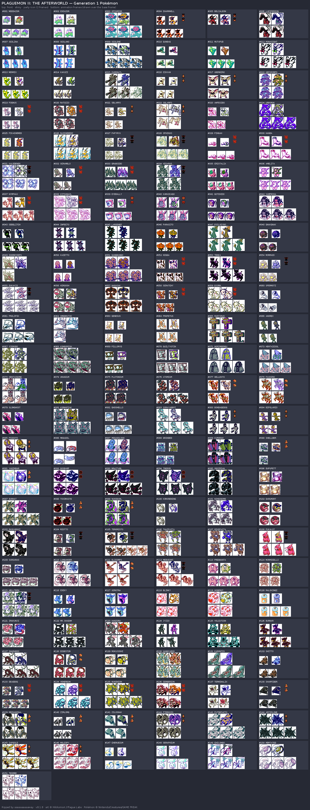
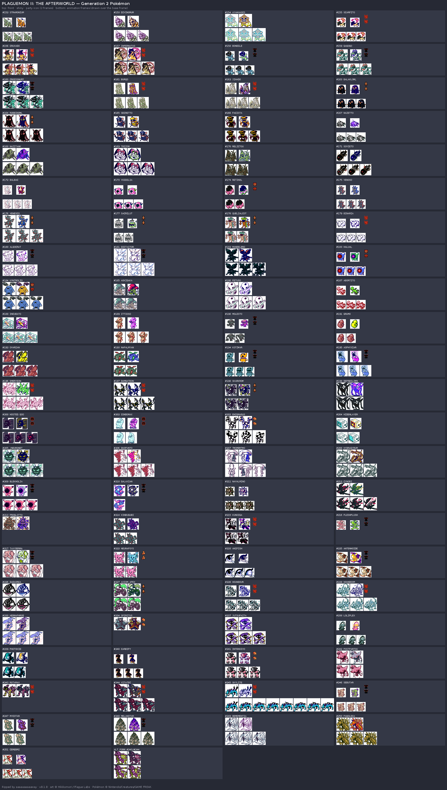
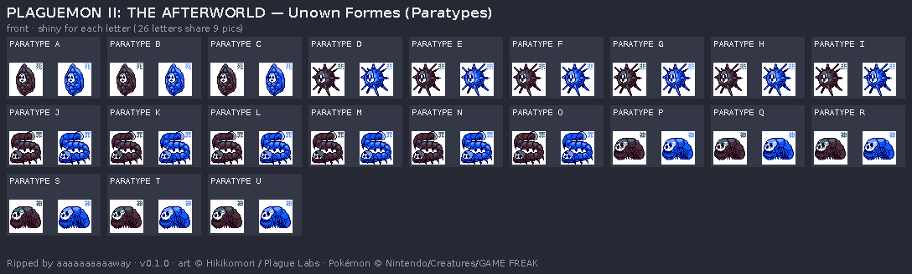

# Plaguemon II: The AfterWorld — sprite rips

Sheets organised like [The Spriters Resource](https://www.spriters-resource.com/game_boy_gbc/pokemoncrystal/): same sections and asset titles as its Pokémon Crystal page.

| Game info | |
|---|---|
| Category | Game Boy / GBC |
| Game | Plaguemon II: The AfterWorld, v0.1.0 (free release, plaguemon.com) |
| Developer | Hikikomori / Plague Labs |
| Base | Pokémon Crystal ROM hack |
| Assets | 5 of 71 ripped |
| Ripped by | aaaaaaaaaaway |

Sheets are at original 1× resolution, PNG. `pokemon/animated/` holds 3× GIFs of each monster's
battle animation, played from the game's own animation scripts.

> Graphics that are byte-identical to Pokémon Crystal are left out; see the
> [Pokémon Crystal page](https://www.spriters-resource.com/game_boy_gbc/pokemoncrystal/) for those.

## Characters [2]

| Preview | Name | Size | Format | Notes |
|---|---|---|---|---|
|  | [Characters (Battle)](characters/characters-battle.png) | 62 KB (908×492) | PNG | 22 Crystal-original omitted |
|  | [Characters (Overworld)](characters/characters-overworld.png) | 23 KB (1048×322) | PNG | 73 Crystal-original omitted |

## Pokémon [3]

| Preview | Name | Size | Format | Notes |
|---|---|---|---|---|
|  | [Generation 1 Pokémon](pokemon/generation-1-pokemon.png) | 752 KB (1448×3774) | PNG | 151 monsters |
|  | [Generation 2 Pokémon](pokemon/generation-2-pokemon.png) | 473 KB (1896×3348) | PNG | 90 monsters, 10 Crystal-original omitted |
|  | [Unown Formes](pokemon/unown-formes.png) | 15 KB (1088×328) | PNG | 21 letters, 5 Crystal-original omitted |

## Backgrounds (Routes) [6]

Not ripped yet: Route 17 · Route 26 · Route 27 · Route 36 · Route 40 · Route 43

## Backgrounds (Locations) [40]

Not ripped yet: Azalea Town · Battle Tower · Blackthorn City · Burned Tower · Celadon City · Cerulean City · Cherrygrove City · Cianwood City · Cinnabar Island · Daycare · Dragon's Den · Ecruteak City · Fuchsia City · Glitter Lighthouse · Goldenrod City · Goldenrod Radio Tower · Ice Path · Ilex Forest · Indigo Plateau · Lavender Town · Magnet Train Tracks · Mahogany Town · Mt. Mortar · Mt. Silver · National Park · New Bark Town · Olivine City · Pallet Town · Pewter City · Pokémon Center / Mart · Rocket Hideout · Ruins of Alph · S.S. Aqua · Saffron City · Slowpoke Well · Sprout Tower · Unused Maps · Vermilion City · Violet City · Viridian City

## Miscellaneous [20]

Not ripped yet: Bag Interface · Bill's PC Interface · Credits · Font · Game Freak Intro · Intro Backgrounds · Intro Sprites · Mail · Minigames · Mobile Content · Mystery Gift Screen · Pokégear · Pokémon Egg · Professor Oak's Opening Lecture · Super Game Boy Error Message · Tileset (Day) · Tileset (Morning) · Tileset (Night) · Trading Sequence · Trainer Card

## Credits

- Plaguemon II: The AfterWorld art and design: Hikikomori / Plague Labs (plaguelabs.com, plaguemon.com).
- Pokémon © Nintendo / Creatures Inc. / GAME FREAK inc. Unofficial fan rip, not affiliated with either.
- No ROM, patch or game code is included in this repository.
