# Plaguemon II: The AfterWorld

Sprite sheets for v0.1.0, laid out like the Pokémon Crystal page on [The Spriters Resource](https://www.spriters-resource.com/game_boy_gbc/pokemoncrystal/).

Graphics unchanged from Pokémon Crystal are left out.

## Characters

<table><tr><td align="center" valign="top"> <a href="zoom/characters/characters-battle.png">Characters (Battle)</a> <a href="characters/characters-battle.png">1×</a></td><td align="center" valign="top"> <a href="zoom/characters/characters-overworld.png">Characters (Overworld)</a> <a href="characters/characters-overworld.png">1×</a></td></tr></table>

## Pokémon

<table><tr><td align="center" valign="top"> <a href="zoom/pokemon/generation-1-pokemon.png">Generation 1 Pokémon</a> <a href="pokemon/generation-1-pokemon.png">1×</a></td><td align="center" valign="top"><a href="zoom/pokemon/generation-2-pokemon.png">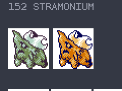</a> <a href="zoom/pokemon/generation-2-pokemon.png">Generation 2 Pokémon</a> <a href="pokemon/generation-2-pokemon.png">1×</a></td><td align="center" valign="top"><a href="zoom/pokemon/unown-formes.png">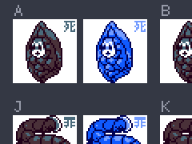</a> <a href="zoom/pokemon/unown-formes.png">Unown Formes</a> Paratypes <a href="pokemon/unown-formes.png">1×</a></td></tr></table>

## Backgrounds (Routes)

<table><tr><td align="center" valign="top"><a href="zoom/backgrounds/routes/route-17.png">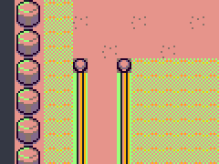</a> <a href="zoom/backgrounds/routes/route-17.png">Route 17</a> AREA 17 <a href="backgrounds/routes/route-17.png">1×</a></td><td align="center" valign="top"> <a href="zoom/backgrounds/routes/route-26.png">Route 26</a> AREA 26 <a href="backgrounds/routes/route-26.png">1×</a></td><td align="center" valign="top"> <a href="zoom/backgrounds/routes/route-27.png">Route 27</a> AREA 27 <a href="backgrounds/routes/route-27.png">1×</a></td><td align="center" valign="top"> <a href="zoom/backgrounds/routes/route-36.png">Route 36</a> AREA 36 <a href="backgrounds/routes/route-36.png">1×</a></td></tr><tr><td align="center" valign="top"> <a href="zoom/backgrounds/routes/route-40.png">Route 40</a> AREA 40 <a href="backgrounds/routes/route-40.png">1×</a></td><td align="center" valign="top"><a href="zoom/backgrounds/routes/route-43.png">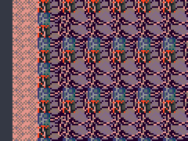</a> <a href="zoom/backgrounds/routes/route-43.png">Route 43</a> AREA 43 <a href="backgrounds/routes/route-43.png">1×</a></td></tr></table>

## Backgrounds (Locations)

<table><tr><td align="center" valign="top"> <a href="zoom/backgrounds/locations/azalea-town.png">Azalea Town</a> LOS AURA <a href="backgrounds/locations/azalea-town.png">1×</a></td><td align="center" valign="top"> <a href="zoom/backgrounds/locations/battle-tower.png">Battle Tower</a> BATTLE TOWER <a href="backgrounds/locations/battle-tower.png">1×</a></td><td align="center" valign="top"> <a href="zoom/backgrounds/locations/blackthorn-city.png">Blackthorn City</a> PEAK OF DREAD <a href="backgrounds/locations/blackthorn-city.png">1×</a></td><td align="center" valign="top"> <a href="zoom/backgrounds/locations/burned-tower.png">Burned Tower</a> BURNED TOWER <a href="backgrounds/locations/burned-tower.png">1×</a></td></tr><tr><td align="center" valign="top"> <a href="zoom/backgrounds/locations/celadon-city.png">Celadon City</a> CELADON CITY <a href="backgrounds/locations/celadon-city.png">1×</a></td><td align="center" valign="top"> <a href="zoom/backgrounds/locations/cerulean-city.png">Cerulean City</a> CERULEAN CITY <a href="backgrounds/locations/cerulean-city.png">1×</a></td><td align="center" valign="top"><a href="zoom/backgrounds/locations/cherrygrove-city.png">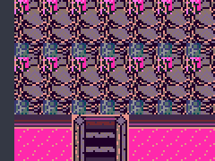</a> <a href="zoom/backgrounds/locations/cherrygrove-city.png">Cherrygrove City</a> NEARBYTOWN <a href="backgrounds/locations/cherrygrove-city.png">1×</a></td><td align="center" valign="top"> <a href="zoom/backgrounds/locations/cianwood-city.png">Cianwood City</a> OVERSEA ASYLUM <a href="backgrounds/locations/cianwood-city.png">1×</a></td></tr><tr><td align="center" valign="top"> <a href="zoom/backgrounds/locations/cinnabar-island.png">Cinnabar Island</a> CINNABAR ISLAND <a href="backgrounds/locations/cinnabar-island.png">1×</a></td><td align="center" valign="top"><a href="zoom/backgrounds/locations/daycare.png">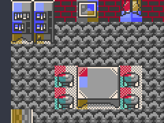</a> <a href="zoom/backgrounds/locations/daycare.png">Daycare</a> AREA 34 <a href="backgrounds/locations/daycare.png">1×</a></td><td align="center" valign="top"><a href="zoom/backgrounds/locations/dragons-den.png">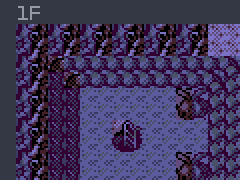</a> <a href="zoom/backgrounds/locations/dragons-den.png">Dragon's Den</a> DRAGON'S DEN <a href="backgrounds/locations/dragons-den.png">1×</a></td><td align="center" valign="top"> <a href="zoom/backgrounds/locations/ecruteak-city.png">Ecruteak City</a> SUBURBIA <a href="backgrounds/locations/ecruteak-city.png">1×</a></td></tr><tr><td align="center" valign="top"> <a href="zoom/backgrounds/locations/fuchsia-city.png">Fuchsia City</a> FUCHSIA CITY <a href="backgrounds/locations/fuchsia-city.png">1×</a></td><td align="center" valign="top"> <a href="zoom/backgrounds/locations/glitter-lighthouse.png">Glitter Lighthouse</a> PENTAFLOOR <a href="backgrounds/locations/glitter-lighthouse.png">1×</a></td><td align="center" valign="top"> <a href="zoom/backgrounds/locations/goldenrod-city.png">Goldenrod City</a> METRO COMPLEX <a href="backgrounds/locations/goldenrod-city.png">1×</a></td><td align="center" valign="top"> <a href="zoom/backgrounds/locations/goldenrod-radio-tower.png">Goldenrod Radio Tower</a> RADIO TOWER <a href="backgrounds/locations/goldenrod-radio-tower.png">1×</a></td></tr><tr><td align="center" valign="top"> <a href="zoom/backgrounds/locations/ice-path.png">Ice Path</a> PARKING LOT <a href="backgrounds/locations/ice-path.png">1×</a></td><td align="center" valign="top"> <a href="zoom/backgrounds/locations/ilex-forest.png">Ilex Forest</a> SUICIDE FOREST <a href="backgrounds/locations/ilex-forest.png">1×</a></td><td align="center" valign="top"> <a href="zoom/backgrounds/locations/indigo-plateau.png">Indigo Plateau</a> INDIGO PLATEAU <a href="backgrounds/locations/indigo-plateau.png">1×</a></td><td align="center" valign="top"> <a href="zoom/backgrounds/locations/lavender-town.png">Lavender Town</a> LAVENDER TOWN <a href="backgrounds/locations/lavender-town.png">1×</a></td></tr><tr><td align="center" valign="top"> <a href="zoom/backgrounds/locations/mahogany-town.png">Mahogany Town</a> LONELY WOODS <a href="backgrounds/locations/mahogany-town.png">1×</a></td><td align="center" valign="top"> <a href="zoom/backgrounds/locations/mt-mortar.png">Mt. Mortar</a> MT.MORTAR <a href="backgrounds/locations/mt-mortar.png">1×</a></td><td align="center" valign="top"><a href="zoom/backgrounds/locations/mt-silver.png">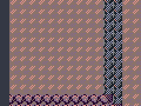</a> <a href="zoom/backgrounds/locations/mt-silver.png">Mt. Silver</a> SILVER CAVE <a href="backgrounds/locations/mt-silver.png">1×</a></td><td align="center" valign="top"> <a href="zoom/backgrounds/locations/national-park.png">National Park</a> NATIONAL PARK <a href="backgrounds/locations/national-park.png">1×</a></td></tr><tr><td align="center" valign="top"> <a href="zoom/backgrounds/locations/new-bark-town.png">New Bark Town</a> HOMETOWN <a href="backgrounds/locations/new-bark-town.png">1×</a></td><td align="center" valign="top"><a href="zoom/backgrounds/locations/olivine-city.png">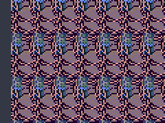</a> <a href="zoom/backgrounds/locations/olivine-city.png">Olivine City</a> GOVERNMENT <a href="backgrounds/locations/olivine-city.png">1×</a></td><td align="center" valign="top"> <a href="zoom/backgrounds/locations/pallet-town.png">Pallet Town</a> PALLET TOWN <a href="backgrounds/locations/pallet-town.png">1×</a></td><td align="center" valign="top"> <a href="zoom/backgrounds/locations/pewter-city.png">Pewter City</a> PEWTER CITY <a href="backgrounds/locations/pewter-city.png">1×</a></td></tr><tr><td align="center" valign="top"> <a href="zoom/backgrounds/locations/pokemon-center-mart.png">Pokémon Center / Mart</a> NEARBYTOWN <a href="backgrounds/locations/pokemon-center-mart.png">1×</a></td><td align="center" valign="top"> <a href="zoom/backgrounds/locations/rocket-hideout.png">Rocket Hideout</a> LONELY WOODS <a href="backgrounds/locations/rocket-hideout.png">1×</a></td><td align="center" valign="top"> <a href="zoom/backgrounds/locations/ruins-of-alph.png">Ruins of Alph</a> BIO IMPACT <a href="backgrounds/locations/ruins-of-alph.png">1×</a></td><td align="center" valign="top"> <a href="zoom/backgrounds/locations/s-s-aqua.png">S.S. Aqua</a> FAST SHIP <a href="backgrounds/locations/s-s-aqua.png">1×</a></td></tr><tr><td align="center" valign="top"> <a href="zoom/backgrounds/locations/saffron-city.png">Saffron City</a> SAFFRON CITY <a href="backgrounds/locations/saffron-city.png">1×</a></td><td align="center" valign="top"> <a href="zoom/backgrounds/locations/slowpoke-well.png">Slowpoke Well</a> SLOWPOKE WELL <a href="backgrounds/locations/slowpoke-well.png">1×</a></td><td align="center" valign="top"> <a href="zoom/backgrounds/locations/sprout-tower.png">Sprout Tower</a> SPROUT TOWER <a href="backgrounds/locations/sprout-tower.png">1×</a></td><td align="center" valign="top"> <a href="zoom/backgrounds/locations/unused-maps.png">Unused Maps</a> GOVERNMENT <a href="backgrounds/locations/unused-maps.png">1×</a></td></tr><tr><td align="center" valign="top"><a href="zoom/backgrounds/locations/vermilion-city.png">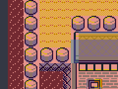</a> <a href="zoom/backgrounds/locations/vermilion-city.png">Vermilion City</a> VERMILION CITY <a href="backgrounds/locations/vermilion-city.png">1×</a></td><td align="center" valign="top"> <a href="zoom/backgrounds/locations/violet-city.png">Violet City</a> NOSTALGOTHIA <a href="backgrounds/locations/violet-city.png">1×</a></td><td align="center" valign="top"> <a href="zoom/backgrounds/locations/viridian-city.png">Viridian City</a> VIRIDIAN CITY <a href="backgrounds/locations/viridian-city.png">1×</a></td></tr></table>

Not yet: Magnet Train Tracks

## Miscellaneous

<table><tr><td align="center" valign="top"> <a href="zoom/miscellaneous/font.png">Font</a> <a href="miscellaneous/font.png">1×</a></td><td align="center" valign="top"><a href="zoom/miscellaneous/game-freak-intro.png">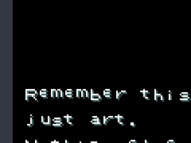</a> <a href="zoom/miscellaneous/game-freak-intro.png">Game Freak Intro</a> <a href="miscellaneous/game-freak-intro.png">1×</a></td><td align="center" valign="top"> <a href="zoom/miscellaneous/intro-backgrounds.png">Intro Backgrounds</a> <a href="miscellaneous/intro-backgrounds.png">1×</a></td><td align="center" valign="top"> <a href="zoom/miscellaneous/pokemon-egg.png">Pokémon Egg</a> <a href="miscellaneous/pokemon-egg.png">1×</a></td></tr><tr><td align="center" valign="top"><a href="zoom/miscellaneous/professor-oaks-opening-lecture.png">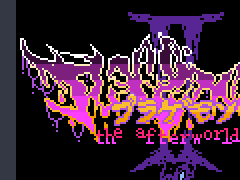</a> <a href="zoom/miscellaneous/professor-oaks-opening-lecture.png">Professor Oak's Opening Lecture</a> <a href="miscellaneous/professor-oaks-opening-lecture.png">1×</a></td><td align="center" valign="top"> <a href="zoom/miscellaneous/tileset-day.png">Tileset (Day)</a> <a href="miscellaneous/tileset-day.png">1×</a></td><td align="center" valign="top"> <a href="zoom/miscellaneous/tileset-morning.png">Tileset (Morning)</a> <a href="miscellaneous/tileset-morning.png">1×</a></td><td align="center" valign="top"> <a href="zoom/miscellaneous/tileset-night.png">Tileset (Night)</a> <a href="miscellaneous/tileset-night.png">1×</a></td></tr></table>

Not yet: Bag Interface, Bill's PC Interface, Credits, Intro Sprites, Mail, Minigames, Mobile Content, Mystery Gift Screen, Pokégear, Super Game Boy Error Message, Trading Sequence, Trainer Card

## More

Not on the Crystal page: the title screen and every other map, by in-game place name.

<table><tr><td align="center" valign="top"> <a href="zoom/more/title-screen.png">Title Screen</a> <a href="more/title-screen.png">1×</a></td><td align="center" valign="top"> <a href="zoom/more/maps/area-1.png">Area 1</a> <a href="more/maps/area-1.png">1×</a></td><td align="center" valign="top"> <a href="zoom/more/maps/area-10.png">Area 10</a> <a href="more/maps/area-10.png">1×</a></td><td align="center" valign="top"> <a href="zoom/more/maps/area-11.png">Area 11</a> <a href="more/maps/area-11.png">1×</a></td></tr><tr><td align="center" valign="top"> <a href="zoom/more/maps/area-12.png">Area 12</a> <a href="more/maps/area-12.png">1×</a></td><td align="center" valign="top"> <a href="zoom/more/maps/area-13.png">Area 13</a> <a href="more/maps/area-13.png">1×</a></td><td align="center" valign="top"> <a href="zoom/more/maps/area-14.png">Area 14</a> <a href="more/maps/area-14.png">1×</a></td><td align="center" valign="top"> <a href="zoom/more/maps/area-15.png">Area 15</a> <a href="more/maps/area-15.png">1×</a></td></tr><tr><td align="center" valign="top"> <a href="zoom/more/maps/area-16.png">Area 16</a> <a href="more/maps/area-16.png">1×</a></td><td align="center" valign="top"> <a href="zoom/more/maps/area-17.png">Area 17</a> <a href="more/maps/area-17.png">1×</a></td><td align="center" valign="top"> <a href="zoom/more/maps/area-18.png">Area 18</a> <a href="more/maps/area-18.png">1×</a></td><td align="center" valign="top"> <a href="zoom/more/maps/area-19.png">Area 19</a> <a href="more/maps/area-19.png">1×</a></td></tr><tr><td align="center" valign="top"><a href="zoom/more/maps/area-2.png">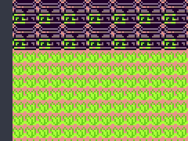</a> <a href="zoom/more/maps/area-2.png">Area 2</a> <a href="more/maps/area-2.png">1×</a></td><td align="center" valign="top"> <a href="zoom/more/maps/area-20.png">Area 20</a> <a href="more/maps/area-20.png">1×</a></td><td align="center" valign="top"> <a href="zoom/more/maps/area-21.png">Area 21</a> <a href="more/maps/area-21.png">1×</a></td><td align="center" valign="top"> <a href="zoom/more/maps/area-22.png">Area 22</a> <a href="more/maps/area-22.png">1×</a></td></tr><tr><td align="center" valign="top"> <a href="zoom/more/maps/area-23.png">Area 23</a> <a href="more/maps/area-23.png">1×</a></td><td align="center" valign="top"> <a href="zoom/more/maps/area-24.png">Area 24</a> <a href="more/maps/area-24.png">1×</a></td><td align="center" valign="top"><a href="zoom/more/maps/area-25.png">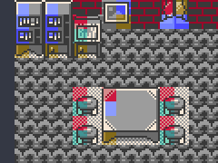</a> <a href="zoom/more/maps/area-25.png">Area 25</a> <a href="more/maps/area-25.png">1×</a></td><td align="center" valign="top"> <a href="zoom/more/maps/area-26.png">Area 26</a> <a href="more/maps/area-26.png">1×</a></td></tr><tr><td align="center" valign="top"> <a href="zoom/more/maps/area-27.png">Area 27</a> <a href="more/maps/area-27.png">1×</a></td><td align="center" valign="top"> <a href="zoom/more/maps/area-28.png">Area 28</a> <a href="more/maps/area-28.png">1×</a></td><td align="center" valign="top"><a href="zoom/more/maps/area-29.png">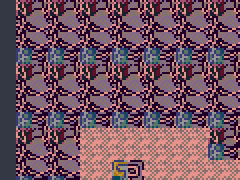</a> <a href="zoom/more/maps/area-29.png">Area 29</a> <a href="more/maps/area-29.png">1×</a></td><td align="center" valign="top"><a href="zoom/more/maps/area-3.png">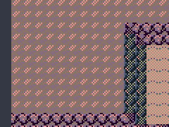</a> <a href="zoom/more/maps/area-3.png">Area 3</a> <a href="more/maps/area-3.png">1×</a></td></tr><tr><td align="center" valign="top"> <a href="zoom/more/maps/area-30.png">Area 30</a> <a href="more/maps/area-30.png">1×</a></td><td align="center" valign="top"> <a href="zoom/more/maps/area-31.png">Area 31</a> <a href="more/maps/area-31.png">1×</a></td><td align="center" valign="top"> <a href="zoom/more/maps/area-32.png">Area 32</a> <a href="more/maps/area-32.png">1×</a></td><td align="center" valign="top"> <a href="zoom/more/maps/area-33.png">Area 33</a> <a href="more/maps/area-33.png">1×</a></td></tr><tr><td align="center" valign="top"> <a href="zoom/more/maps/area-34.png">Area 34</a> <a href="more/maps/area-34.png">1×</a></td><td align="center" valign="top"> <a href="zoom/more/maps/area-35.png">Area 35</a> <a href="more/maps/area-35.png">1×</a></td><td align="center" valign="top"> <a href="zoom/more/maps/area-36.png">Area 36</a> <a href="more/maps/area-36.png">1×</a></td><td align="center" valign="top"> <a href="zoom/more/maps/area-37.png">Area 37</a> <a href="more/maps/area-37.png">1×</a></td></tr><tr><td align="center" valign="top"><a href="zoom/more/maps/area-38.png">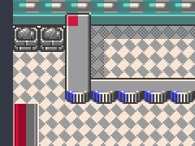</a> <a href="zoom/more/maps/area-38.png">Area 38</a> <a href="more/maps/area-38.png">1×</a></td><td align="center" valign="top"> <a href="zoom/more/maps/area-39.png">Area 39</a> <a href="more/maps/area-39.png">1×</a></td><td align="center" valign="top"> <a href="zoom/more/maps/area-4.png">Area 4</a> <a href="more/maps/area-4.png">1×</a></td><td align="center" valign="top"> <a href="zoom/more/maps/area-41.png">Area 41</a> <a href="more/maps/area-41.png">1×</a></td></tr><tr><td align="center" valign="top"> <a href="zoom/more/maps/area-42.png">Area 42</a> <a href="more/maps/area-42.png">1×</a></td><td align="center" valign="top"> <a href="zoom/more/maps/area-43.png">Area 43</a> <a href="more/maps/area-43.png">1×</a></td><td align="center" valign="top"> <a href="zoom/more/maps/area-44.png">Area 44</a> <a href="more/maps/area-44.png">1×</a></td><td align="center" valign="top"><a href="zoom/more/maps/area-45.png">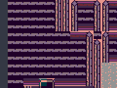</a> <a href="zoom/more/maps/area-45.png">Area 45</a> <a href="more/maps/area-45.png">1×</a></td></tr><tr><td align="center" valign="top"> <a href="zoom/more/maps/area-46.png">Area 46</a> <a href="more/maps/area-46.png">1×</a></td><td align="center" valign="top"> <a href="zoom/more/maps/area-5.png">Area 5</a> <a href="more/maps/area-5.png">1×</a></td><td align="center" valign="top"><a href="zoom/more/maps/area-6.png">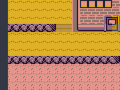</a> <a href="zoom/more/maps/area-6.png">Area 6</a> <a href="more/maps/area-6.png">1×</a></td><td align="center" valign="top"><a href="zoom/more/maps/area-7.png">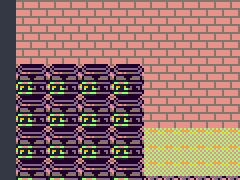</a> <a href="zoom/more/maps/area-7.png">Area 7</a> <a href="more/maps/area-7.png">1×</a></td></tr><tr><td align="center" valign="top"><a href="zoom/more/maps/area-8.png">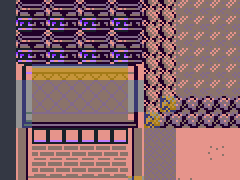</a> <a href="zoom/more/maps/area-8.png">Area 8</a> <a href="more/maps/area-8.png">1×</a></td><td align="center" valign="top"> <a href="zoom/more/maps/area-9.png">Area 9</a> <a href="more/maps/area-9.png">1×</a></td><td align="center" valign="top"> <a href="zoom/more/maps/digletts-cave.png">Diglett'S Cave</a> <a href="more/maps/digletts-cave.png">1×</a></td><td align="center" valign="top"> <a href="zoom/more/maps/mt-moon.png">Mt.Moon</a> <a href="more/maps/mt-moon.png">1×</a></td></tr><tr><td align="center" valign="top"><a href="zoom/more/maps/power-plant.png">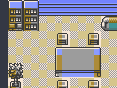</a> <a href="zoom/more/maps/power-plant.png">Power Plant</a> <a href="more/maps/power-plant.png">1×</a></td><td align="center" valign="top"> <a href="zoom/more/maps/rock-tunnel.png">Rock Tunnel</a> <a href="more/maps/rock-tunnel.png">1×</a></td><td align="center" valign="top"> <a href="zoom/more/maps/sewers.png">Sewers</a> <a href="more/maps/sewers.png">1×</a></td><td align="center" valign="top"> <a href="zoom/more/maps/source-of-plasma.png">Source Of Plasma</a> <a href="more/maps/source-of-plasma.png">1×</a></td></tr><tr><td align="center" valign="top"> <a href="zoom/more/maps/tin-tower.png">Tin Tower</a> <a href="more/maps/tin-tower.png">1×</a></td><td align="center" valign="top"> <a href="zoom/more/maps/tohjo-falls.png">Tohjo Falls</a> <a href="more/maps/tohjo-falls.png">1×</a></td><td align="center" valign="top"> <a href="zoom/more/maps/underground.png">Underground</a> <a href="more/maps/underground.png">1×</a></td><td align="center" valign="top"><a href="zoom/more/maps/union-cave.png">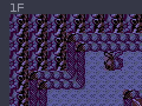</a> <a href="zoom/more/maps/union-cave.png">Union Cave</a> <a href="more/maps/union-cave.png">1×</a></td></tr><tr><td align="center" valign="top"><a href="zoom/more/maps/victory-road.png">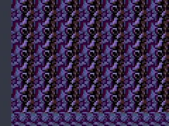</a> <a href="zoom/more/maps/victory-road.png">Victory Road</a> <a href="more/maps/victory-road.png">1×</a></td><td align="center" valign="top"> <a href="zoom/more/maps/whirl-islands.png">Whirl Islands</a> <a href="more/maps/whirl-islands.png">1×</a></td></tr></table>

Not yet: Battle Screen, Battle Backgrounds

Click a sheet for a zoomed copy; **1×** is the original. Animated battle sprites: [`pokemon/animated/`](pokemon/animated/). Offline viewer with zoom: `index.html`.

---

Plaguemon II © Hikikomori / Plague Labs. Pokémon © Nintendo / Creatures / GAME FREAK. Unofficial; no ROM data included.
