# Animated battle sprites

[all sheets](../README.md)

<table><tr><td align="center"> 001 WEEDAZOR</td><td align="center">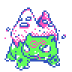 002 COCAZOR</td><td align="center"> 003 OPIUMZOR</td><td align="center"> 004 CHARMHELL</td></tr><tr><td align="center"> 005 BELIALEON</td><td align="center">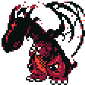 006 LUCIFERION</td><td align="center">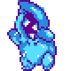 007 SCOLINA</td><td align="center"> 008 SCOLANO</td></tr><tr><td align="center"> 009 SCOLENE</td><td align="center">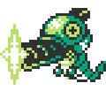 010 GUNBAG</td><td align="center">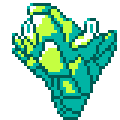 011 MUTAPUD</td><td align="center"> 012 MONASIGHT</td></tr><tr><td align="center">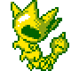 013 WERMIX</td><td align="center">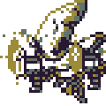 014 KAKUZI</td><td align="center"> 015 CAMOGATL</td><td align="center"> 016 CIKKAN</td></tr><tr><td align="center">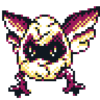 017 UBERBIRO</td><td align="center"> 018 HEPOCORPS</td><td align="center">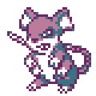 019 FOGNUS</td><td align="center"> 020 RATOZZO</td></tr><tr><td align="center">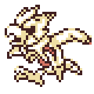 021 SBLARFO</td><td align="center"> 022 SGLARFO</td><td align="center"> 023 ANFESIBO</td><td align="center">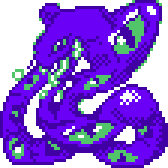 024 URBOROK</td></tr><tr><td align="center"> 025 PIKACHEWED</td><td align="center"> 026 RAICHEWEDZ</td><td align="center"> 027 PAPYRYU</td><td align="center"> 028 SPHINXO</td></tr><tr><td align="center">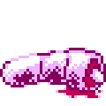 029 FINGAH</td><td align="center"> 030 HANDA</td><td align="center">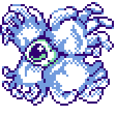 031 KALEDENDS</td><td align="center"> 032 SCRAMBLO</td></tr><tr><td align="center">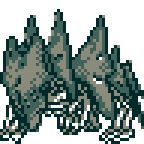 033 GRABOIDO</td><td align="center"> 034 KESARUS</td><td align="center"> 035 CRISTALIA</td><td align="center"> 036 AMELITA</td></tr><tr><td align="center"> 037 NYMPHAX</td><td align="center">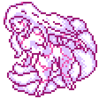 038 KITSUNAIL</td><td align="center"> 039 EYEBALLY</td><td align="center"> 040 KAWAIKAGO</td></tr><tr><td align="center"> 041 GOTCHICK</td><td align="center"> 042 VAMPESSA</td><td align="center"> 043 ODDGLITCH</td><td align="center">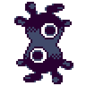 044 INFECTO</td></tr><tr><td align="center"> 045 LARSENEF</td><td align="center"> 046 PARASITO</td><td align="center"> 047 PSILOCYBO</td><td align="center">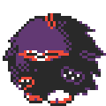 048 GNAKGNAK</td></tr><tr><td align="center"> 049 CHORDYCEPS</td><td align="center">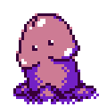 050 KAZETTO</td><td align="center">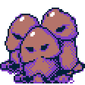 051 GANGBANGO</td><td align="center">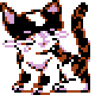 052 NIGGA</td></tr><tr><td align="center">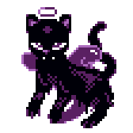 053 TENKA</td><td align="center"> 054 WORMACK</td><td align="center">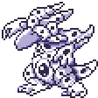 055 DUKAKIS</td><td align="center"> 056 HIROOSH</td></tr><tr><td align="center"> 057 NAGASAK</td><td align="center"> 058 SCRATCHY</td><td align="center"> 059 BJORN</td><td align="center"> 060 SPERMOTZ</td></tr><tr><td align="center"> 061 PROLIFIK</td><td align="center">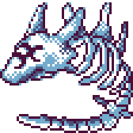 062 SMEGMATIC</td><td align="center">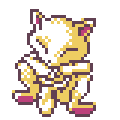 063 GENESUS</td><td align="center">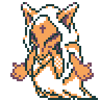 064 PROFETUS</td></tr><tr><td align="center">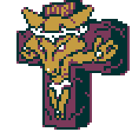 065 MARTIRUS</td><td align="center"> 066 ANOREX</td><td align="center"> 067 STERODO</td><td align="center">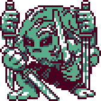 068 KONGORISH</td></tr><tr><td align="center">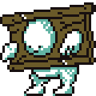 069 PILLORYD</td><td align="center">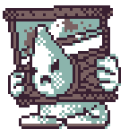 070 GUILTYOTIN</td><td align="center">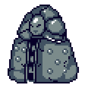 071 NORIMBERGU</td><td align="center"> 072 HENTAICOOL</td></tr><tr><td align="center">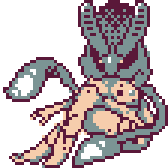 073 HENTAIGORE</td><td align="center"> 074 URANIUM</td><td align="center"> 075 PLUTONIUM</td><td align="center"> 076 ATOMIUM</td></tr><tr><td align="center">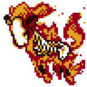 077 HELLESTO</td><td align="center"> 078 FAXHIRO</td><td align="center"> 079 SLOWGHOST</td><td align="center">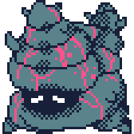 080 KORNUPIAK</td></tr><tr><td align="center"> 081 GHOSHELLO</td><td align="center">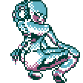 082 SORAYAMBOT</td><td align="center"> 083 BONDAGEDOG</td><td align="center">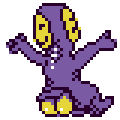 084 BIPOLARIO</td></tr><tr><td align="center">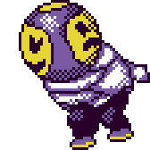 085 PSICOTO</td><td align="center"> 086 MEGADIL</td><td align="center"> 087 MEGADIL500</td><td align="center">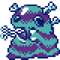 088 GRINDED</td></tr><tr><td align="center"> 089 KUMORAH</td><td align="center">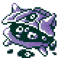 090 SHELLDER</td><td align="center"> 091 VAGINDAM</td><td align="center"> 092 GOSBAMP</td></tr><tr><td align="center"> 093 WRAITARL</td><td align="center"> 094 TREROR</td><td align="center"> 095 OBSIDIAN</td><td align="center"> 096 DUPUPETT</td></tr><tr><td align="center">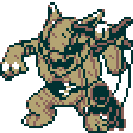 097 BURHAT</td><td align="center"> 098 TOXIWASTE</td><td align="center"> 099 NUKEBARL</td><td align="center"> 100 KOWARENING</td></tr><tr><td align="center"> 101 NINGOGORE</td><td align="center"> 102 DARUMORT</td><td align="center">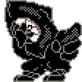 103 MASKABUKI</td><td align="center">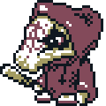 104 RIOTTO</td></tr><tr><td align="center"> 105 TERORISTO</td><td align="center">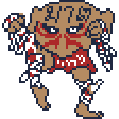 106 THAIFAITA</td><td align="center"> 107 MIKEFAITA</td><td align="center"> 108 PUKALOT</td></tr><tr><td align="center"> 109 SARSARAS</td><td align="center">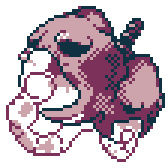 110 LUNGANSER</td><td align="center"> 111 ELICORPS</td><td align="center">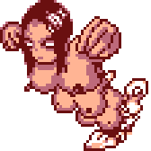 112 MEDUCUNT</td></tr><tr><td align="center"> 113 PREGNANTA</td><td align="center">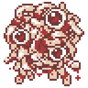 114 WORMICELLI</td><td align="center"> 115 HELLTECH</td><td align="center">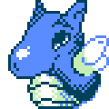 116 COCKY</td></tr><tr><td align="center"> 117 SCROTRA</td><td align="center">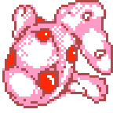 118 BLINKY</td><td align="center"> 119 HOGEROT</td><td align="center"> 120 MALOKINGI</td></tr><tr><td align="center"> 121 IRUKUNJI</td><td align="center"> 122 MR.SHADOW</td><td align="center"> 123 HANZORU</td><td align="center"> 124 JYZZO</td></tr><tr><td align="center">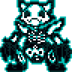 125 VOLCUTION</td><td align="center"> 126 BURNAR</td><td align="center"> 127 SHAMABOO</td><td align="center"> 128 DIGESTOR</td></tr><tr><td align="center"> 129 ROKUJOSHI</td><td align="center">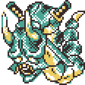 130 HANNYADOS</td><td align="center"> 131 KARONTIS</td><td align="center"> 132 SHITTO</td></tr><tr><td align="center"> 133 DEADDOG</td><td align="center"> 134 VENEREON</td><td align="center"> 135 NUKENION</td><td align="center">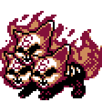 136 CERBERION</td></tr><tr><td align="center"> 137 TERMINALIX</td><td align="center"> 138 SHARPIDER</td><td align="center"> 139 MECHANIGAL</td><td align="center"> 140 ZIRLORG</td></tr><tr><td align="center"> 141 ZILOSNAK</td><td align="center"> 142 PTEROXIS</td><td align="center"> 143 PUTREFACTO</td><td align="center"> 144 ARTICLONE</td></tr><tr><td align="center"> 145 ZAPGOLD</td><td align="center"> 146 MOLCOPY</td><td align="center"> 147 CHERUBIUM</td><td align="center"> 148 SERAPHIUM</td></tr><tr><td align="center"> 149 CHILONGO</td><td align="center"> 150 MEWTATED</td><td align="center"> 151 TWOMEW</td><td align="center"> 152 STRAMONIUM</td></tr><tr><td align="center"> 153 DIVINORUM</td><td align="center"> 154 AYAHUASCO</td><td align="center"> 155 SCARFITO</td><td align="center"> 156 CRUXADO</td></tr><tr><td align="center"> 157 INFERNATUS</td><td align="center"> 158 BONDILE</td><td align="center"> 159 GAGOGO</td><td align="center"> 160 CROCOSNUFF</td></tr><tr><td align="center"> 161 BURQO</td><td align="center"> 162 JIHADO</td><td align="center"> 163 BALAKLOWL</td><td align="center"> 164 ROBBINOWL</td></tr><tr><td align="center"> 165 SBIRETTO</td><td align="center"> 166 FACISTA</td><td align="center"> 167 NAZETTO</td><td align="center"> 168 NAZITANK</td></tr><tr><td align="center"> 169 TRIZOM</td><td align="center"> 170 RELICTOU</td><td align="center"> 171 SOVIETO</td><td align="center"> 172 BALBAC</td></tr><tr><td align="center"> 173 VOIDILIA</td><td align="center"> 174 RETINOL</td><td align="center"> 175 VENOSO</td><td align="center"> 176 VENESCO</td></tr><tr><td align="center"> 177 SACRILUT</td><td align="center"> 178 QUELZALCOT</td><td align="center"> 179 BINARIA</td><td align="center"> 180 ALGOCRAT</td></tr><tr><td align="center"> 181 DICTAITOR</td><td align="center"> 182 MANDELBRO</td><td align="center"> 183 HALUAL</td><td align="center"> 184 KONTROLIO</td></tr><tr><td align="center"> 185 AOKIGAKA</td><td align="center"> 186 FETUSO</td><td align="center"> 187 ABORTITO</td><td align="center"> 188 INCUBATO</td></tr><tr><td align="center"> 189 ITTIOSO</td><td align="center"> 190 MOLESTO</td><td align="center"> 191 GRUMO</td><td align="center"> 192 OVARIAN</td></tr><tr><td align="center"> 193 NAPALMYAN</td><td align="center"> 194 KOTZWAR</td><td align="center"> 195 ASPHYXIAR</td><td align="center"> 196 EMBRYEON</td></tr><tr><td align="center"> 197 DAMNATEON</td><td align="center"> 198 SKARKROW</td><td align="center"> 199 DEPRECLOWN</td><td align="center"> 200 HOSTED.GOO</td></tr><tr><td align="center"> 202 CONDOMAX</td><td align="center"> 203 ENIGMAGUS</td><td align="center"> 204 HIDENLAYER</td><td align="center"> 205 /NEURONET</td></tr><tr><td align="center"> 206 DUOFUNTO</td><td align="center"> 207 TWOMEWTWO</td><td align="center"> 208 HYDRAGYRUM</td><td align="center"> 209 BLEKHOLIA</td></tr><tr><td align="center"> 210 GALAXIAN</td><td align="center"> 211 NAVALMINO</td><td align="center"> 212 CYNOBI</td><td align="center"> 213 PROGLOTTO</td></tr><tr><td align="center"> 214 KINBUGUBI</td><td align="center"> 215 KUNOIGA</td><td align="center"> 216 FLESHPLUSH</td><td align="center"> 217 TAXYDERMA</td></tr><tr><td align="center"> 222 NEURAPSYS</td><td align="center"> 223 ANIFISH</td><td align="center"> 225 ANTENNOIDE</td><td align="center"> 226 DADAORCA</td></tr><tr><td align="center"> 227 AXIOM:APEX</td><td align="center"> 228 HOUNDOUR</td><td align="center"> 229 HOUNDOOM</td><td align="center"> 230 HERMAPHROD</td></tr><tr><td align="center"> 234 SPIRITUS</td><td align="center"> 237 JUTSUFAITA</td><td align="center"> 238 LOLIPLEX</td><td align="center"> 239 PHOTOKID</td></tr><tr><td align="center"> 240 CARBIFY</td><td align="center"> 241 INTENSIVO</td><td align="center"> 242 POSTPARTOU</td><td align="center"> 243 ROTARAX</td></tr><tr><td align="center"> 244 VITATEC</td><td align="center"> 245 SKYLITE</td><td align="center"> 246 SEBUTAR</td><td align="center"> 247 MYCOTAR</td></tr><tr><td align="center"> 248 MELANOTAR</td><td align="center"> 249 DEMEMENTIA</td><td align="center"> 250 PAGOLDIA</td><td align="center"> 251 CEREBRI</td></tr><tr><td align="center"> PARATYPE A</td><td align="center"> PARATYPE D</td><td align="center"> PARATYPE J</td><td align="center"> PARATYPE P</td></tr><tr><td align="center"> PARATYPE V</td><td align="center"> PARATYPE W</td><td align="center"> PARATYPE X</td><td align="center"> PARATYPE Y</td></tr><tr><td align="center"> PARATYPE Z</td><td align="center"> ALT FORM (ROTARAX / VITATEC)</td></tr></table>
