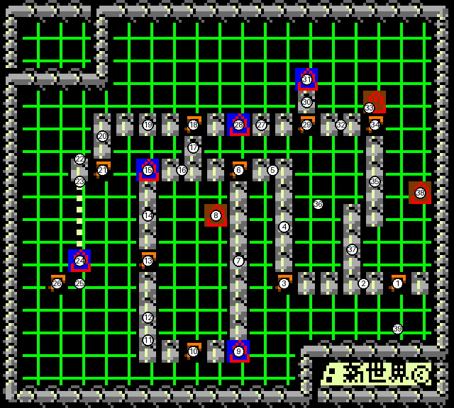

# Region Map (Johto)

The Pokégear map with every landmark numbered · [1× original](../../backgrounds/region-map-johto.png) · [all sheets](../../README.md)

| # | Landmark |
|--:|---|
| 1 | Hometown |
| 2 | Area 29 |
| 3 | Nearbytown |
| 4 | Area 30 |
| 5 | Area 31 |
| 6 | Nostalgothia / Sprout Tower |
| 7 | Area 32 |
| 8 | Bio Impact |
| 9 | Union Cave / Area 33 |
| 10 | Los Aura / Slowpoke Well |
| 11 | Suicide Forest |
| 12 | Area 34 |
| 13 | Metro Complex / Radio Tower |
| 14 | Area 35 |
| 15 | National Park |
| 16 | Area 36 |
| 17 | Area 37 |
| 18 | Suburbia / Tin Tower / Burned Tower |
| 19 | Area 38 |
| 20 | Area 39 |
| 21 | Government / Pentafloor |
| 22 | Battle Tower |
| 23 | Area 40 |
| 24 | Whirl Islands |
| 25 | Area 41 |
| 26 | Oversea Asylum |
| 27 | Area 42 |
| 28 | Mt.Mortar |
| 29 | Lonely Woods |
| 30 | Area 43 |
| 31 | Source Of Plasma |
| 32 | Area 44 |
| 33 | Parking Lot / Dragon'S Den |
| 34 | Peak Of Dread |
| 35 | Area 45 |
| 36 | Sewers |
| 37 | Area 46 |
| 38 | Silver Cave |
| 39 | Fast Ship |
