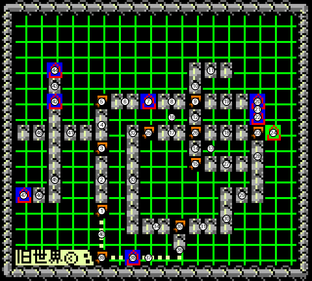

# Region Map (Kanto)

[Open full-size PNG](../../backgrounds/region-map-kanto.png) · [all sheets](../../README.md)

| # | Landmark |
|--:|---|
| 1 | Pallet Town |
| 2 | Area 1 |
| 3 | Viridian City |
| 4 | Area 2 |
| 5 | Pewter City |
| 6 | Area 3 |
| 7 | Mt.Moon |
| 8 | Area 4 |
| 9 | Cerulean City |
| 10 | Area 24 |
| 11 | Area 25 |
| 12 | Area 5 |
| 13 | Underground |
| 14 | Area 6 |
| 15 | Vermilion City |
| 16 | Diglett's Cave |
| 17 | Area 7 |
| 18 | Area 8 |
| 19 | Area 9 |
| 20 | Rock Tunnel |
| 21 | Area 10 |
| 22 | Power Plant |
| 23 | Lavender Town |
| 24 | Lav Radio Tower |
| 25 | Celadon City |
| 26 | Saffron City |
| 27 | Area 11 |
| 28 | Area 12 |
| 29 | Area 13 |
| 30 | Area 14 |
| 31 | Area 15 |
| 32 | Area 16 |
| 33 | Area 17 |
| 34 | Area 18 |
| 35 | Fuchsia City |
| 36 | Area 19 |
| 37 | Area 20 |
| 38 | Seafoam Islands |
| 39 | Cinnabar Island |
| 40 | Area 21 |
| 41 | Area 22 |
| 42 | Victory Road |
| 43 | Area 23 |
| 44 | Indigo Plateau |
| 45 | Area 26 |
| 46 | Area 27 |
| 47 | Tohjo Falls |
| 48 | Area 28 |
