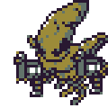
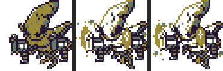

# 014 KAKUZI

**MILITARY / MEDICAL** · [← 013 WERMIX](013_WERMIX.md) · [Pokédex](../pokedex.md) · [015 CAMOGATL →](015_CAMOGATL.md)

<table><tr><th>Front</th><th>Shiny</th><th>Animated</th><th>Animated shiny</th></tr><tr><td align="center" valign="bottom"></td><td align="center" valign="bottom"></td><td align="center" valign="bottom"></td><td align="center" valign="bottom"></td></tr></table>

No back sprite of its own in v0.1.0.

<table><tr><td valign="top"><table><tr><th colspan="3">Base stats</th></tr><tr><td>HP</td><td align="right">45</td><td>▇▇▇▇</td></tr><tr><td>Attack</td><td align="right">25</td><td>▇▇</td></tr><tr><td>Defense</td><td align="right">50</td><td>▇▇▇▇</td></tr><tr><td>Sp. Atk</td><td align="right">25</td><td>▇▇</td></tr><tr><td>Sp. Def</td><td align="right">25</td><td>▇▇</td></tr><tr><td>Speed</td><td align="right">35</td><td>▇▇▇</td></tr><tr><td><b>Total</b></td><td align="right"><b>205</b></td><td></td></tr></table></td><td valign="top"><table><tr><td>Catch rate</td><td>120</td></tr><tr><td>Base exp</td><td>71</td></tr><tr><td>Gender</td><td>50% female</td></tr><tr><td>Growth</td><td>Medium Fast</td></tr></table>  party icon  palette: normal · shiny</td></tr></table>

**Animation frames** (base + 2)

## Pokédex

**COCOON** · 2'00" · 22.0 lb

> Nearly incapable of movement, it leans against stout trees while waiting for its evolution.

Pokédex text unchanged from Pokémon Crystal.

## Evolution

Evolves from [GUNBAG](010_GUNBAG.md) (level 7) Evolves into [CAMOGATL](015_CAMOGATL.md) (level 10)

## Moves

| Level | Move | Type | Power | Accuracy | PP |
|--:|---|---|--:|--:|--:|
| 1 | HARDEN | MUTANT | — | 100% | 30 |
| 7 | HARDEN | MUTANT | — | 100% | 30 |

## Wild

| Where | How | Chance | Levels |
|---|---|---|--:|
| Suicide Forest | walking | 10% morning/day | 7 |
