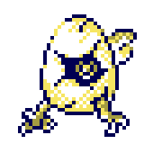
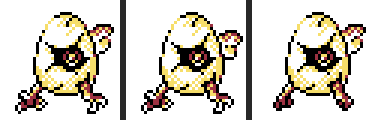

# 016 CIKKAN

[← 015 CAMOGATL](015_CAMOGATL.md) · [Pokédex](../pokedex.md) · [017 UBERBIRO →](017_UBERBIRO.md)

 

front · shiny

 

battle animation · shiny

animation frames (base + 2)

 party icon

 palette: normal · shiny

| | |
|---|---|
| Type | MUTANT / MECHANIC |
| HP | 40 `█████` |
| Attack | 45 `██████` |
| Defense | 40 `█████` |
| Sp. Atk | 35 `████` |
| Sp. Def | 35 `████` |
| Speed | 56 `███████` |
| Total | 251 |
| Catch rate | 255 |
| Base exp | 55 |
| Gender | 50% female |
| Growth | Medium Slow |
