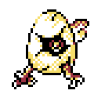

# 016 CIKKAN

**MUTANT / MECHANIC** · [← 015 CAMOGATL](015_CAMOGATL.md) · [Pokédex](../pokedex.md) · [017 UBERBIRO →](017_UBERBIRO.md)

<table><tr><th>Front</th><th>Shiny</th><th>Animated</th><th>Animated shiny</th></tr><tr><td align="center" valign="bottom"></td><td align="center" valign="bottom"></td><td align="center" valign="bottom"></td><td align="center" valign="bottom"></td></tr></table>

No back sprite of its own in v0.1.0.

<table><tr><td valign="top"><table><tr><th colspan="3">Base stats</th></tr><tr><td>HP</td><td align="right">40</td><td>▇▇▇</td></tr><tr><td>Attack</td><td align="right">45</td><td>▇▇▇▇</td></tr><tr><td>Defense</td><td align="right">40</td><td>▇▇▇</td></tr><tr><td>Sp. Atk</td><td align="right">35</td><td>▇▇▇</td></tr><tr><td>Sp. Def</td><td align="right">35</td><td>▇▇▇</td></tr><tr><td>Speed</td><td align="right">56</td><td>▇▇▇▇▇</td></tr><tr><td><b>Total</b></td><td align="right"><b>251</b></td><td></td></tr></table></td><td valign="top"><table><tr><td>Catch rate</td><td>255</td></tr><tr><td>Base exp</td><td>55</td></tr><tr><td>Gender</td><td>50% female</td></tr><tr><td>Growth</td><td>Medium Slow</td></tr></table>  party icon  palette: normal · shiny</td></tr></table>

**Animation frames** (base + 2)

## Pokédex

**TINY BIRD** · 1'00" · 4.0 lb

> Just a stinky dead bird. Not so good to be eaten. Not so good for anything

## Evolution

Evolves into [UBERBIRO](017_UBERBIRO.md) (level 18)

## Moves

| Level | Move | Type | Power | Accuracy | PP |
|--:|---|---|--:|--:|--:|
| 1 | TACKLE | MUTANT | 35 | 95% | 35 |
| 5 | SAND-ATTACK | ORGANIC | — | 100% | 15 |
| 9 | GUST | MECHANIC | 40 | 100% | 35 |
| 15 | QUICK ATTACK | MUTANT | 40 | 100% | 30 |
| 21 | WHIRLWIND | MUTANT | — | 100% | 20 |
| 29 | WING ATTACK | MECHANIC | 60 | 100% | 35 |
| 37 | AGILITY | NEURAL | — | 100% | 30 |
| 47 | MIRROR MOVE | MECHANIC | — | 100% | 20 |

## Wild

| Where | How | Chance | Levels |
|---|---|---|--:|
| Area 36 | walking | 70% day, 40% morning | 4-6 |
| Area 37 | walking | 55% day, 20% morning | 13-15 |
| Area 2 | walking | 50% day, 20% morning | 3-5 |
| Area 29 | walking | 50% morning/day | 2-3 |
| Area 1 | walking | 45% morning/day | 2-4 |
| Area 30 | walking | 40% day, 10% morning | 3-4 |
| Area 31 | walking | 40% day, 10% morning | 4-5 |
| Area 25 | walking | 30% morning/day | 10 |
| Area 35 | walking | 30% morning/day | 14 |
| Area 5 | walking | 30% morning/day | 13 |
| Area 34 | walking | 20% morning/day | 12 |
| National Park | walking | 10% morning/day | 13 |
| Area 32 | walking | 5% morning/day | 7 |
| Area 35 | walking (swarm) | 5% morning/day | 14 |
| Suicide Forest | walking | 5% morning/day | 7 |
