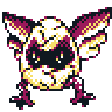

# 017 UBERBIRO

[← 016 CIKKAN](016_CIKKAN.md) · [Pokédex](../pokedex.md) · [018 HEPOCORPS →](018_HEPOCORPS.md)

  

front · shiny · battle animation

animation frames (base + 2)

 party icon

 palette: normal · shiny

| | |
|---|---|
| Type | MUTANT / MECHANIC |
| HP | 63 `████████` |
| Attack | 60 `████████` |
| Defense | 55 `███████` |
| Sp. Atk | 50 `██████` |
| Sp. Def | 50 `██████` |
| Speed | 71 `█████████` |
| Total | 349 |
| Catch rate | 120 |
| Base exp | 113 |
| Gender | 50% female |
| Growth | Medium Slow |
