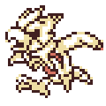
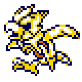
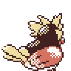
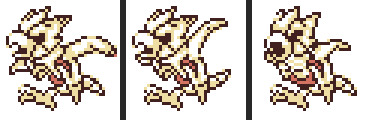

# 021 SBLARFO

**MUTANT / MECHANIC** · [← 020 RATOZZO](020_RATOZZO.md) · [Pokédex](../pokedex.md) · [022 SGLARFO →](022_SGLARFO.md)

<table><tr><th>Front</th><th>Shiny</th><th>Animated</th><th>Animated shiny</th><th>Back</th></tr><tr><td align="center" valign="bottom"></td><td align="center" valign="bottom"></td><td align="center" valign="bottom"></td><td align="center" valign="bottom"></td><td align="center" valign="bottom"></td></tr></table>

<table><tr><td valign="top"><table><tr><th colspan="3">Base stats</th></tr><tr><td>HP</td><td align="right">40</td><td>▇▇▇</td></tr><tr><td>Attack</td><td align="right">60</td><td>▇▇▇▇▇</td></tr><tr><td>Defense</td><td align="right">30</td><td>▇▇</td></tr><tr><td>Sp. Atk</td><td align="right">31</td><td>▇▇▇</td></tr><tr><td>Sp. Def</td><td align="right">31</td><td>▇▇▇</td></tr><tr><td>Speed</td><td align="right">70</td><td>▇▇▇▇▇▇</td></tr><tr><td><b>Total</b></td><td align="right"><b>262</b></td><td></td></tr></table></td><td valign="top"><table><tr><td>Catch rate</td><td>255</td></tr><tr><td>Base exp</td><td>58</td></tr><tr><td>Gender</td><td>50% female</td></tr><tr><td>Growth</td><td>Medium Fast</td></tr></table>  party icon  palette: normal · shiny</td></tr></table>

**Animation frames** (base + 2)

## Pokédex

**TINY BIRD** · 1'00" · 4.0 lb

> This is what happens when you put uranium near chickens. Are you happy now, Kim?

## Evolution

Evolves into [SGLARFO](022_SGLARFO.md) (level 20)
