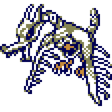

# 022 SGLARFO

[← 021 SBLARFO](021_SBLARFO.md) · [Pokédex](../pokedex.md) · [023 ANFESIBO →](023_ANFESIBO.md)

 

front · shiny

 

battle animation · shiny

animation frames (base + 2)

 party icon

 palette: normal · shiny

| | |
|---|---|
| Type | MUTANT / MECHANIC |
| HP | 65 `████████` |
| Attack | 90 `███████████` |
| Defense | 65 `████████` |
| Sp. Atk | 61 `████████` |
| Sp. Def | 61 `████████` |
| Speed | 100 `████████████` |
| Total | 442 |
| Catch rate | 90 |
| Base exp | 162 |
| Gender | 50% female |
| Growth | Medium Fast |
