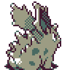

# 032 SCRAMBLO

**MEDICAL** · [← 031 KALEDENDS](031_KALEDENDS.md) · [Pokédex](../pokedex.md) · [033 GRABOIDO →](033_GRABOIDO.md)

<table><tr><th>Front</th><th>Shiny</th><th>Animated</th><th>Animated shiny</th><th>Back</th></tr><tr><td align="center" valign="bottom"></td><td align="center" valign="bottom"></td><td align="center" valign="bottom"></td><td align="center" valign="bottom"></td><td align="center" valign="bottom"></td></tr></table>

Back sprite unchanged from Pokémon Crystal.

<table><tr><td valign="top"><table><tr><th colspan="3">Base stats</th></tr><tr><td>HP</td><td align="right">46</td><td>▇▇▇▇</td></tr><tr><td>Attack</td><td align="right">57</td><td>▇▇▇▇▇</td></tr><tr><td>Defense</td><td align="right">40</td><td>▇▇▇</td></tr><tr><td>Sp. Atk</td><td align="right">40</td><td>▇▇▇</td></tr><tr><td>Sp. Def</td><td align="right">40</td><td>▇▇▇</td></tr><tr><td>Speed</td><td align="right">50</td><td>▇▇▇▇</td></tr><tr><td><b>Total</b></td><td align="right"><b>273</b></td><td></td></tr></table></td><td valign="top"><table><tr><td>Catch rate</td><td>235</td></tr><tr><td>Base exp</td><td>60</td></tr><tr><td>Gender</td><td>100% male</td></tr><tr><td>Growth</td><td>Medium Slow</td></tr></table>  party icon  palette: normal · shiny</td></tr></table>

**Animation frames** (base + 2)

## Pokédex

**POISON PIN** · 1'08" · 20.0 lb

> Found dead in a sewer. Now it can be admired in this shitty game. Yeah..

## Evolution

Evolves into [GRABOIDO](033_GRABOIDO.md) (level 16)

## Moves

| Level | Move | Type | Power | Accuracy | PP |
|--:|---|---|--:|--:|--:|
| 1 | LEER | MUTANT | — | 100% | 30 |
| 1 | TACKLE | MUTANT | 35 | 95% | 35 |
| 8 | PENTOTHAL | DRUGS | 65 | 100% | 25 |
| 12 | DOUBLE KICK | VIOLENCE | 30 | 100% | 30 |
| 17 | DIRTY NEEDLE | MEDICAL | 15 | 100% | 35 |
| 23 | FOCUS ENERGY | MUTANT | — | 100% | 30 |
| 30 | FURY ATTACK | MUTANT | 15 | 85% | 20 |
| 38 | HORN DRILL | MUTANT | — | 30% | 5 |

## Wild

| Where | How | Chance | Levels |
|---|---|---|--:|
| Area 35 | walking (swarm) | 30% | 12 |
| National Park | walking | 30% morning/day | 12 |
