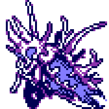
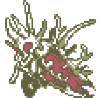

# 049 CHORDYCEPS

[← 048 GNAKGNAK](048_GNAKGNAK.md) · [Pokédex](../pokedex.md) · [050 KAZETTO →](050_KAZETTO.md)

  

front · shiny · battle animation

animation frames (base + 2)

 palette: normal · shiny

| | |
|---|---|
| Type | MILITARY / MEDICAL |
| HP | 70 `█████████` |
| Attack | 65 `████████` |
| Defense | 60 `████████` |
| Sp. Atk | 90 `███████████` |
| Sp. Def | 75 `█████████` |
| Speed | 90 `███████████` |
| Total | 450 |
| Catch rate | 75 |
| Base exp | 138 |
| Gender | 50% female |
| Growth | Medium Fast |
