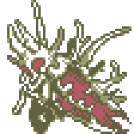
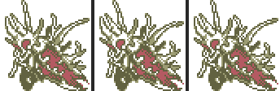

# 049 CHORDYCEPS

**MILITARY / MEDICAL** · [← 048 GNAKGNAK](048_GNAKGNAK.md) · [Pokédex](../pokedex.md) · [050 KAZETTO →](050_KAZETTO.md)

<table><tr><th>Front</th><th>Shiny</th><th>Animated</th><th>Animated shiny</th></tr><tr><td align="center" valign="bottom"></td><td align="center" valign="bottom"></td><td align="center" valign="bottom"></td><td align="center" valign="bottom"></td></tr></table>

<table><tr><td valign="top"><table><tr><th colspan="3">Base stats</th></tr><tr><td>HP</td><td align="right">70</td><td>▇▇▇▇▇▇</td></tr><tr><td>Attack</td><td align="right">65</td><td>▇▇▇▇▇</td></tr><tr><td>Defense</td><td align="right">60</td><td>▇▇▇▇▇</td></tr><tr><td>Sp. Atk</td><td align="right">90</td><td>▇▇▇▇▇▇▇▇</td></tr><tr><td>Sp. Def</td><td align="right">75</td><td>▇▇▇▇▇▇</td></tr><tr><td>Speed</td><td align="right">90</td><td>▇▇▇▇▇▇▇▇</td></tr><tr><td><b>Total</b></td><td align="right"><b>450</b></td><td></td></tr></table></td><td valign="top"><table><tr><td>Catch rate</td><td>75</td></tr><tr><td>Base exp</td><td>138</td></tr><tr><td>Gender</td><td>50% female</td></tr><tr><td>Growth</td><td>Medium Fast</td></tr></table>  party icon  palette: normal · shiny</td></tr></table>

**Animation frames** (base + 2)

## Pokédex

**POISONMOTH** · 4'11" · 28.0 lb

> The scales it scatters will paralyze anyone who touches them, making that person unable to stand.

## Evolution

Evolves from [GNAKGNAK](048_GNAKGNAK.md) (level 31)
