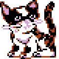
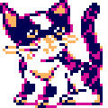
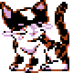
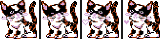

# 052 NIGGA

**MUTANT** · [← 051 GANGBANGO](051_GANGBANGO.md) · [Pokédex](../pokedex.md) · [053 TENKA →](053_TENKA.md)

<table><tr><th>Front</th><th>Shiny</th><th>Animated</th><th>Animated shiny</th></tr><tr><td align="center" valign="bottom"></td><td align="center" valign="bottom"></td><td align="center" valign="bottom"></td><td align="center" valign="bottom"></td></tr></table>

No back sprite of its own in v0.1.0.

<table><tr><td valign="top"><table><tr><th colspan="3">Base stats</th></tr><tr><td>HP</td><td align="right">40</td><td>▇▇▇</td></tr><tr><td>Attack</td><td align="right">45</td><td>▇▇▇▇</td></tr><tr><td>Defense</td><td align="right">35</td><td>▇▇▇</td></tr><tr><td>Sp. Atk</td><td align="right">40</td><td>▇▇▇</td></tr><tr><td>Sp. Def</td><td align="right">40</td><td>▇▇▇</td></tr><tr><td>Speed</td><td align="right">90</td><td>▇▇▇▇▇▇▇▇</td></tr><tr><td><b>Total</b></td><td align="right"><b>290</b></td><td></td></tr></table></td><td valign="top"><table><tr><td>Catch rate</td><td>255</td></tr><tr><td>Base exp</td><td>69</td></tr><tr><td>Gender</td><td>50% female</td></tr><tr><td>Growth</td><td>Medium Fast</td></tr></table>  party icon  palette: normal · shiny</td></tr></table>

**Animation frames** (base + 3)

## Pokédex

**SCRATCHCAT** · 1'04" · 9.0 lb

> It loves things that sparkle. When it sees a shiny object, the gold coin on its head shines too.

Pokédex text unchanged from Pokémon Crystal.

## Evolution

Does not evolve.

## Moves

| Level | Move | Type | Power | Accuracy | PP |
|--:|---|---|--:|--:|--:|
| 1 | SCRATCH | MUTANT | 40 | 100% | 35 |
| 1 | GROWL | MUTANT | — | 100% | 40 |
| 11 | BITE | DOOM | 60 | 100% | 25 |
| 20 | PAY DAY | MUTANT | 40 | 100% | 20 |
| 28 | FAINT ATTACK | DOOM | 60 | 100% | 20 |
| 35 | SCREECH | MUTANT | — | 85% | 40 |
| 41 | FURY SWIPES | MUTANT | 18 | 80% | 15 |
| 46 | SLASH | MUTANT | 70 | 100% | 20 |

## Wild

| Where | How | Chance | Levels |
|---|---|---|--:|
| Area 38 | walking | 40% night | 16 |
| Area 11 | walking | 30% night | 13 |
| Area 5 | walking | 30% night | 13 |
| Area 6 | walking | 30% night | 13 |
| Area 7 | walking | 30% night | 17 |
| Area 8 | walking | 30% night | 17 |
