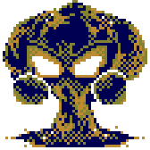

# 057 NAGASAK

**VIOLENCE** · [← 056 HIROOSH](056_HIROOSH.md) · [Pokédex](../pokedex.md) · [058 SCRATCHY →](058_SCRATCHY.md)

<table><tr><th>Front</th><th>Shiny</th><th>Animated</th><th>Animated shiny</th><th>Back</th></tr><tr><td align="center" valign="bottom"></td><td align="center" valign="bottom"></td><td align="center" valign="bottom"></td><td align="center" valign="bottom"></td><td align="center" valign="bottom"></td></tr></table>

Back sprite unchanged from Pokémon Crystal.

Plays every frame evenly; the game's own script for it is incomplete in v0.1.0.

<table><tr><td valign="top"><table><tr><th colspan="3">Base stats</th></tr><tr><td>HP</td><td align="right">65</td><td>▇▇▇▇▇</td></tr><tr><td>Attack</td><td align="right">105</td><td>▇▇▇▇▇▇▇▇▇</td></tr><tr><td>Defense</td><td align="right">60</td><td>▇▇▇▇▇</td></tr><tr><td>Sp. Atk</td><td align="right">60</td><td>▇▇▇▇▇</td></tr><tr><td>Sp. Def</td><td align="right">70</td><td>▇▇▇▇▇▇</td></tr><tr><td>Speed</td><td align="right">95</td><td>▇▇▇▇▇▇▇▇</td></tr><tr><td><b>Total</b></td><td align="right"><b>455</b></td><td></td></tr></table></td><td valign="top"><table><tr><td>Catch rate</td><td>75</td></tr><tr><td>Base exp</td><td>149</td></tr><tr><td>Gender</td><td>50% female</td></tr><tr><td>Growth</td><td>Medium Fast</td></tr></table>  party icon  palette: normal · shiny</td></tr></table>

**Animation frames** (base + 3)

## Pokédex

**PIG MONKEY** · 3'03" · 71.0 lb

> It will beat up anyone who makes it mad, even if it has to chase them until the end of the world.

Pokédex text unchanged from Pokémon Crystal.

## Evolution

Evolves from [HIROOSH](056_HIROOSH.md) (level 28)

## Moves

| Level | Move | Type | Power | Accuracy | PP |
|--:|---|---|--:|--:|--:|
| 1 | SCRATCH | MUTANT | 40 | 100% | 35 |
| 1 | LEER | MUTANT | — | 100% | 30 |
| 1 | LOW KICK | VIOLENCE | 50 | 90% | 20 |
| 1 | RAGE | MUTANT | 20 | 100% | 20 |
| 9 | LOW KICK | VIOLENCE | 50 | 90% | 20 |
| 15 | KARATE CHOP | VIOLENCE | 50 | 100% | 25 |
| 21 | FURY SWIPES | MUTANT | 18 | 80% | 15 |
| 27 | FOCUS ENERGY | MUTANT | — | 100% | 30 |
| 28 | RAGE | MUTANT | 20 | 100% | 20 |
| 36 | ATOMIC BOMB | NUCLEAR | — | 100% | 20 |
| 45 | CROSS CHOP | VIOLENCE | 100 | 80% | 5 |
| 54 | SCREECH | MUTANT | — | 85% | 40 |
| 63 | THRASH | MUTANT | 90 | 100% | 20 |

## Wild

Not in any wild encounter table.
