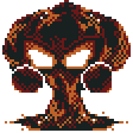

# 057 NAGASAK

[← 056 HIROOSH](056_HIROOSH.md) · [Pokédex](../pokedex.md) · [058 SCRATCHY →](058_SCRATCHY.md)

 

front · shiny

 

battle animation · shiny (all frames, evenly timed: this build's script for it is incomplete)

animation frames (base + 3)

 party icon

 palette: normal · shiny

| | |
|---|---|
| Type | VIOLENCE |
| HP | 65 `████████` |
| Attack | 105 `█████████████` |
| Defense | 60 `████████` |
| Sp. Atk | 60 `████████` |
| Sp. Def | 70 `█████████` |
| Speed | 95 `████████████` |
| Total | 455 |
| Catch rate | 75 |
| Base exp | 149 |
| Gender | 50% female |
| Growth | Medium Fast |
