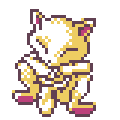
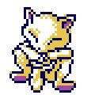

# 063 GENESUS

**NEURAL** · [← 062 SMEGMATIC](062_SMEGMATIC.md) · [Pokédex](../pokedex.md) · [064 PROFETUS →](064_PROFETUS.md)

<table><tr><th>Front</th><th>Shiny</th><th>Animated</th><th>Animated shiny</th></tr><tr><td align="center" valign="bottom"></td><td align="center" valign="bottom"></td><td align="center" valign="bottom"></td><td align="center" valign="bottom"></td></tr></table>

<table><tr><td valign="top"><table><tr><th colspan="3">Base stats</th></tr><tr><td>HP</td><td align="right">25</td><td>▇▇</td></tr><tr><td>Attack</td><td align="right">20</td><td>▇▇</td></tr><tr><td>Defense</td><td align="right">15</td><td>▇</td></tr><tr><td>Sp. Atk</td><td align="right">105</td><td>▇▇▇▇▇▇▇▇▇</td></tr><tr><td>Sp. Def</td><td align="right">55</td><td>▇▇▇▇▇</td></tr><tr><td>Speed</td><td align="right">90</td><td>▇▇▇▇▇▇▇▇</td></tr><tr><td><b>Total</b></td><td align="right"><b>310</b></td><td></td></tr></table></td><td valign="top"><table><tr><td>Catch rate</td><td>200</td></tr><tr><td>Base exp</td><td>73</td></tr><tr><td>Gender</td><td>25% female</td></tr><tr><td>Growth</td><td>Medium Slow</td></tr></table>  party icon  palette: normal · shiny</td></tr></table>

**Animation frames** (base + 3)

## Pokédex

**PSI** · 2'11" · 43.0 lb

> It hypnotizes itself so that it can teleport away when it senses danger, even if it is asleep.

## Evolution

Evolves into [PROFETUS](064_PROFETUS.md) (level 16)
