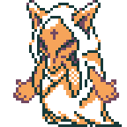
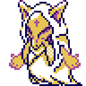
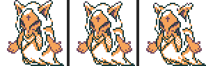

# 064 PROFETUS

**NEURAL** · [← 063 GENESUS](063_GENESUS.md) · [Pokédex](../pokedex.md) · [065 MARTIRUS →](065_MARTIRUS.md)

<table><tr><th>Front</th><th>Shiny</th><th>Animated</th><th>Animated shiny</th><th>Back</th></tr><tr><td align="center" valign="bottom"></td><td align="center" valign="bottom"></td><td align="center" valign="bottom"></td><td align="center" valign="bottom"></td><td align="center" valign="bottom"></td></tr></table>

Back sprite unchanged from Pokémon Crystal.

Plays every frame evenly; the game's own script for it is incomplete in v0.1.0.

<table><tr><td valign="top"><table><tr><th colspan="3">Base stats</th></tr><tr><td>HP</td><td align="right">40</td><td>▇▇▇</td></tr><tr><td>Attack</td><td align="right">35</td><td>▇▇▇</td></tr><tr><td>Defense</td><td align="right">30</td><td>▇▇</td></tr><tr><td>Sp. Atk</td><td align="right">120</td><td>▇▇▇▇▇▇▇▇▇▇</td></tr><tr><td>Sp. Def</td><td align="right">70</td><td>▇▇▇▇▇▇</td></tr><tr><td>Speed</td><td align="right">105</td><td>▇▇▇▇▇▇▇▇▇</td></tr><tr><td><b>Total</b></td><td align="right"><b>400</b></td><td></td></tr></table></td><td valign="top"><table><tr><td>Catch rate</td><td>100</td></tr><tr><td>Base exp</td><td>145</td></tr><tr><td>Gender</td><td>25% female</td></tr><tr><td>Growth</td><td>Medium Slow</td></tr></table>  party icon  palette: normal · shiny</td></tr></table>

**Animation frames** (base + 2)

## Pokédex

**PSI** · 4'03" · 125.0 lb

> The prophet grows up sharing his thought. Multiplying fishes

## Evolution

Evolves from [GENESUS](063_GENESUS.md) (level 16) Evolves into [MARTIRUS](065_MARTIRUS.md) (level 33)

## Moves

| Level | Move | Type | Power | Accuracy | PP |
|--:|---|---|--:|--:|--:|
| 1 | TELEPORT | NEURAL | — | 100% | 20 |
| 1 | KINESIS | NEURAL | — | 80% | 15 |
| 1 | CONFUSION | NEURAL | 50 | 100% | 25 |
| 16 | CONFUSION | NEURAL | 50 | 100% | 25 |
| 18 | DISABLE | MUTANT | — | 55% | 20 |
| 21 | BRAINWASHING | NEURAL | 65 | 100% | 20 |
| 26 | RECOVER | MUTANT | — | 100% | 20 |
| 31 | FUTURE SIGHT | NEURAL | 80 | 90% | 15 |
| 38 | MK ULTRA | NEURAL | 90 | 100% | 10 |
| 45 | REFLECT | NEURAL | — | 100% | 20 |

## Wild

| Where | How | Chance | Levels |
|---|---|---|--:|
| Area 8 | walking | 5% | 18 |
