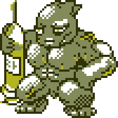
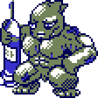
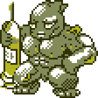
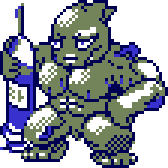
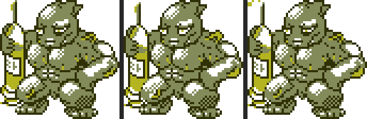

# 067 STERODO

**VIOLENCE** · [← 066 ANOREX](066_ANOREX.md) · [Pokédex](../pokedex.md) · [068 KONGORISH →](068_KONGORISH.md)

<table><tr><th>Front</th><th>Shiny</th><th>Animated</th><th>Animated shiny</th></tr><tr><td align="center" valign="bottom"></td><td align="center" valign="bottom"></td><td align="center" valign="bottom"></td><td align="center" valign="bottom"></td></tr></table>

<table><tr><td valign="top"><table><tr><th colspan="3">Base stats</th></tr><tr><td>HP</td><td align="right">80</td><td>▇▇▇▇▇▇▇</td></tr><tr><td>Attack</td><td align="right">100</td><td>▇▇▇▇▇▇▇▇</td></tr><tr><td>Defense</td><td align="right">70</td><td>▇▇▇▇▇▇</td></tr><tr><td>Sp. Atk</td><td align="right">50</td><td>▇▇▇▇</td></tr><tr><td>Sp. Def</td><td align="right">60</td><td>▇▇▇▇▇</td></tr><tr><td>Speed</td><td align="right">45</td><td>▇▇▇▇</td></tr><tr><td><b>Total</b></td><td align="right"><b>405</b></td><td></td></tr></table></td><td valign="top"><table><tr><td>Catch rate</td><td>90</td></tr><tr><td>Base exp</td><td>146</td></tr><tr><td>Gender</td><td>25% female</td></tr><tr><td>Growth</td><td>Medium Slow</td></tr></table>  party icon  palette: normal · shiny</td></tr></table>

**Animation frames** (base + 3)

## Pokédex

**SUPERPOWER** · 4'11" · 155.0 lb

> This tough POKéMON always stays in the zone. Its muscles become thicker after every battle.

## Evolution

Evolves from [ANOREX](066_ANOREX.md) (level 28) Evolves into [KONGORISH](068_KONGORISH.md) (trade)
