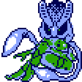
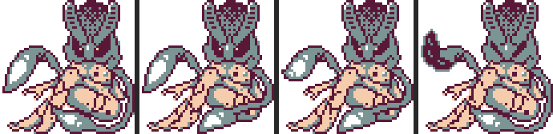

# 073 HENTAIGORE

**SEX / MEDICAL** · [← 072 HENTAICOOL](072_HENTAICOOL.md) · [Pokédex](../pokedex.md) · [074 URANIUM →](074_URANIUM.md)

<table><tr><th>Front</th><th>Shiny</th><th>Animated</th><th>Animated shiny</th><th>Back</th></tr><tr><td align="center" valign="bottom"></td><td align="center" valign="bottom"></td><td align="center" valign="bottom"></td><td align="center" valign="bottom"></td><td align="center" valign="bottom"></td></tr></table>

Back sprite unchanged from Pokémon Crystal.

<table><tr><td valign="top"><table><tr><th colspan="3">Base stats</th></tr><tr><td>HP</td><td align="right">80</td><td>▇▇▇▇▇▇▇</td></tr><tr><td>Attack</td><td align="right">70</td><td>▇▇▇▇▇▇</td></tr><tr><td>Defense</td><td align="right">65</td><td>▇▇▇▇▇</td></tr><tr><td>Sp. Atk</td><td align="right">80</td><td>▇▇▇▇▇▇▇</td></tr><tr><td>Sp. Def</td><td align="right">120</td><td>▇▇▇▇▇▇▇▇▇▇</td></tr><tr><td>Speed</td><td align="right">100</td><td>▇▇▇▇▇▇▇▇</td></tr><tr><td><b>Total</b></td><td align="right"><b>515</b></td><td></td></tr></table></td><td valign="top"><table><tr><td>Catch rate</td><td>60</td></tr><tr><td>Base exp</td><td>205</td></tr><tr><td>Gender</td><td>50% female</td></tr><tr><td>Growth</td><td>Slow</td></tr></table>  party icon  palette: normal · shiny</td></tr></table>

**Animation frames** (base + 3)

## Pokédex

**JELLYFISH** · 5'03" · 121.0 lb

> When its 80 feel- ers absorb water, it stretches to become like a net to entangle its prey.

Pokédex text unchanged from Pokémon Crystal.

## Evolution

Evolves from [HENTAICOOL](072_HENTAICOOL.md) (level 30)

## Moves

| Level | Move | Type | Power | Accuracy | PP |
|--:|---|---|--:|--:|--:|
| 1 | DIRTY NEEDLE | MEDICAL | 15 | 100% | 35 |
| 1 | SUPERSONIC | MUTANT | — | 55% | 20 |
| 1 | CONSTRICT | MUTANT | 10 | 100% | 35 |
| 6 | SUPERSONIC | MUTANT | — | 55% | 20 |
| 12 | CONSTRICT | MUTANT | 10 | 100% | 35 |
| 19 | ACID | MEDICAL | 40 | 100% | 30 |
| 25 | BUBBLEBEAM | SEX | 65 | 100% | 20 |
| 30 | WRAP | MUTANT | 15 | 85% | 20 |
| 38 | BARRIER | NEURAL | — | 100% | 30 |
| 47 | SCREECH | MUTANT | — | 85% | 40 |
| 55 | MEGA SQUIRT | SEX | 120 | 80% | 5 |

## Wild

| Where | How | Chance | Levels |
|---|---|---|--:|
| Whirl Islands (Whirl Island Lugia Chamber) | surfing | 30% | 20 |
| Area 12 | surfing | 10% | 25 |
| Area 13 | surfing | 10% | 25 |
| Area 19 | surfing | 10% | 35 |
| Area 20 | surfing | 10% | 35 |
| Area 21 | surfing | 10% | 35 |
| Area 26 | surfing | 10% | 30 |
| Area 27 | surfing | 10% | 20 |
| Area 32 | surfing | 10% | 20 |
| Area 34 | surfing | 10% | 20 |
| Area 40 | surfing | 10% | 20 |
| Cinnabar Island | surfing | 10% | 35 |
| Government (Olivine City) | surfing | 10% | 20 |
| Government (Olivine Port) | surfing | 10% | 20 |
| Hometown | surfing | 10% | 20 |
| Nearbytown | surfing | 10% | 20 |
| Oversea Asylum | surfing | 10% | 20 |
| Pallet Town | surfing | 10% | 35 |
| Union Cave B2F | surfing | 10% | 20 |
| Vermilion City | surfing | 10% | 35 |
| Vermilion City (Vermilion Port) | surfing | 10% | 35 |
| Whirl Island Sw | surfing | 10% | 20 |
| Whirl Islands (Whirl Island B2F) | surfing | 10% | 20 |
