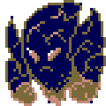
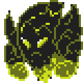
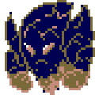

# 074 URANIUM

**MINERAL / ORGANIC** · [← 073 HENTAIGORE](073_HENTAIGORE.md) · [Pokédex](../pokedex.md) · [075 PLUTONIUM →](075_PLUTONIUM.md)

<table><tr><th>Front</th><th>Shiny</th><th>Animated</th><th>Animated shiny</th></tr><tr><td align="center" valign="bottom"></td><td align="center" valign="bottom"></td><td align="center" valign="bottom"></td><td align="center" valign="bottom"></td></tr></table>

<table><tr><td valign="top"><table><tr><th colspan="3">Base stats</th></tr><tr><td>HP</td><td align="right">40</td><td>▇▇▇</td></tr><tr><td>Attack</td><td align="right">80</td><td>▇▇▇▇▇▇▇</td></tr><tr><td>Defense</td><td align="right">100</td><td>▇▇▇▇▇▇▇▇</td></tr><tr><td>Sp. Atk</td><td align="right">30</td><td>▇▇</td></tr><tr><td>Sp. Def</td><td align="right">30</td><td>▇▇</td></tr><tr><td>Speed</td><td align="right">20</td><td>▇▇</td></tr><tr><td><b>Total</b></td><td align="right"><b>300</b></td><td></td></tr></table></td><td valign="top"><table><tr><td>Catch rate</td><td>255</td></tr><tr><td>Base exp</td><td>86</td></tr><tr><td>Gender</td><td>50% female</td></tr><tr><td>Growth</td><td>Medium Slow</td></tr></table>  party icon  palette: normal · shiny</td></tr></table>

**Animation frames** (base + 2)

## Pokédex

**ROCK** · 1'04" · 44.0 lb

> Proud of their sturdy bodies, they bash against each other in a contest to prove whose is harder.

## Evolution

Evolves into [PLUTONIUM](075_PLUTONIUM.md) (level 25)
