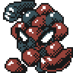
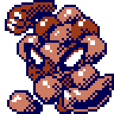
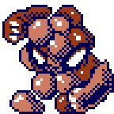
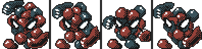

# 076 ATOMIUM

**MINERAL / ORGANIC** · [← 075 PLUTONIUM](075_PLUTONIUM.md) · [Pokédex](../pokedex.md) · [077 HELLESTO →](077_HELLESTO.md)

<table><tr><th>Front</th><th>Shiny</th><th>Animated</th><th>Animated shiny</th></tr><tr><td align="center" valign="bottom"></td><td align="center" valign="bottom"></td><td align="center" valign="bottom"></td><td align="center" valign="bottom"></td></tr></table>

<table><tr><td valign="top"><table><tr><th colspan="3">Base stats</th></tr><tr><td>HP</td><td align="right">80</td><td>▇▇▇▇▇▇▇</td></tr><tr><td>Attack</td><td align="right">110</td><td>▇▇▇▇▇▇▇▇▇</td></tr><tr><td>Defense</td><td align="right">130</td><td>▇▇▇▇▇▇▇▇▇▇▇</td></tr><tr><td>Sp. Atk</td><td align="right">55</td><td>▇▇▇▇▇</td></tr><tr><td>Sp. Def</td><td align="right">65</td><td>▇▇▇▇▇</td></tr><tr><td>Speed</td><td align="right">45</td><td>▇▇▇▇</td></tr><tr><td><b>Total</b></td><td align="right"><b>485</b></td><td></td></tr></table></td><td valign="top"><table><tr><td>Catch rate</td><td>45</td></tr><tr><td>Base exp</td><td>177</td></tr><tr><td>Gender</td><td>50% female</td></tr><tr><td>Growth</td><td>Medium Slow</td></tr></table>  party icon  palette: normal · shiny</td></tr></table>

**Animation frames** (base + 3)

## Pokédex

**MEGATON** · 4'07" · 662.0 lb

> Its rock-like body is so durable, even high-powered dynamite blasts fail to scratch its rugged hide.

## Evolution

Evolves from [PLUTONIUM](075_PLUTONIUM.md) (trade)
