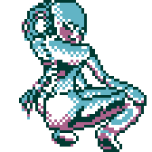

# 082 SORAYAMBOT

**NUCLEAR / CYBER** · [← 081 GHOSHELLO](081_GHOSHELLO.md) · [Pokédex](../pokedex.md) · [083 BONDAGEDOG →](083_BONDAGEDOG.md)

<table><tr><th>Front</th><th>Shiny</th><th>Animated</th><th>Animated shiny</th><th>Back</th></tr><tr><td align="center" valign="bottom"></td><td align="center" valign="bottom"></td><td align="center" valign="bottom"></td><td align="center" valign="bottom"></td><td align="center" valign="bottom"></td></tr></table>

Back sprite unchanged from Pokémon Crystal.

Plays every frame evenly; the game's own script for it is incomplete in v0.1.0.

<table><tr><td valign="top"><table><tr><th colspan="3">Base stats</th></tr><tr><td>HP</td><td align="right">50</td><td>▇▇▇▇</td></tr><tr><td>Attack</td><td align="right">60</td><td>▇▇▇▇▇</td></tr><tr><td>Defense</td><td align="right">95</td><td>▇▇▇▇▇▇▇▇</td></tr><tr><td>Sp. Atk</td><td align="right">120</td><td>▇▇▇▇▇▇▇▇▇▇</td></tr><tr><td>Sp. Def</td><td align="right">70</td><td>▇▇▇▇▇▇</td></tr><tr><td>Speed</td><td align="right">70</td><td>▇▇▇▇▇▇</td></tr><tr><td><b>Total</b></td><td align="right"><b>465</b></td><td></td></tr></table></td><td valign="top"><table><tr><td>Catch rate</td><td>60</td></tr><tr><td>Base exp</td><td>161</td></tr><tr><td>Gender</td><td>genderless</td></tr><tr><td>Growth</td><td>Medium Fast</td></tr></table>  party icon  palette: normal · shiny</td></tr></table>

**Animation frames** (base + 3)

## Pokédex

**MAGNET** · 3'03" · 132.0 lb

> When many MAGNETON gather together, the resulting magnetic storm disrupts radio waves.

Pokédex text unchanged from Pokémon Crystal.

## Evolution

Evolves from [GHOSHELLO](081_GHOSHELLO.md) (level 30)

## Moves

| Level | Move | Type | Power | Accuracy | PP |
|--:|---|---|--:|--:|--:|
| 1 | TACKLE | MUTANT | 35 | 95% | 35 |
| 1 | THUNDERSHOCK | NUCLEAR | 40 | 100% | 30 |
| 1 | SUPERSONIC | MUTANT | — | 55% | 20 |
| 1 | SONICBOOM | MUTANT | 20 | 90% | 20 |
| 6 | THUNDERSHOCK | NUCLEAR | 40 | 100% | 30 |
| 11 | SUPERSONIC | MUTANT | — | 55% | 20 |
| 16 | SONICBOOM | MUTANT | 20 | 90% | 20 |
| 21 | THUNDER WAVE | NUCLEAR | — | 100% | 20 |
| 27 | LOCK-ON | MUTANT | — | 100% | 5 |
| 35 | TRI ATTACK | MUTANT | 80 | 100% | 10 |
| 43 | SCREECH | MUTANT | — | 85% | 40 |
| 53 | ZAP CANNON | NUCLEAR | 100 | 50% | 5 |

## Wild

Not in any wild encounter table.
