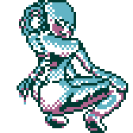

# 082 SORAYAMBOT

**NUCLEAR / CYBER** · [← 081 GHOSHELLO](081_GHOSHELLO.md) · [Pokédex](../pokedex.md) · [083 BONDAGEDOG →](083_BONDAGEDOG.md)

<table><tr><th>Front</th><th>Shiny</th><th>Animated</th><th>Animated shiny</th></tr><tr><td align="center" valign="bottom"></td><td align="center" valign="bottom"></td><td align="center" valign="bottom"></td><td align="center" valign="bottom"></td></tr></table>

<table><tr><td valign="top"><table><tr><th colspan="3">Base stats</th></tr><tr><td>HP</td><td align="right">50</td><td>▇▇▇▇</td></tr><tr><td>Attack</td><td align="right">60</td><td>▇▇▇▇▇</td></tr><tr><td>Defense</td><td align="right">95</td><td>▇▇▇▇▇▇▇▇</td></tr><tr><td>Sp. Atk</td><td align="right">120</td><td>▇▇▇▇▇▇▇▇▇▇</td></tr><tr><td>Sp. Def</td><td align="right">70</td><td>▇▇▇▇▇▇</td></tr><tr><td>Speed</td><td align="right">70</td><td>▇▇▇▇▇▇</td></tr><tr><td><b>Total</b></td><td align="right"><b>465</b></td><td></td></tr></table></td><td valign="top"><table><tr><td>Catch rate</td><td>60</td></tr><tr><td>Base exp</td><td>161</td></tr><tr><td>Gender</td><td>genderless</td></tr><tr><td>Growth</td><td>Medium Fast</td></tr></table>  party icon  palette: normal · shiny</td></tr></table>

**Animation frames** (base + 3)

## Pokédex

**MAGNET** · 3'03" · 132.0 lb

> When many MAGNETON gather together, the resulting magnetic storm disrupts radio waves.

## Evolution

Evolves from [GHOSHELLO](081_GHOSHELLO.md) (level 30)
