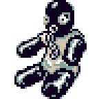
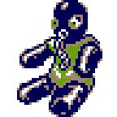
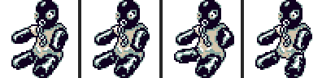

# 083 BONDAGEDOG

[← 082 SORAYAMBOT](082_SORAYAMBOT.md) · [Pokédex](../pokedex.md) · [084 BIPOLARIO →](084_BIPOLARIO.md)

 

front · shiny

 

battle animation · shiny

animation frames (base + 3)

 party icon

 palette: normal · shiny

| | |
|---|---|
| Type | MUTANT / MECHANIC |
| HP | 52 `██████` |
| Attack | 65 `████████` |
| Defense | 55 `███████` |
| Sp. Atk | 58 `███████` |
| Sp. Def | 62 `████████` |
| Speed | 60 `████████` |
| Total | 352 |
| Catch rate | 45 |
| Base exp | 94 |
| Gender | 50% female |
| Growth | Medium Fast |
