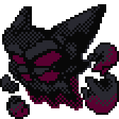
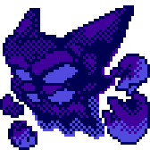
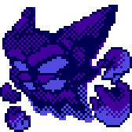

# 093 WRAITARL

**DEATH / MEDICAL** · [← 092 GOSBAMP](092_GOSBAMP.md) · [Pokédex](../pokedex.md) · [094 TREROR →](094_TREROR.md)

<table><tr><th>Front</th><th>Shiny</th><th>Animated</th><th>Animated shiny</th></tr><tr><td align="center" valign="bottom"></td><td align="center" valign="bottom"></td><td align="center" valign="bottom"></td><td align="center" valign="bottom"></td></tr></table>

<table><tr><td valign="top"><table><tr><th colspan="3">Base stats</th></tr><tr><td>HP</td><td align="right">45</td><td>▇▇▇▇</td></tr><tr><td>Attack</td><td align="right">50</td><td>▇▇▇▇</td></tr><tr><td>Defense</td><td align="right">45</td><td>▇▇▇▇</td></tr><tr><td>Sp. Atk</td><td align="right">115</td><td>▇▇▇▇▇▇▇▇▇▇</td></tr><tr><td>Sp. Def</td><td align="right">55</td><td>▇▇▇▇▇</td></tr><tr><td>Speed</td><td align="right">95</td><td>▇▇▇▇▇▇▇▇</td></tr><tr><td><b>Total</b></td><td align="right"><b>405</b></td><td></td></tr></table></td><td valign="top"><table><tr><td>Catch rate</td><td>90</td></tr><tr><td>Base exp</td><td>126</td></tr><tr><td>Gender</td><td>50% female</td></tr><tr><td>Growth</td><td>Medium Slow</td></tr></table>  party icon  palette: normal · shiny</td></tr></table>

**Animation frames** (base + 3)

## Pokédex

**GAS** · 5'03" · 0.2 lb

> It hides in the dark, planning to take the life of the next living thing that wanders close by.

## Evolution

Evolves from [GOSBAMP](092_GOSBAMP.md) (level 25) Evolves into [TREROR](094_TREROR.md) (trade)
