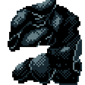
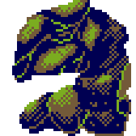
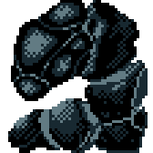
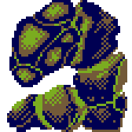

# 095 OBSIDIAN

**MINERAL / ORGANIC** · [← 094 TREROR](094_TREROR.md) · [Pokédex](../pokedex.md) · [096 DUPUPETT →](096_DUPUPETT.md)

<table><tr><th>Front</th><th>Shiny</th><th>Animated</th><th>Animated shiny</th><th>Back</th></tr><tr><td align="center" valign="bottom"></td><td align="center" valign="bottom"></td><td align="center" valign="bottom"></td><td align="center" valign="bottom"></td><td align="center" valign="bottom"></td></tr></table>

Back sprite unchanged from Pokémon Crystal.

<table><tr><td valign="top"><table><tr><th colspan="3">Base stats</th></tr><tr><td>HP</td><td align="right">35</td><td>▇▇▇</td></tr><tr><td>Attack</td><td align="right">45</td><td>▇▇▇▇</td></tr><tr><td>Defense</td><td align="right">160</td><td>▇▇▇▇▇▇▇▇▇▇▇▇▇</td></tr><tr><td>Sp. Atk</td><td align="right">30</td><td>▇▇</td></tr><tr><td>Sp. Def</td><td align="right">45</td><td>▇▇▇▇</td></tr><tr><td>Speed</td><td align="right">70</td><td>▇▇▇▇▇▇</td></tr><tr><td><b>Total</b></td><td align="right"><b>385</b></td><td></td></tr></table></td><td valign="top"><table><tr><td>Catch rate</td><td>45</td></tr><tr><td>Base exp</td><td>108</td></tr><tr><td>Gender</td><td>50% female</td></tr><tr><td>Growth</td><td>Medium Fast</td></tr></table>  party icon  palette: normal · shiny</td></tr></table>

**Animation frames** (base + 2)

## Pokédex

**ROCK SNAKE** · 28'10" · 463.0 lb

> When the world collapsed, only the monsters made out of radiations benefited from the situation

## Evolution

Does not evolve.

## Moves

| Level | Move | Type | Power | Accuracy | PP |
|--:|---|---|--:|--:|--:|
| 1 | TACKLE | MUTANT | 35 | 95% | 35 |
| 1 | SCREECH | MUTANT | — | 85% | 40 |
| 10 | BIND | MUTANT | 15 | 75% | 20 |
| 14 | FECAL MATTER | ORGANIC | 50 | 90% | 15 |
| 23 | HARDEN | MUTANT | — | 100% | 30 |
| 27 | RAGE | MUTANT | 20 | 100% | 20 |
| 36 | SANDSTORM | MINERAL | — | 100% | 10 |
| 40 | SLAM | MUTANT | 80 | 75% | 20 |

## Wild

| Where | How | Chance | Levels |
|---|---|---|--:|
| Silver Cave Room 3 | walking | 30% | 48 |
| Rock Tunnel B1F | walking | 20% | 16 |
| Silver Cave Room 1 | walking | 20% | 42 |
| Victory Road | walking | 20% | 32-33 |
| Union Cave B1F | walking | 10% | 8 |
| Union Cave 1F | walking | 5% | 6 |
| Union Cave B2F | walking | 5% | 23 |
