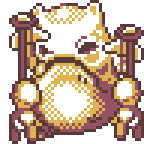
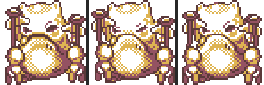

# 096 DUPUPETT

**NEURAL / PUPPET** · [← 095 OBSIDIAN](095_OBSIDIAN.md) · [Pokédex](../pokedex.md) · [097 BURHAT →](097_BURHAT.md)

<table><tr><th>Front</th><th>Shiny</th><th>Animated</th><th>Animated shiny</th><th>Back</th></tr><tr><td align="center" valign="bottom"></td><td align="center" valign="bottom"></td><td align="center" valign="bottom"></td><td align="center" valign="bottom"></td><td align="center" valign="bottom"></td></tr></table>

<table><tr><td valign="top"><table><tr><th colspan="3">Base stats</th></tr><tr><td>HP</td><td align="right">60</td><td>▇▇▇▇▇</td></tr><tr><td>Attack</td><td align="right">48</td><td>▇▇▇▇</td></tr><tr><td>Defense</td><td align="right">45</td><td>▇▇▇▇</td></tr><tr><td>Sp. Atk</td><td align="right">43</td><td>▇▇▇▇</td></tr><tr><td>Sp. Def</td><td align="right">90</td><td>▇▇▇▇▇▇▇▇</td></tr><tr><td>Speed</td><td align="right">42</td><td>▇▇▇▇</td></tr><tr><td><b>Total</b></td><td align="right"><b>328</b></td><td></td></tr></table></td><td valign="top"><table><tr><td>Catch rate</td><td>190</td></tr><tr><td>Base exp</td><td>102</td></tr><tr><td>Gender</td><td>50% female</td></tr><tr><td>Growth</td><td>Medium Fast</td></tr></table>  party icon  palette: normal · shiny</td></tr></table>

**Animation frames** (base + 2)

## Pokédex

**HYPNOSIS** · 3'03" · 71.0 lb

> When it twitches its nose, it can tell where someone is sleeping and what that person is dreaming about.

## Evolution

Evolves into [BURHAT](097_BURHAT.md) (level 26)
