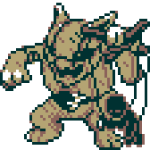
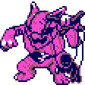
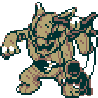
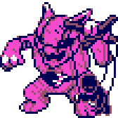

# 097 BURHAT

**NEURAL / PUPPET** · [← 096 DUPUPETT](096_DUPUPETT.md) · [Pokédex](../pokedex.md) · [098 TOXIWASTE →](098_TOXIWASTE.md)

<table><tr><th>Front</th><th>Shiny</th><th>Animated</th><th>Animated shiny</th></tr><tr><td align="center" valign="bottom"></td><td align="center" valign="bottom"></td><td align="center" valign="bottom"></td><td align="center" valign="bottom"></td></tr></table>

No back sprite of its own in v0.1.0.

<table><tr><td valign="top"><table><tr><th colspan="3">Base stats</th></tr><tr><td>HP</td><td align="right">85</td><td>▇▇▇▇▇▇▇</td></tr><tr><td>Attack</td><td align="right">73</td><td>▇▇▇▇▇▇</td></tr><tr><td>Defense</td><td align="right">70</td><td>▇▇▇▇▇▇</td></tr><tr><td>Sp. Atk</td><td align="right">73</td><td>▇▇▇▇▇▇</td></tr><tr><td>Sp. Def</td><td align="right">115</td><td>▇▇▇▇▇▇▇▇▇▇</td></tr><tr><td>Speed</td><td align="right">67</td><td>▇▇▇▇▇▇</td></tr><tr><td><b>Total</b></td><td align="right"><b>483</b></td><td></td></tr></table></td><td valign="top"><table><tr><td>Catch rate</td><td>75</td></tr><tr><td>Base exp</td><td>165</td></tr><tr><td>Gender</td><td>50% female</td></tr><tr><td>Growth</td><td>Medium Fast</td></tr></table>  party icon  palette: normal · shiny</td></tr></table>

**Animation frames** (base + 3)

## Pokédex

**HYPNOSIS** · 5'03" · 167.0 lb

> The longer it swings its pendulum, the longer the effects of its hypnosis last.

Pokédex text unchanged from Pokémon Crystal.

## Evolution

Evolves from [DUPUPETT](096_DUPUPETT.md) (level 26)

## Moves

| Level | Move | Type | Power | Accuracy | PP |
|--:|---|---|--:|--:|--:|
| 1 | POUND | MUTANT | 40 | 100% | 35 |
| 1 | HYPNOSIS | NEURAL | — | 60% | 20 |
| 1 | DISABLE | MUTANT | — | 55% | 20 |
| 1 | CONFUSION | NEURAL | 50 | 100% | 25 |
| 10 | DISABLE | MUTANT | — | 55% | 20 |
| 18 | CONFUSION | NEURAL | 50 | 100% | 25 |
| 25 | SCAVENGE | MUTANT | 70 | 100% | 15 |
| 33 | POISON GAS | MEDICAL | — | 55% | 40 |
| 40 | MEDITATE | NEURAL | — | 100% | 40 |
| 49 | MK ULTRA | NEURAL | 90 | 100% | 10 |
| 55 | PSYCH UP | MUTANT | — | 100% | 10 |
| 60 | FUTURE SIGHT | NEURAL | 80 | 90% | 15 |

## Wild

| Where | How | Chance | Levels |
|---|---|---|--:|
| Area 11 | walking | 5% night | 16 |
