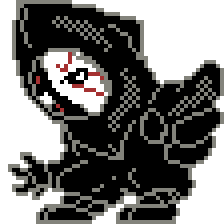
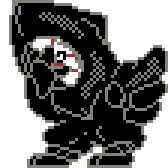

# 103 MASKABUKI

[← 102 DARUMORT](102_DARUMORT.md) · [Pokédex](../pokedex.md) · [104 RIOTTO →](104_RIOTTO.md)

 

front · shiny

 

battle animation · shiny

animation frames (base + 3)

 party icon

 palette: normal · shiny

| | |
|---|---|
| Type | DRUGS / NEURAL |
| HP | 95 `████████████` |
| Attack | 95 `████████████` |
| Defense | 85 `███████████` |
| Sp. Atk | 125 `████████████████` |
| Sp. Def | 65 `████████` |
| Speed | 55 `███████` |
| Total | 520 |
| Catch rate | 45 |
| Base exp | 212 |
| Gender | 50% female |
| Growth | Slow |
