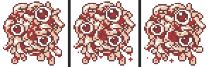

# 114 WORMICELLI

**DRUGS** · [← 113 PREGNANTA](113_PREGNANTA.md) · [Pokédex](../pokedex.md) · [115 HELLTECH →](115_HELLTECH.md)

<table><tr><th>Front</th><th>Shiny</th><th>Animated</th><th>Animated shiny</th><th>Back</th></tr><tr><td align="center" valign="bottom"></td><td align="center" valign="bottom"></td><td align="center" valign="bottom"></td><td align="center" valign="bottom"></td><td align="center" valign="bottom"></td></tr></table>

Back sprite unchanged from Pokémon Crystal.

<table><tr><td valign="top"><table><tr><th colspan="3">Base stats</th></tr><tr><td>HP</td><td align="right">65</td><td>▇▇▇▇▇</td></tr><tr><td>Attack</td><td align="right">55</td><td>▇▇▇▇▇</td></tr><tr><td>Defense</td><td align="right">115</td><td>▇▇▇▇▇▇▇▇▇▇</td></tr><tr><td>Sp. Atk</td><td align="right">100</td><td>▇▇▇▇▇▇▇▇</td></tr><tr><td>Sp. Def</td><td align="right">40</td><td>▇▇▇</td></tr><tr><td>Speed</td><td align="right">60</td><td>▇▇▇▇▇</td></tr><tr><td><b>Total</b></td><td align="right"><b>435</b></td><td></td></tr></table></td><td valign="top"><table><tr><td>Catch rate</td><td>45</td></tr><tr><td>Base exp</td><td>166</td></tr><tr><td>Gender</td><td>50% female</td></tr><tr><td>Growth</td><td>Medium Fast</td></tr></table>  party icon  palette: normal · shiny</td></tr></table>

**Animation frames** (base + 2)

## Pokédex

**VINE** · 3'03" · 77.0 lb

> Dust, eyes, teeth. Everything goes in- to this mutation. It's just some- thing ugly that has become worse

## Evolution

Does not evolve.

## Moves

| Level | Move | Type | Power | Accuracy | PP |
|--:|---|---|--:|--:|--:|
| 1 | CONSTRICT | MUTANT | 10 | 100% | 35 |
| 4 | SLEEP POWDER | DRUGS | — | 75% | 15 |
| 10 | ABSORB | DRUGS | 20 | 100% | 20 |
| 13 | POISONPOWDER | MEDICAL | — | 75% | 35 |
| 19 | VINE WHIP | DRUGS | 35 | 100% | 10 |
| 25 | BIND | MUTANT | 15 | 75% | 20 |
| 31 | MEGA DRAIN | DRUGS | 40 | 100% | 10 |
| 34 | STUN SPORE | DRUGS | — | 75% | 30 |
| 40 | SLAM | MUTANT | 80 | 75% | 20 |
| 46 | GROWTH | MUTANT | — | 100% | 40 |

## Wild

| Where | How | Chance | Levels |
|---|---|---|--:|
| Area 21 | walking | 60% night, 50% morning/day | 28-35 |
| Area 28 | walking | 30% | 39 |
| Area 44 | walking | 30% | 23 |
| Silver Cave Outside | walking | 30% | 41 |
