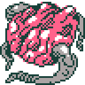
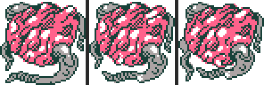

# 121 IRUKUNJI

[← 120 MALOKINGI](120_MALOKINGI.md) · [Pokédex](../pokedex.md) · [122 MR.SHADOW →](122_MR_SHADOW.md)

 

front · shiny

 

battle animation · shiny (all frames, evenly timed: this build's script for it is incomplete)

animation frames (base + 2)

 party icon

 palette: normal · shiny

| | |
|---|---|
| Type | SEX / NEURAL |
| HP | 60 `████████` |
| Attack | 75 `█████████` |
| Defense | 85 `███████████` |
| Sp. Atk | 100 `████████████` |
| Sp. Def | 85 `███████████` |
| Speed | 115 `██████████████` |
| Total | 520 |
| Catch rate | 60 |
| Base exp | 207 |
| Gender | genderless |
| Growth | Slow |
