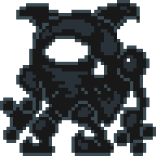

# 122 MR.SHADOW

[← 121 IRUKUNJI](121_IRUKUNJI.md) · [Pokédex](../pokedex.md) · [123 HANZORU →](123_HANZORU.md)

  

front · shiny · battle animation (approximate timing: this build's animation script is incomplete)

animation frames (base + 3)

 palette: normal · shiny

| | |
|---|---|
| Type | NEURAL |
| HP | 40 `█████` |
| Attack | 45 `██████` |
| Defense | 65 `████████` |
| Sp. Atk | 100 `████████████` |
| Sp. Def | 120 `███████████████` |
| Speed | 90 `███████████` |
| Total | 460 |
| Catch rate | 45 |
| Base exp | 136 |
| Gender | 50% female |
| Growth | Medium Fast |
