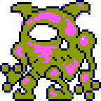

# 122 MR.SHADOW

**NEURAL** · [← 121 IRUKUNJI](121_IRUKUNJI.md) · [Pokédex](../pokedex.md) · [123 HANZORU →](123_HANZORU.md)

<table><tr><th>Front</th><th>Shiny</th><th>Animated</th><th>Animated shiny</th><th>Back</th></tr><tr><td align="center" valign="bottom"></td><td align="center" valign="bottom"></td><td align="center" valign="bottom"></td><td align="center" valign="bottom"></td><td align="center" valign="bottom"></td></tr></table>

Back sprite unchanged from Pokémon Crystal.

Plays every frame evenly; the game's own script for it is incomplete in v0.1.0.

<table><tr><td valign="top"><table><tr><th colspan="3">Base stats</th></tr><tr><td>HP</td><td align="right">40</td><td>▇▇▇</td></tr><tr><td>Attack</td><td align="right">45</td><td>▇▇▇▇</td></tr><tr><td>Defense</td><td align="right">65</td><td>▇▇▇▇▇</td></tr><tr><td>Sp. Atk</td><td align="right">100</td><td>▇▇▇▇▇▇▇▇</td></tr><tr><td>Sp. Def</td><td align="right">120</td><td>▇▇▇▇▇▇▇▇▇▇</td></tr><tr><td>Speed</td><td align="right">90</td><td>▇▇▇▇▇▇▇▇</td></tr><tr><td><b>Total</b></td><td align="right"><b>460</b></td><td></td></tr></table></td><td valign="top"><table><tr><td>Catch rate</td><td>45</td></tr><tr><td>Base exp</td><td>136</td></tr><tr><td>Gender</td><td>50% female</td></tr><tr><td>Growth</td><td>Medium Fast</td></tr></table>  party icon  palette: normal · shiny</td></tr></table>

**Animation frames** (base + 3)

## Pokédex

**BARRIER** · 4'03" · 120.0 lb

> It uses the mysterious power it has in its fingers to solidify air into an invisible wall.

Pokédex text unchanged from Pokémon Crystal.

## Evolution

Evolves into [KORNUPIAK](080_KORNUPIAK.md) (level 37)

## Moves

| Level | Move | Type | Power | Accuracy | PP |
|--:|---|---|--:|--:|--:|
| 1 | BARRIER | NEURAL | — | 100% | 30 |
| 6 | CONFUSION | NEURAL | 50 | 100% | 25 |
| 11 | SUBSTITUTE | MUTANT | — | 100% | 10 |
| 16 | MEDITATE | NEURAL | — | 100% | 40 |
| 21 | DOUBLESLAP | MUTANT | 15 | 85% | 10 |
| 26 | LIGHT SCREEN | NEURAL | — | 100% | 30 |
| 26 | REFLECT | NEURAL | — | 100% | 20 |
| 31 | ENCORE | MUTANT | — | 100% | 5 |
| 36 | BRAINWASHING | NEURAL | 65 | 100% | 20 |
| 41 | BATON PASS | MUTANT | — | 100% | 40 |
| 46 | SAFEGUARD | MUTANT | — | 100% | 25 |

## Wild

| Where | How | Chance | Levels |
|---|---|---|--:|
| Area 21 | walking | 10% morning/day | 28-30 |
