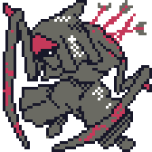
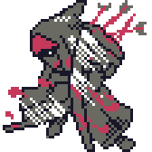

# 123 HANZORU

**MILITARY / MECHANIC** · [← 122 MR.SHADOW](122_MR_SHADOW.md) · [Pokédex](../pokedex.md) · [124 JYZZO →](124_JYZZO.md)

<table><tr><th>Front</th><th>Shiny</th><th>Animated</th><th>Animated shiny</th></tr><tr><td align="center" valign="bottom"></td><td align="center" valign="bottom"></td><td align="center" valign="bottom"></td><td align="center" valign="bottom"></td></tr></table>

Animation: all frames, evenly timed: this build's script for it is incomplete.

<table><tr><td valign="top"><table><tr><th colspan="3">Base stats</th></tr><tr><td>HP</td><td align="right">70</td><td>▇▇▇▇▇▇</td></tr><tr><td>Attack</td><td align="right">110</td><td>▇▇▇▇▇▇▇▇▇</td></tr><tr><td>Defense</td><td align="right">80</td><td>▇▇▇▇▇▇▇</td></tr><tr><td>Sp. Atk</td><td align="right">55</td><td>▇▇▇▇▇</td></tr><tr><td>Sp. Def</td><td align="right">80</td><td>▇▇▇▇▇▇▇</td></tr><tr><td>Speed</td><td align="right">105</td><td>▇▇▇▇▇▇▇▇▇</td></tr><tr><td><b>Total</b></td><td align="right"><b>500</b></td><td></td></tr></table></td><td valign="top"><table><tr><td>Catch rate</td><td>45</td></tr><tr><td>Base exp</td><td>187</td></tr><tr><td>Gender</td><td>50% female</td></tr><tr><td>Growth</td><td>Medium Fast</td></tr></table>  party icon  palette: normal · shiny</td></tr></table>

**Animation frames** (base + 3)

