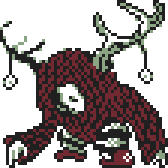
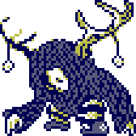

# 127 SHAMABOO

**MILITARY** · [← 126 BURNAR](126_BURNAR.md) · [Pokédex](../pokedex.md) · [128 DIGESTOR →](128_DIGESTOR.md)

<table><tr><th>Front</th><th>Shiny</th><th>Animated</th><th>Animated shiny</th><th>Back</th></tr><tr><td align="center" valign="bottom"></td><td align="center" valign="bottom"></td><td align="center" valign="bottom"></td><td align="center" valign="bottom"></td><td align="center" valign="bottom"></td></tr></table>

Back sprite unchanged from Pokémon Crystal.

Plays every frame evenly; the game's own script for it is incomplete in v0.1.0.

<table><tr><td valign="top"><table><tr><th colspan="3">Base stats</th></tr><tr><td>HP</td><td align="right">65</td><td>▇▇▇▇▇</td></tr><tr><td>Attack</td><td align="right">125</td><td>▇▇▇▇▇▇▇▇▇▇</td></tr><tr><td>Defense</td><td align="right">100</td><td>▇▇▇▇▇▇▇▇</td></tr><tr><td>Sp. Atk</td><td align="right">55</td><td>▇▇▇▇▇</td></tr><tr><td>Sp. Def</td><td align="right">70</td><td>▇▇▇▇▇▇</td></tr><tr><td>Speed</td><td align="right">85</td><td>▇▇▇▇▇▇▇</td></tr><tr><td><b>Total</b></td><td align="right"><b>500</b></td><td></td></tr></table></td><td valign="top"><table><tr><td>Catch rate</td><td>45</td></tr><tr><td>Base exp</td><td>200</td></tr><tr><td>Gender</td><td>50% female</td></tr><tr><td>Growth</td><td>Slow</td></tr></table>  party icon  palette: normal · shiny</td></tr></table>

**Animation frames** (base + 3)

## Pokédex

**STAGBEETLE** · 4'11" · 121.0 lb

> An old powerful shaman. His existence is lost in time, Nobody saw him without his mask

## Evolution

Does not evolve.

## Moves

| Level | Move | Type | Power | Accuracy | PP |
|--:|---|---|--:|--:|--:|
| 1 | VICEGRIP | MUTANT | 55 | 100% | 30 |
| 7 | FOCUS ENERGY | MUTANT | — | 100% | 30 |
| 13 | BIND | MUTANT | 15 | 75% | 20 |
| 19 | ATOMIC BOMB | NUCLEAR | — | 100% | 20 |
| 25 | HARDEN | MUTANT | — | 100% | 30 |
| 31 | GUILLOTINE | MUTANT | — | 30% | 5 |
| 37 | SUBMISSION | VIOLENCE | 80 | 80% | 25 |
| 43 | SWORDS DANCE | MUTANT | — | 100% | 30 |

## Wild

Not in any wild encounter table.
