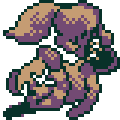
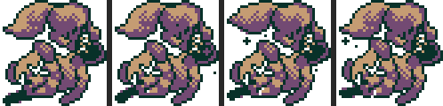

# 133 DEADDOG

**MUTANT** · [← 132 SHITTO](132_SHITTO.md) · [Pokédex](../pokedex.md) · [134 VENEREON →](134_VENEREON.md)

<table><tr><th>Front</th><th>Shiny</th><th>Animated</th><th>Animated shiny</th></tr><tr><td align="center" valign="bottom"></td><td align="center" valign="bottom"></td><td align="center" valign="bottom"></td><td align="center" valign="bottom"></td></tr></table>

<table><tr><td valign="top"><table><tr><th colspan="3">Base stats</th></tr><tr><td>HP</td><td align="right">55</td><td>▇▇▇▇▇</td></tr><tr><td>Attack</td><td align="right">55</td><td>▇▇▇▇▇</td></tr><tr><td>Defense</td><td align="right">50</td><td>▇▇▇▇</td></tr><tr><td>Sp. Atk</td><td align="right">45</td><td>▇▇▇▇</td></tr><tr><td>Sp. Def</td><td align="right">65</td><td>▇▇▇▇▇</td></tr><tr><td>Speed</td><td align="right">55</td><td>▇▇▇▇▇</td></tr><tr><td><b>Total</b></td><td align="right"><b>325</b></td><td></td></tr></table></td><td valign="top"><table><tr><td>Catch rate</td><td>45</td></tr><tr><td>Base exp</td><td>92</td></tr><tr><td>Gender</td><td>12.5% female</td></tr><tr><td>Growth</td><td>Medium Fast</td></tr></table>  party icon  palette: normal · shiny</td></tr></table>

**Animation frames** (base + 3)

## Pokédex

**EVOLUTION** · 1'00" · 14.0 lb

> Its ability to evolve into many forms allows it to adapt smoothly and perfectly to any environment.

## Evolution

Evolves into [NUKENION](135_NUKENION.md) (use X-RAY) Evolves into [VENEREON](134_VENEREON.md) (use BROKEN CONDOM) Evolves into [CERBERION](136_CERBERION.md) (use FIRE STONE) Evolves into [EMBRYEON](196_EMBRYEON.md) (happiness, morning/day) Evolves into [DAMNATEON](197_DAMNATEON.md) (special: game counter at RAM $D9C6 is 5 or more)
