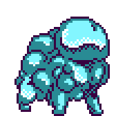
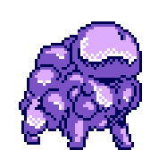
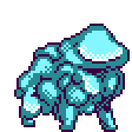
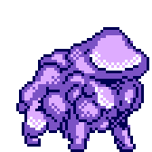
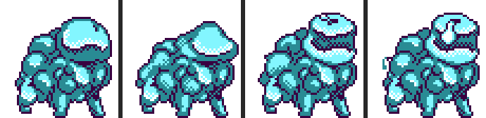

# 134 VENEREON

**SEX** · [← 133 DEADDOG](133_DEADDOG.md) · [Pokédex](../pokedex.md) · [135 NUKENION →](135_NUKENION.md)

<table><tr><th>Front</th><th>Shiny</th><th>Animated</th><th>Animated shiny</th></tr><tr><td align="center" valign="bottom"></td><td align="center" valign="bottom"></td><td align="center" valign="bottom"></td><td align="center" valign="bottom"></td></tr></table>

<table><tr><td valign="top"><table><tr><th colspan="3">Base stats</th></tr><tr><td>HP</td><td align="right">130</td><td>▇▇▇▇▇▇▇▇▇▇▇</td></tr><tr><td>Attack</td><td align="right">65</td><td>▇▇▇▇▇</td></tr><tr><td>Defense</td><td align="right">60</td><td>▇▇▇▇▇</td></tr><tr><td>Sp. Atk</td><td align="right">110</td><td>▇▇▇▇▇▇▇▇▇</td></tr><tr><td>Sp. Def</td><td align="right">95</td><td>▇▇▇▇▇▇▇▇</td></tr><tr><td>Speed</td><td align="right">65</td><td>▇▇▇▇▇</td></tr><tr><td><b>Total</b></td><td align="right"><b>525</b></td><td></td></tr></table></td><td valign="top"><table><tr><td>Catch rate</td><td>45</td></tr><tr><td>Base exp</td><td>196</td></tr><tr><td>Gender</td><td>12.5% female</td></tr><tr><td>Growth</td><td>Medium Fast</td></tr></table>  party icon  palette: normal · shiny</td></tr></table>

**Animation frames** (base + 4)

## Pokédex

**BUBBLE JET** · 3'03" · 64.0 lb

> As it uses the fins on the tip of its tail to swim, it blends with the water perfectly.

## Evolution

Evolves from [DEADDOG](133_DEADDOG.md) (use BROKEN CONDOM)
