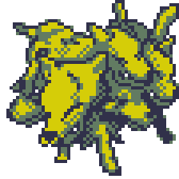
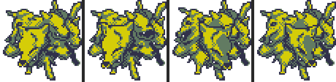

# 135 NUKENION

[← 134 VENEREON](134_VENEREON.md) · [Pokédex](../pokedex.md) · [136 CERBERION →](136_CERBERION.md)

 

front · shiny

 

battle animation · shiny (all frames, evenly timed: this build's script for it is incomplete)

animation frames (base + 3)

 party icon

 palette: normal · shiny

| | |
|---|---|
| Type | NUCLEAR |
| HP | 65 `████████` |
| Attack | 65 `████████` |
| Defense | 60 `████████` |
| Sp. Atk | 110 `██████████████` |
| Sp. Def | 95 `████████████` |
| Speed | 130 `████████████████` |
| Total | 525 |
| Catch rate | 45 |
| Base exp | 197 |
| Gender | 12.5% female |
| Growth | Medium Fast |
