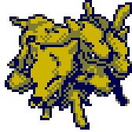
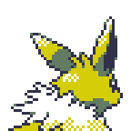

# 135 NUKENION

**NUCLEAR** · [← 134 VENEREON](134_VENEREON.md) · [Pokédex](../pokedex.md) · [136 CERBERION →](136_CERBERION.md)

<table><tr><th>Front</th><th>Shiny</th><th>Animated</th><th>Animated shiny</th><th>Back</th></tr><tr><td align="center" valign="bottom"></td><td align="center" valign="bottom"></td><td align="center" valign="bottom"></td><td align="center" valign="bottom"></td><td align="center" valign="bottom"></td></tr></table>

Back sprite unchanged from Pokémon Crystal.

Plays every frame evenly; the game's own script for it is incomplete in v0.1.0.

<table><tr><td valign="top"><table><tr><th colspan="3">Base stats</th></tr><tr><td>HP</td><td align="right">65</td><td>▇▇▇▇▇</td></tr><tr><td>Attack</td><td align="right">65</td><td>▇▇▇▇▇</td></tr><tr><td>Defense</td><td align="right">60</td><td>▇▇▇▇▇</td></tr><tr><td>Sp. Atk</td><td align="right">110</td><td>▇▇▇▇▇▇▇▇▇</td></tr><tr><td>Sp. Def</td><td align="right">95</td><td>▇▇▇▇▇▇▇▇</td></tr><tr><td>Speed</td><td align="right">130</td><td>▇▇▇▇▇▇▇▇▇▇▇</td></tr><tr><td><b>Total</b></td><td align="right"><b>525</b></td><td></td></tr></table></td><td valign="top"><table><tr><td>Catch rate</td><td>45</td></tr><tr><td>Base exp</td><td>197</td></tr><tr><td>Gender</td><td>12.5% female</td></tr><tr><td>Growth</td><td>Medium Fast</td></tr></table>  party icon  palette: normal · shiny</td></tr></table>

**Animation frames** (base + 3)

## Pokédex

**LIGHTNING** · 2'07" · 54.0 lb

> The negatively charged ions generated in its fur create a constant sparking noise.

Pokédex text unchanged from Pokémon Crystal.

## Evolution

Evolves from [DEADDOG](133_DEADDOG.md) (use X-RAY)

## Moves

| Level | Move | Type | Power | Accuracy | PP |
|--:|---|---|--:|--:|--:|
| 1 | TACKLE | MUTANT | 35 | 95% | 35 |
| 1 | TAIL WHIP | MUTANT | — | 100% | 30 |
| 8 | SAND-ATTACK | ORGANIC | — | 100% | 15 |
| 16 | THUNDERSHOCK | NUCLEAR | 40 | 100% | 30 |
| 23 | QUICK ATTACK | MUTANT | 40 | 100% | 30 |
| 30 | DOUBLE KICK | VIOLENCE | 30 | 100% | 30 |
| 36 | PIN MISSILE | MILITARY | 14 | 85% | 20 |
| 42 | THUNDER WAVE | NUCLEAR | — | 100% | 20 |
| 47 | AGILITY | NEURAL | — | 100% | 30 |
| 52 | THUNDER | NUCLEAR | 120 | 70% | 10 |

## Wild

Not in any wild encounter table.
