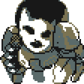

# 139 MECHANIGAL

**MINERAL / SEX** · [← 138 SHARPIDER](138_SHARPIDER.md) · [Pokédex](../pokedex.md) · [140 ZIRLORG →](140_ZIRLORG.md)

<table><tr><th>Front</th><th>Shiny</th><th>Animated</th><th>Animated shiny</th></tr><tr><td align="center" valign="bottom"></td><td align="center" valign="bottom"></td><td align="center" valign="bottom"></td><td align="center" valign="bottom"></td></tr></table>

<table><tr><td valign="top"><table><tr><th colspan="3">Base stats</th></tr><tr><td>HP</td><td align="right">70</td><td>▇▇▇▇▇▇</td></tr><tr><td>Attack</td><td align="right">60</td><td>▇▇▇▇▇</td></tr><tr><td>Defense</td><td align="right">125</td><td>▇▇▇▇▇▇▇▇▇▇</td></tr><tr><td>Sp. Atk</td><td align="right">115</td><td>▇▇▇▇▇▇▇▇▇▇</td></tr><tr><td>Sp. Def</td><td align="right">70</td><td>▇▇▇▇▇▇</td></tr><tr><td>Speed</td><td align="right">55</td><td>▇▇▇▇▇</td></tr><tr><td><b>Total</b></td><td align="right"><b>495</b></td><td></td></tr></table></td><td valign="top"><table><tr><td>Catch rate</td><td>45</td></tr><tr><td>Base exp</td><td>199</td></tr><tr><td>Gender</td><td>12.5% female</td></tr><tr><td>Growth</td><td>Medium Fast</td></tr></table>  party icon  palette: normal · shiny</td></tr></table>

**Animation frames** (base + 3)

## Pokédex

**SPIRAL** · 3'03" · 77.0 lb

> Its heavy shell allowed it to reach only nearby food. This could be the reason it is extinct.

## Evolution

Evolves from [SHARPIDER](138_SHARPIDER.md) (level 40)
