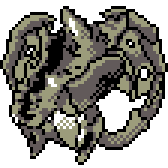
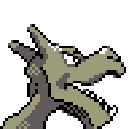

# 142 PTEROXIS

**MINERAL / MECHANIC** · [← 141 ZILOSNAK](141_ZILOSNAK.md) · [Pokédex](../pokedex.md) · [143 PUTREFACTO →](143_PUTREFACTO.md)

<table><tr><th>Front</th><th>Shiny</th><th>Animated</th><th>Animated shiny</th><th>Back</th></tr><tr><td align="center" valign="bottom"></td><td align="center" valign="bottom"></td><td align="center" valign="bottom"></td><td align="center" valign="bottom"></td><td align="center" valign="bottom"></td></tr></table>

Back sprite unchanged from Pokémon Crystal.

<table><tr><td valign="top"><table><tr><th colspan="3">Base stats</th></tr><tr><td>HP</td><td align="right">80</td><td>▇▇▇▇▇▇▇</td></tr><tr><td>Attack</td><td align="right">105</td><td>▇▇▇▇▇▇▇▇▇</td></tr><tr><td>Defense</td><td align="right">65</td><td>▇▇▇▇▇</td></tr><tr><td>Sp. Atk</td><td align="right">60</td><td>▇▇▇▇▇</td></tr><tr><td>Sp. Def</td><td align="right">75</td><td>▇▇▇▇▇▇</td></tr><tr><td>Speed</td><td align="right">130</td><td>▇▇▇▇▇▇▇▇▇▇▇</td></tr><tr><td><b>Total</b></td><td align="right"><b>515</b></td><td></td></tr></table></td><td valign="top"><table><tr><td>Catch rate</td><td>45</td></tr><tr><td>Base exp</td><td>202</td></tr><tr><td>Gender</td><td>12.5% female</td></tr><tr><td>Growth</td><td>Slow</td></tr></table>  party icon  palette: normal · shiny</td></tr></table>

**Animation frames** (base + 3)

## Pokédex

**FOSSIL** · 5'11" · 130.0 lb

> In prehistoric times, this POKéMON flew freely and fearlessly through the skies.

Pokédex text unchanged from Pokémon Crystal.

## Evolution

Does not evolve.

## Moves

| Level | Move | Type | Power | Accuracy | PP |
|--:|---|---|--:|--:|--:|
| 1 | WING ATTACK | MECHANIC | 60 | 100% | 35 |
| 8 | AGILITY | NEURAL | — | 100% | 30 |
| 15 | BITE | DOOM | 60 | 100% | 25 |
| 22 | SUPERSONIC | MUTANT | — | 55% | 20 |
| 29 | ANCIENTPOWER | MINERAL | 60 | 100% | 5 |
| 36 | SCARY FACE | MUTANT | — | 90% | 10 |
| 43 | TAKE DOWN | MUTANT | 90 | 85% | 20 |
| 50 | ETERNAL TAO | DIVINITY | 150 | 100% | 5 |

## Wild

Not in any wild encounter table.
