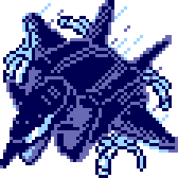

# 144 ARTICLONE

[← 143 PUTREFACTO](143_PUTREFACTO.md) · [Pokédex](../pokedex.md) · [145 ZAPGOLD →](145_ZAPGOLD.md)

 

front · shiny

 

battle animation · shiny

animation frames (base + 3)

 party icon

 palette: normal · shiny

| | |
|---|---|
| Type | CHEMICAL / MECHANIC |
| HP | 90 `███████████` |
| Attack | 85 `███████████` |
| Defense | 100 `████████████` |
| Sp. Atk | 95 `████████████` |
| Sp. Def | 125 `████████████████` |
| Speed | 85 `███████████` |
| Total | 580 |
| Catch rate | 3 |
| Base exp | 215 |
| Gender | genderless |
| Growth | Slow |
