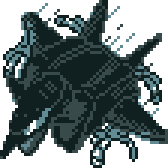
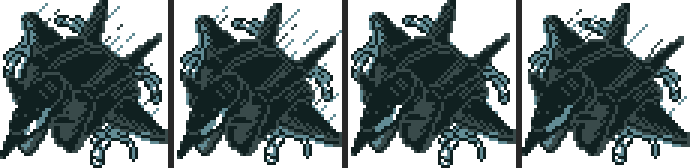

# 144 ARTICLONE

**CHEMICAL / MECHANIC** · [← 143 PUTREFACTO](143_PUTREFACTO.md) · [Pokédex](../pokedex.md) · [145 ZAPGOLD →](145_ZAPGOLD.md)

<table><tr><th>Front</th><th>Shiny</th><th>Animated</th><th>Animated shiny</th></tr><tr><td align="center" valign="bottom"></td><td align="center" valign="bottom"></td><td align="center" valign="bottom"></td><td align="center" valign="bottom"></td></tr></table>

<table><tr><td valign="top"><table><tr><th colspan="3">Base stats</th></tr><tr><td>HP</td><td align="right">90</td><td>▇▇▇▇▇▇▇▇</td></tr><tr><td>Attack</td><td align="right">85</td><td>▇▇▇▇▇▇▇</td></tr><tr><td>Defense</td><td align="right">100</td><td>▇▇▇▇▇▇▇▇</td></tr><tr><td>Sp. Atk</td><td align="right">95</td><td>▇▇▇▇▇▇▇▇</td></tr><tr><td>Sp. Def</td><td align="right">125</td><td>▇▇▇▇▇▇▇▇▇▇</td></tr><tr><td>Speed</td><td align="right">85</td><td>▇▇▇▇▇▇▇</td></tr><tr><td><b>Total</b></td><td align="right"><b>580</b></td><td></td></tr></table></td><td valign="top"><table><tr><td>Catch rate</td><td>3</td></tr><tr><td>Base exp</td><td>215</td></tr><tr><td>Gender</td><td>genderless</td></tr><tr><td>Growth</td><td>Slow</td></tr></table>  party icon  palette: normal · shiny</td></tr></table>

**Animation frames** (base + 3)

## Pokédex

**FREEZE** · 5'07" · 122.0 lb

> Legendary bird POKéMON. As it flies through the sky, it cools the air, causing snow to fall.

## Evolution

Does not evolve.
