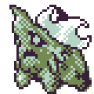
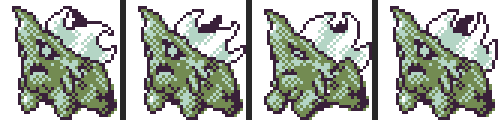

# 152 STRAMONIUM

**DRUGS** · [← 151 TWOMEW](151_TWOMEW.md) · [Pokédex](../pokedex.md) · [153 DIVINORUM →](153_DIVINORUM.md)

<table><tr><th>Front</th><th>Shiny</th><th>Animated</th><th>Animated shiny</th></tr><tr><td align="center" valign="bottom"></td><td align="center" valign="bottom"></td><td align="center" valign="bottom"></td><td align="center" valign="bottom"></td></tr></table>

No back sprite of its own in v0.1.0.

<table><tr><td valign="top"><table><tr><th colspan="3">Base stats</th></tr><tr><td>HP</td><td align="right">45</td><td>▇▇▇▇</td></tr><tr><td>Attack</td><td align="right">49</td><td>▇▇▇▇</td></tr><tr><td>Defense</td><td align="right">65</td><td>▇▇▇▇▇</td></tr><tr><td>Sp. Atk</td><td align="right">49</td><td>▇▇▇▇</td></tr><tr><td>Sp. Def</td><td align="right">65</td><td>▇▇▇▇▇</td></tr><tr><td>Speed</td><td align="right">45</td><td>▇▇▇▇</td></tr><tr><td><b>Total</b></td><td align="right"><b>318</b></td><td></td></tr></table></td><td valign="top"><table><tr><td>Catch rate</td><td>45</td></tr><tr><td>Base exp</td><td>64</td></tr><tr><td>Gender</td><td>12.5% female</td></tr><tr><td>Growth</td><td>Medium Slow</td></tr></table>  party icon  palette: normal · shiny</td></tr></table>

**Animation frames** (base + 3)

## Pokédex

**DATURA** · 2'11" · 14.0 lb

> Jimsonweed is a poisonous flower of Central America Atropine is the toxic alkaloid. Makes you mad.

## Evolution

Evolves into [DIVINORUM](153_DIVINORUM.md) (level 16)

## Moves

| Level | Move | Type | Power | Accuracy | PP |
|--:|---|---|--:|--:|--:|
| 1 | TACKLE | MUTANT | 35 | 95% | 35 |
| 1 | GROWL | MUTANT | — | 100% | 40 |
| 8 | RAZOR LEAF | DRUGS | 55 | 95% | 25 |
| 12 | REFLECT | NEURAL | — | 100% | 20 |
| 15 | POISONPOWDER | MEDICAL | — | 75% | 35 |
| 22 | SYNTHESIS | DRUGS | — | 100% | 5 |
| 29 | URA NAGE | MUTANT | 85 | 100% | 15 |
| 36 | LIGHT SCREEN | NEURAL | — | 100% | 30 |
| 43 | SAFEGUARD | MUTANT | — | 100% | 25 |
| 50 | SOLARBEAM | DRUGS | 120 | 100% | 10 |

## Wild

Not in any wild encounter table.
